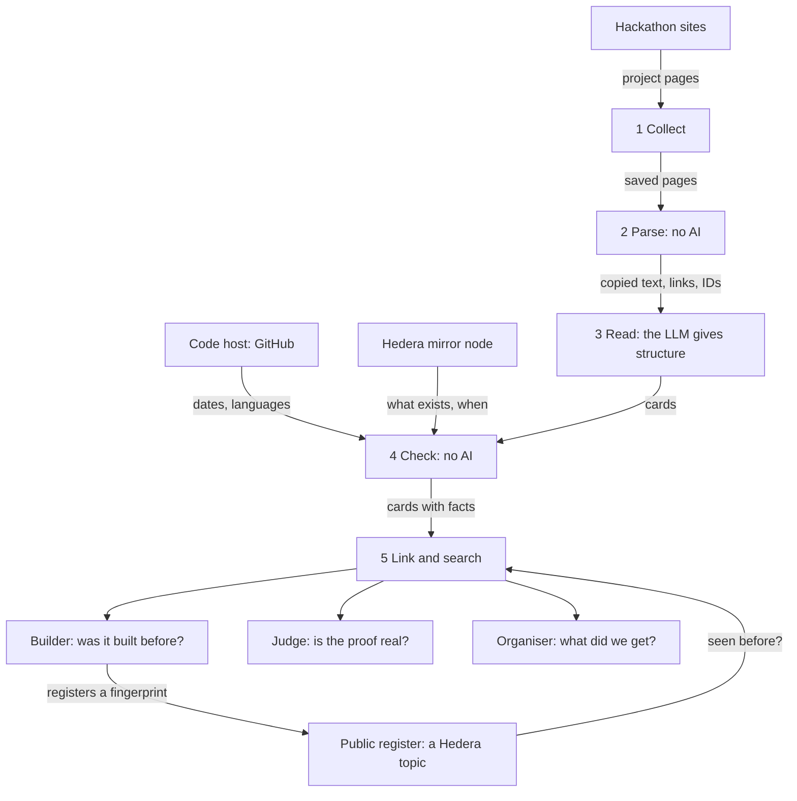

# Hackathon Memory: the design

This document explains what the tool is, how it is built, and why. The code and the tests point to its sections by number, for example "design 5.7" or "design section 11.6". So the numbers are fixed: a new section is added at the end, never in the middle.

**State on 11 October 2026.** Phase A is done: the setup and four small proofs, which all passed (section 14.2). Sections 6 to 13 describe what comes next. They are a plan, not a result. Where a number in this document comes from a run, the text says so and names the result file.

Words in **bold** on first use are explained in section 17.

---

## 0. Summary

- **What it is:** a memory of Hedera's hackathon projects: what each one claimed, what really happened, and whether it is still alive. It holds the projects whose pages could be read, and the winners of the rest (section 1.4).
- **The one behaviour that matters most:** a builder types an idea and sees the closest past Hedera hackathon projects, each with what the Hedera **ledger** says about it.
- **Who it is for:** builders, judges and organisers of Hedera hackathons.
- **Where Hedera is used:** the tool reads the public ledger to check every claim, and it writes a public register of submissions.
- **Why it is built now:** it is an entry for the FSS Campus Edition of the Hedera Cross Campus Challenge 2026.

---

## 1. The problem

### 1.1 The problem

- Hedera has run many hackathons. Nobody can see their projects in one place.
- So builders rebuild old ideas without knowing it.
- A judge cannot tell quickly whether a project is a repeat.
- Every team writes "we use Hedera". Nobody can check that quickly.
- Nobody knows which past projects are still alive.

### 1.2 The numbers

Hedera has run at least 12 big hackathons since 2018. Seven of them publish how many projects were sent in.

| Year | Event | Projects sent in |
|---|---|---|
| 2018 | Hedera18 | not published |
| 2020 | Hedera20 | 45 |
| 2021 | Hedera21 | 54 |
| 2022 | Hedera22 | 118 |
| 2023 | Beyond Blockchain | not found |
| 2024 | Hello Future | not found |
| 2024 | Hello Future 2.0 | not found |
| 2025 | Hedera x AI | not found |
| 2025 | Hello Future Origins | 159 |
| 2025 | Hedera Africa Hackathon | more than 1,300 |
| 2025 | Hello Future Ascension | 135 |
| 2026 | Hello Future Apex | 368 |

The seven numbers add up to more than 2,100 projects. They sit on at least five different websites, so no single place holds the history. The sources are in section 18.

Hedera is also a sponsor at the events of ETHGlobal, and gives prizes there. Those projects are in ETHGlobal's showcase (section 5.7).

### 1.3 What a hackathon asks for today

The Hello Future rules ask each team to "provide your Hedera testnet on-chain account as a proof of an on-chain transaction". The same page names no automatic check and no check for repeated projects. A program can check that proof on the public ledger.

Coming back with an old project is allowed, and Hedera even invites it. The Apex event had a track named Legacy Builders: "For returning participants from past Hedera Hackathons, including Origins, to build on previous ideas or apply their experience to new concepts." So "seen before" is not an accusation. What is missing is a way to see what came before.

### 1.4 The history is already disappearing

On 9 October 2026 every site was opened by hand.

- The platforms of Hedera18 and Hedera20 are gone. An old copy of the first one still lists its winners, with no code.
- The site of Hello Future 2024 and Hello Future 2.0 cannot be opened. Its security certificate expired in September 2025.
- The submissions of Hello Future Ascension, Hello Future Apex and this year's campus challenge are private.
- For Beyond Blockchain 2023 and Hedera x AI 2025, only the winners are public.

So for eight of the twelve big events, no place was found where the submissions can still be read. They are public for four: Hedera21, Hedera22, Hello Future Origins and the Africa hackathon.

This changes what the tool can honestly say. It cannot know every project. It can know the projects whose pages can still be read, and the winners of the rest (section 4.6). It also shows why a memory is needed: what nobody keeps in one place gets lost.

---

## 2. Users and their tasks

| User | Their question | Task in the tool |
|---|---|---|
| Builder | Was my idea already built on Hedera? What happened to it? | T1: search an idea. T2: read a project card. T3: register my submission. |
| Judge | Is this submission's Hedera proof real? What is close to it? Was it sent before? | T4: check a submission. |
| Organiser | What did our past events produce? | T5: read the overview of an event. |

Nobody asked an organiser whether they want this. The assumption is that they check submissions by hand or with simple database queries. The tool does not need their permission to help builders.

---

## 3. What the tool does, and what it never does

### 3.1 In the first version

- The projects that ETHGlobal's showcase ties to Hedera: 658 projects from 14 events, 92 of them with a Hedera prize (section 5.7). This is the first source. A card says whether its project took a Hedera prize, a prize of another sponsor, or none.
- Projects from DoraHacks for two events, the Hedera Africa Hackathon 2025 and Hello Future Origins 2025, if DoraHacks gives its written permission (section 5.2). It has not answered yet.
- Winner entries for the events whose submissions are not public (section 4.6).
- One card for each project (section 4).
- A check of each project's Hedera IDs on the ledger, and of its code on GitHub (section 7).
- A search by idea, with a short comparison (section 8).
- A register of submissions on a Hedera topic (section 9).
- A website with six screens (section 12).
- Four tests with results that anybody can open (section 13).

### 3.2 Not in the first version

- Other hackathon websites.
- Accounts and sign-in.
- A plug-in for AI tools.
- Registrations signed by the team's own Hedera account (section 9.4).
- The register on the main network. The code refuses to write to any network but the test network.

### 3.3 Rules for the AI

1. It never gives a score to a project.
2. It never ranks projects by quality and never picks a winner.
3. It never says "this is a copy". It shows what is the same and what differs, and it points to the cards.
4. It never states a fact. Facts come from the parser, the code host and the ledger (section 6.4).
5. Everything it writes is marked as written by the AI, with its label and its quotes (section 6.3).

The reason: an AI used as a judge gives an opinion that is not grounded in proof. People decide, with the facts in front of them.

One consequence for the collected pages. The data of an ETHGlobal project page holds scores and a summary that the site computes by itself. The tool never reads them out and never shows them.

### 3.4 Why the two DoraHacks events

- **Same website.** Both are on DoraHacks, so one collector and one parser serve both.
- **Close in time.** Hello Future Origins ran from 21 July to 8 August 2025. The Africa hackathon ran from 1 August to 30 September 2025. A team could enter both, so real repeats are likely and "seen before" has something to find.
- **Still checkable.** Both are later than the last reset of the test network (1 February 2024), so their test IDs can still be read.
- **The judges know them.** The Africa hackathon is the biggest one.
- **The proof is asked for.** Hello Future asks each team for a test account as proof (section 1.3). That is exactly what the tool checks.

---

## 4. The card

### 4.1 Three sources

Every field on a card comes from exactly one of three sources. The website shows which one.

| Source | Fields | Why this source |
|---|---|---|
| **Parser**, no AI | Name, short line, links, Hedera IDs, event, track, prize. The text of the titled sections of the page, word for word. | Exact and free. Nothing can be invented. |
| Code host and ledger, no AI | Programming languages, Hedera libraries named in the code's package files, dates of the code, activity of each Hedera ID. | These are facts. The tech stack comes from the code, not from what the page says. |
| The **LLM** | One plain sentence on what the project does. How it works, in 3 to 6 steps. For whom. Which Hedera services the page says it uses, and for what. A category from a fixed list. The problem and the solution when no titled section gives them. | This is reading work that rules cannot do: titles that differ, pages without titles, long text to shorten, and the same structure for every project. |

### 4.2 Why the same structure for every project

Two projects can work the same way and differ in the market: an escrow for freelancers and an escrow for rentals. With separate fields the tool can say "same mechanism, different users". That is more useful than "similar".

### 4.3 Labels on LLM fields

| Label | Meaning | What the card shows |
|---|---|---|
| Stated | The page says it | The text and its exact quote |
| Inferred | The page does not say it directly. The LLM worked it out from other sentences. | The text, those sentences, and a "less sure" mark |
| Not found | The page gives nothing about it | An empty field |

An empty field is right only when the page really has nothing. When the information is there without a title, the field is filled and marked.

### 4.4 Statuses computed by rules

- **Proof status** of the Hedera IDs: section 7.2.
- **Life status** of the project: section 7.4.

### 4.5 Categories (first version, confirmed by a test)

Payments and remittance. Lending, saving and investing. Real-world assets and tokens. Identity and credentials. Supply chain and provenance. Sustainability, energy and climate. Health. Education. Agriculture. Gaming and entertainment. Social and community. AI agents and automation. Developer tools. Data and devices. Public services. Other.

- **Why a list of our own.** The tracks of the events cannot do this job. They change from one event to the next, and some say nothing about the subject, like "Open Track" and "Legacy Builders".
- **One category for each project.** It is chosen by who the project serves, not by the technology inside. "AI agents and automation" and "Developer tools" are used only when the agent or the tool is itself the product.
- **How the list is confirmed.** On the projects of Test 1 (section 13.2), two graders each pick a category, separately. The list is accepted if they agree on at least 80% of the projects and if at most 15% land in "Other". If not, categories are merged or split once, before the full run.

### 4.6 Winner entries: a thinner card

For an event whose submissions are not public, the only thing left is the organiser's list of winners (section 1.4). Such a project gets a **winner entry**.

| | Full card | Winner entry |
|---|---|---|
| Comes from | The team's own submission page | The organiser's winners page or blog post |
| Fields | All of section 4.1 | The name, the event, the track, the prize, the description as it was published, and the link to the project's website if there is one |
| The LLM | All LLM fields | Only the category. The description is short already, so it is copied as it is. |
| Ledger and code facts | Yes | Only if the page gives an ID or a repository. Most do not. The entry then says "no ID given" and "unknown". |

**Why they are kept, although they are thin.** The search is the behaviour that matters most, and the winners are the projects a builder most needs to find. With them the search covers all twelve events. They also make returns visible: one project name stood among the winners of three events of 2025.

**What they cannot do.** They do not show the ledger check, and that check is what this tool adds. So the demo is built on full cards. Winner entries only widen the search. Every winner entry says where it comes from, and that only the winners of its event are public.

**Where they come from.** Hedera's own winner posts, and winners pages that were copied by hand, with no request by a program. Nothing is read by a program before the rules of section 5.2 allow it.

---

## 5. Step 1: Collect

### 5.1 How each source is read

| Source | How |
|---|---|
| ETHGlobal's showcase | Simple requests. A walk through one list of the showcase finds the winners, and a run reads their pages (section 5.7). |
| DoraHacks, list of an event's projects | A real browser driven by a program, because the list is built in the browser. Only after written permission. |
| DoraHacks, one project page | A simple request. Only after written permission. |
| A project's README | The GitHub API (section 7.3). |
| Winner posts | One simple request, or a copy made by hand when the server refuses a program. |

### 5.2 Polite collection, and the terms of each site

The **terms of use** of a site are read before the first request to it. If they ask for permission, no automated request is sent before the site has said yes in writing.

**No collector runs on a site before the maintainer has said yes for that site** and for the pages that will be read. The collectors are written like every other part, and they are tested on invented sample files. The Hedera mirror node, the Hedera test network, Google's models and the local database are not collectors.

**When collection is allowed:**

- One request at a time for each site, with a pause.
- Each request says who it is: the name of the tool and a contact address. It does not pretend to be a normal browser.
- Stop after five errors in a row.
- No sign-in, no cookie, and no way around a block.
- **A no of the site.** An answer of 401, 403 or 451, or a bot check, stops everything for that site. Nothing is worked around, and nothing is sent again until a person has decided how to go on.
- **Too many requests.** When the site answers 429, "too many requests", the run stops at once. The tool sends nothing for one hour, or longer if the site names a longer time, and then it goes on five times slower. A third 429 within a day is taken for a no. Every command keeps to this by itself: the cooldown and the slower pace are written next to the count of requests.
- **A stop order.** The people who run a site can ask for a stop at any time. One switch for each site turns its collector off at once.

Collection by a program is a proof of the idea. Real use would need the sites to give the data themselves.

### 5.3 Raw pages

- Every page is saved with its address, the date and a **fingerprint** of its content. There are two exceptions to "saved as received", both made before the page is saved.
  1. **The team part is cut out,** because the sites were promised that it is not collected (section 5.7). That means the block that shows the team, the metadata that names an author, and the keys that hold people inside data blocks.
  2. **The page is written again by the HTML parser,** because the cut needs one. A test compares a saved sample page with the original after the team part was removed by hand: the visible text, the links and the order of the tags are the same. The spaces between tags, the case of the doctype and the slash of empty tags may differ. Two fingerprints are kept next to the page: of the page as saved, and of what the site sent.
- A saved page is never edited.
- Running the collection again skips pages that are already saved, and pages that an earlier run read and did not keep.
- Everything else in the system can be rebuilt from the raw pages with one command. This is also the backup.

### 5.4 Personal data

Project pages can show team members. The tool does not store their names, emails or photos. It needs none of them. The account name inside a repository link is kept because the link needs it.

### 5.5 A start that needs no permission: public repositories

GitHub allows a program to read public repositories through its API. A search for repositories whose README names a Hedera hackathon gives a few hundred projects. The limits are real: only projects with a public repository that names its event are found, and a README is what a team wrote for developers, not what it sent to the hackathon.

### 5.6 The sites that hold Hedera hackathon projects, and what each one allows

Checked on 9 October 2026.

| Site | Hedera events on it | Can a visitor see the projects without a sign-in? | What its rules or its answer say about a program |
|---|---|---|---|
| ETHGlobal's showcase | Projects tied to Hedera at ETHGlobal's events | Yes | Asked on 9 October 2026. **It agreed in writing** to a slow, signed read of its Hedera prize projects (section 5.7). This is the first source. |
| DoraHacks | Africa 2025, Hello Future Origins 2025 | Yes | Forbidden without its written permission. Asked on 9 October 2026. No answer yet. |
| Devpost | Hedera21, Hedera22 | Yes | **Refused on 9 October 2026.** No program ever touches Devpost. A person may browse the galleries and link to the pages. |
| StackUp, which is part of AngelHack | Hello Future Ascension 2025, Hello Future Apex 2026 | No | The submissions are private, so there is nothing to collect. |
| The Hello Future site, by AngelHack | The winners of Origins and Ascension, later Apex | Yes | AngelHack's terms ask for written consent. Asked on 9 October 2026. No answer yet. |
| 4hacks | The 12 campus editions of the Hedera Cross Campus Challenge 2026 | No | Excluded. The organiser keeps submissions private. |
| hedera.com | The winner posts of nine events | Yes | No rule about programs was found. |
| GitHub | The code of projects from any event | Yes | Allowed through its API. |
| Hedera's mirror node | The ledger facts | Yes | A public API, made for programs. |

For four events no submission site was found at all. The platforms of Hedera18 and Hedera20 no longer exist. These events get winner entries (section 4.6).

**What the table shows.** Almost every site that holds the submissions either forbids a program or hides the projects behind a sign-in. So a memory of all Hedera hackathons cannot be built by a program alone. It needs the sites or the organisers to agree, or to hand over the data. This is the honest limit of the idea.

**One rule about who can say yes.** An organiser can agree for its own site and its own data. It cannot agree for another company's site.

### 5.7 How a site is read, and what ETHGlobal was asked

The way a site is read is fixed in the code, with a test for each rule. ETHGlobal was asked before any program read its showcase. It agreed in writing to a slow, signed read of its Hedera prize projects, and the other projects that its showcase ties to Hedera are read in exactly the same way. The maintainer decided that on 10 October 2026, so that the tool can show what is built on Hedera and not only what wins.

| The rule | What the code does |
|---|---|
| Only named pages | A walk reads one list of the showcase: the one with the filter "partner: Hedera". A run reads robots.txt and the pages of the projects on that list. Every other address is refused before a request is sent, also on a redirect. |
| A limit of requests | A fixed limit for each site: 800 for ETHGlobal's showcase. Every request is counted in one file, so the limit holds for all commands and all days together. |
| One time | A second run skips every page that is already saved, and every page that an earlier run read and did not keep. |
| One request at a time | One worker, a pause of two seconds, nothing in parallel. |
| Each request carries the name of the tool and a contact address | Both come from the settings. The collector refuses to start when one of them is empty. |
| No names, photos or profiles of team members | The team part is cut out before a page is saved (section 5.3). If a page shows a profile link, an avatar or a data key that holds people, the run stops. |
| Too many requests | When the site answers 429, "too many requests", the run stops at once. The tool sends nothing for one hour, or longer if the site names a longer time, and then it goes on five times slower. A third 429 within a day is taken for a no. |
| A no of the site | An answer of 401, 403 or 451, or a bot check, stops everything for that site. Nothing is worked around, and nothing is sent again until a person has decided how to go on. |
| It stops at once when asked | One switch for each site in the settings, read again before every request. It is there for a stop order from the people who run the site. |
| The collected pages stay on one laptop | The data folder never enters git. No text taken from a collected page is committed, also not in a test file or a result file. The sample pages of the tests are invented. |
| A new request before anything is published | Before the repository, the tool or its data goes public, the site is asked again. |

**How the projects are found.** No page of ETHGlobal lists the winners of one sponsor. A prize page lists prizes, and a winner is shown only on its own project page, in a block named "Winner of". But the showcase has a list with the filter "partner: Hedera". It names every project that is tied to Hedera, and its data says, for each project, which sponsors gave it a prize.

1. **A walk** reads the pages of that list, one after the other. It saves no page. For each project it keeps the address, the event and the ids of the sponsors of its prizes.
2. The list names a sponsor by a short id, not by its name. **Which id is Hedera is not guessed.** A person opens one or two project pages in a browser, sees "Winner of" and a line that starts with "Hedera", and writes their addresses into a small file. Hedera is the one id that all these pages have.
3. **A run** reads the page of every project of the list. Whether a project took a Hedera prize is read from its own page, in the block "Winner of". The run compares that with the list, and three pages in a row that differ stop it.

**The first collection, on 10 October 2026** (result file `proofs/results/20261010T194925Z-lists.json`). It read the projects with a Hedera prize first.

- The walk read 21 pages of the list: 658 projects in 14 events, 173 with a prize of some sponsor, 92 with a Hedera prize.
- The run read the 92 pages and kept all 92. The id from the list and the block on the page agreed every time.
- The site answered every request, and never with a check or a refusal.

**The second collection, on 11 October 2026** (result file `proofs/results/20261011T031418Z-lists.json`). It read every other project of the list.

- The walk was made again and kept every project: the same 658, and the list had not moved.
- The run read the other 566 pages and kept all of them. Of the 658 projects, 92 took a Hedera prize, 81 a prize of another sponsor only, and 485 no prize. The list and the block on the page agreed every time.
- Once the site asked for a slower pace ("too many requests"). The tool waited one hour and went on at ten seconds between two requests, as section 5.2 says.
- 732 requests were sent to the site over both collections, out of the limit of 800.

---

## 6. Steps 2 and 3: Parse and Read

### 6.1 The parser

The parser is ordinary code. It does three things.

1. It pulls out the name, the short line, the links and the full text.
2. It finds Hedera IDs with a pattern: numbers that look like `0.0.12345`. It keeps the words around each ID, because they often say what the ID is.
3. It finds section titles from a list of known words and copies the text under each title, word for word.

On free-form project pages the titles differ a lot. Many pages have neither a Problem nor a Solution title, and a parser cannot know that a page states its problem under a title of its own.

A page of ETHGlobal's showcase has a fixed shape instead: a short line, "Project Description" and "How it's Made". A team can put titles of its own inside these two texts, so a section ends at the next known title, not at the next title.

A trap for the parser: a version number like "0.0.3" has the same shape as a Hedera ID. The words around a number decide what it is.

### 6.2 What the LLM is asked

The LLM gets the page text and the sections the parser copied. It fills the LLM fields of section 4.1 in a fixed form. It is told:

- Use only what the page says.
- For each field, give the label and copy the exact sentences that support it.
- Do not rewrite a section that was already copied.
- Do not write IDs, links, dates or numbers as facts.

### 6.3 Labels and the quote check

A program checks every quote: after spaces and letter case are made uniform, the sentence must be found in the saved page.

| What the LLM gave | Result |
|---|---|
| Label "stated" and at least one quote that is found | The field is kept as stated |
| Label "inferred" and supporting sentences that are found | The field is kept as inferred |
| A quote or sentence that is not found in the page | That quote is removed |
| No quote left after the check | The field is dropped and logged |

This check runs on every project. It catches invention. It does not catch a wrong reading of a real sentence. For that, people grade a sample (section 13.2).

### 6.4 Facts never come from the LLM

IDs, links, dates, counts and statuses are produced only by the parser, the code host and the ledger. If the LLM writes one, it is ignored.

### 6.5 Cache and versions

Each LLM answer is stored with the model name, the version of the instructions and a fingerprint of the input. Running again with the same three gives the stored answer and costs nothing. A change in any of the three is visible in the data.

---

## 7. Step 4: Check

### 7.1 Hedera IDs and networks

Hedera has two networks that matter here: the **main network**, with real money, and the **test network**, for practice. The same number is a different thing on each. So an ID is always stored with its network.

- If the page names the network near the ID, or gives a HashScan link, that network is used.
- If not, both are asked.

For each ID the **mirror node** is asked: what kind of thing is it (account, topic, token or contract), when it was created, how much happened on it, and when the first and the last activity were. The raw answer is stored with the time of the question.

### 7.2 The proof rule

An ID that exists proves almost nothing: nearly every small number exists on Hedera as something. So the rule looks at the kind of thing and at the dates.

The window of an event runs from 30 days before it started to 14 days after it ended.

| Status | When |
|---|---|
| Proof found | The ID exists. Its kind fits how the page describes it. It was created or active inside the window. |
| Found, but the dates do not fit | The ID exists, but nothing happened on it inside the window. |
| Found, but empty | A topic with no message, a token never issued, or a deleted contract. |
| Not found | The ID does not exist on the network. |
| Cannot be checked | The ID is on the test network and older than its last reset (1 February 2024). |
| No ID given | The page and the README give no Hedera ID. |

The numbers 30 and 14 are a first choice. Test 3 (section 13.4) tells whether they are right.

**What this check does not show.** It does not show that the project is good. It does not prove that the ID belongs to the team: a team could paste somebody else's ID. Two things reduce that risk: the same ID must also appear in the team's own code or README, and the dates on Hedera must fit the dates of the code.

### 7.3 Facts from the code

The GitHub API is asked with a read-only token. Without a token the limit is 60 requests per hour. With a token it is 5,000 per hour. Requests go one after the other, the limit headers are read, and every answer is stored so it is never asked twice.

For each repository: does it exist, when was it created, when was the first and the last change, how many changes, how many contributors, which languages. The package files are read to see whether a Hedera library is named. The README is searched for Hedera IDs, because many project pages give none.

### 7.4 The life rule

| Status | When |
|---|---|
| Active | A change to the code or activity on the ledger in the last 90 days |
| Quiet | Nothing in the last 90 days, but something later than 30 days after the event |
| Stopped | Nothing later than 30 days after the event |
| Unknown | No repository and no ID to look at |

---

## 8. Step 5: Link and search

### 8.1 What is compared

An **embedding** model turns a text into a list of numbers. Texts with close meanings get close numbers. For each project the model reads the fields that describe the idea: what it does, how it works, the problem and the solution.

Which fields give the best search is not known yet. Test 2 (section 13.3) compares the choices, including "the page as it is".

### 8.2 The search

The search uses two methods together and merges their results:

- by meaning, with the embeddings;
- by words, with a normal text search over the name, the short line, the card fields and the original text.

Each method finds what the other misses. The original text is always searched, so a weak LLM field cannot hide a project.

The user can filter by event, year, category, proof status and life status.

### 8.3 The comparison

For the first results, the LLM reads the cards and the user's idea. For each project it writes what is the same and what differs, and it names the card fields it used. If this call fails, the page still shows the cards.

### 8.4 "Seen before"

Two entries are the same project when they share the same repository link, or the same Hedera ID on the same network. This is exact matching, with no AI.

One trap: some IDs are services that many projects use, like a popular token. An ID that appears in more than three projects with different repositories is treated as a shared service. It is shown as such and is not used for "seen before".

A returning name is a hint, not "seen before". Two teams can pick the same name.

### 8.5 Groups for the overview

For an event, the overview counts projects by category, by proof status and by life status.

---

## 9. Hedera integration

### 9.1 Reading

The ledger is the ground truth for every claim a project makes about Hedera (section 7). Reading goes through the mirror node, which is free and needs no key. Each card links to HashScan so anybody can see the same record.

### 9.2 Writing: the public register

A **topic** is a public message list on Hedera. Nobody can edit or delete a message, and Hedera gives each one a number and a time.

1. A team enters its repository link, its event and, if it wants, its Hedera account.
2. The tool computes a fingerprint from them.
3. The tool posts one small record to the topic.
4. Hedera adds the number and the time.
5. The tool reads the record back from the mirror node and shows the receipt, with a HashScan link.

If the same fingerprint appears again later, at any event, the tool says "seen before" and shows the first date.

**Why a ledger and not a normal database.** Hedera's hackathons run on several websites that do not share data. A register that belongs to none of them makes sense. And nobody, including the people who run the tool, can change a date afterwards.

### 9.3 The record

- A fixed form with a version number, the fingerprints and the event. Nothing else.
- No free text, no names, no links in clear text. A message can never be deleted, so nothing personal may go in.
- Far below 1 KB, because a longer message is cut into pieces. The record of the Gate A proof has 102 bytes.
- Only the tool's own account can write to the topic. This keeps strangers from filling it.

### 9.4 What the register proves, and what it does not

It proves that a fingerprint was registered through the tool at a given time. It does not prove who registered it, because in the first version the tool's account does the writing. A stronger form, where the team signs with its own account, is not in the first version.

### 9.5 The keys of the topic

A topic can have two keys.

- The **admin key** lets its holder change the settings of the topic or delete it. Hedera's documentation says: "If no Admin Key is specified, the topic is immutable."
- The **submit key** decides who may post. With no submit key, anybody can post.

The topic is created with **no admin key**, and with a **submit key** that the tool's account holds.

- **Why no admin key.** The register must belong to nobody. With an admin key the register could be deleted, or the right to write could be handed to somebody else quietly. Without it this is impossible, and anybody can check that on HashScan.
- **Why a submit key.** Without it, any stranger could post false records.
- **The price.** A lost or stolen submit key cannot be replaced. A new topic would be created, and the method screen would say so.

One trap: the Python example in Hedera's own tutorial sets an admin key. This topic must not.

---

## 10. Data model

The store is PostgreSQL. The main tables:

| Table | One row is | Filled by |
|---|---|---|
| events | A hackathon, with its dates and its website | By hand |
| projects | A project page, with its name, short line and the place of its raw page | Parser |
| sections | A titled section copied from a page | Parser |
| links | A repository, video or site link of a project | Parser |
| hedera_ids | An ID found on a page or in a README, with its network and the words around it | Parser |
| ledger_facts | The mirror node's answer for an ID, with the time of the question | Check |
| repo_facts | The GitHub facts of a repository | Check |
| card_fields | One LLM field of a card, with its label, its quotes, the model and the version of the instructions | Read |
| embeddings | The list of numbers for a project | Link |
| registrations | A record read back from the topic | Register |
| llm_calls | One call to a model: the model, the tokens, the time, the cost. Numbers only, never a text. | Every step that calls a model |

The proof status and the life status are computed from the facts. They are not typed in.

---

## 11. Tech stack by need

Each choice is justified by what the job needs and by a source. "Already installed", "easy" and "free" are not reasons.

### 11.1 The choices

| Job | What the job needs | Choice | Why |
|---|---|---|---|
| Language | One language for collection, data, the tests and the website | Python 3.11 | One language means one copy of each rule. Python is the stronger one for the measuring. Its one weak point, the Hedera write, was tested first. See section 11.5. |
| Collect lists that a browser builds | A real browser that waits for the page by itself | Playwright | Not installed yet. The first source did not need a browser. |
| Collect pages | A simple request, where the site allows it | requests and BeautifulSoup | It works for ETHGlobal's showcase, and it is lighter than a browser for the site. |
| Store | Rows with links between them, text search, vector search and filters in one query, several programs writing, easy hosting | PostgreSQL with pgvector | The standard way to mix normal data, text search and vector search. |
| LLM | Reads English and answers in a fixed form | Gemini 3.1 Pro to read and rewrite the pages, Gemini 3.8 Flash for the search, both on Vertex AI | Section 11.3 |
| Embeddings | Good on short English text, with one mode for documents and one for questions | Google's embedding model, confirmed by Test 2 | Section 11.3 |
| Ledger facts | Read access to Hedera's history | The mirror node, with plain requests | Free, no key. |
| Code facts | Read access to repositories | The GitHub API with a token | Section 7.3 |
| Register | Create a topic, post a message | hiero-sdk-python | Hedera's own tutorial uses it for exactly these two actions. It is labelled "pre-alpha", so Gate A tested it first, and it passed. |
| Website | Six screens, forms, lists with filters, one slow check with progress | FastAPI with server-made HTML pages and a little HTMX | The rules live in one place, in Python. One service to run. |
| Run anywhere | One command starts everything | Docker Compose | A judge and the maintainer must run the same thing. |
| Tests | The same checks every time | pytest, plus the tests of section 13 | |

### 11.2 Options that were rejected

| Option | Why not |
|---|---|
| SQLite | It would work at this size. Its only real advantage is "no setup". It allows one writer at a time, its vector add-on is young, and it is awkward to host next to a website. |
| Selenium | Playwright fits the job better: it waits for the page by itself. |
| No LLM, only embeddings | That is a cost reason, not a need. Half the pages have no usable titles, and the same structure for every project needs reading. |
| A local LLM | The reading needs a strong model, and the data is public, so there is no privacy reason. |
| A separate JavaScript website | It would put the rules in two languages. Two copies drift apart. |
| Big data tools | Section 11.6. |

### 11.3 The LLM and the embedding model

There are two layers of LLM. The models and their thinking levels are settings, so a change of model is a change of one line.

**The first layer reads the pages and rewrites them into cards. It uses Gemini 3.1 Pro,** for the quality of the rewrite. Facts from Google's own pages, read on 9 and 10 October 2026:

- It is a public preview model. Google may change or retire it.
- It can be forced to answer in a fixed form.
- It thinks at the level LOW, MEDIUM or HIGH. The thinking tokens are billed as output.
- It costs 2 dollars for a million tokens in and 12 out, for prompts up to 200,000 tokens.

**The search compares the closest projects with the idea of the user. It uses Gemini 3.8 Flash.** It is generally available. It costs 0.75 dollars for a million tokens in and 3.75 out until 31 December 2026, then double.

**Both run at the thinking level HIGH.** One call of each layer on a short text took about 15 to 45 seconds and cost 1 to 3 cents (the result files of the Google proof have each number). A search that makes a person wait that long is slow, so the level of the search is the first setting to test again.

**A model sometimes gives a bad answer.** On the first live runs, one model once returned text that was not valid JSON, and the other once answered with a server error. So a bad answer is asked for again, up to three calls in all, and an error of the server is retried up to four calls with growing waits. Every call is counted in the cost, also a failed one.

**The cost of every call is counted.** Every call goes through one client that writes a line to a ledger: the model, the tokens, the time and the cost, from a dated price list. There are two budgets, one for the work before the tool is shown and one for the tool while people use it. A call that could go over the budget is not made. A price that is not in the list is never guessed.

**The embedding model.** Google's `gemini-embedding-001` has one mode for stored documents and one for search questions, which fits a short idea matched against a longer description. The first live run returned vectors of 3,072 numbers. Test 2 compares it with another model on the same known pairs.

None of these choices is trusted blindly. Test 1 measures the LLM fields, and Test 2 the search.

### 11.4 Costs

| Thing | Cost |
|---|---|
| The first layer, once for each project | Not measured on a full page yet. One call on a short text cost about 3 cents. |
| The search, for each search | About 1 to 3 cents for one call as measured, less at a lower thinking level. |
| The Hedera test network | Free test money |
| Reference: the main network | About 1 cent to create a topic, 0.08 cent for a message |

### 11.5 Why Python and not JavaScript

Both languages could build this tool. The question is which one leaves the smaller and safer gap.

| What the project needs | Python | JavaScript |
|---|---|---|
| Read pages, call Google's models, use PostgreSQL | Official or standard libraries | The same |
| Correct statistics for the tests: ranges by project, agreement between two graders | Standard, tested libraries | Fewer ready tools, more written by hand |
| Create a topic and post a message on Hedera | A community library, labelled "pre-alpha", that Hedera's own tutorial uses | One of Hedera's official libraries |
| Let a user sign with a wallet inside the browser | Not possible | The usual way |

- **Where Python is weaker.** The Hedera write. But this gap is two calls that either work on day one or do not. Gate A tested them on the real test network, and they work.
- **Where JavaScript is weaker.** The measuring. A mistake there is silent: it gives a wrong number that looks right.
- **The last line does not apply.** In the first version the tool's own account writes (section 9.4), so nobody signs inside the browser.

### 11.6 Production level, and why no big data tools

**The size, in numbers.**

| Thing | Size |
|---|---|
| Projects that could be counted, over eight years | About 2,100 |
| One saved page of ETHGlobal's showcase | About 80 KB (measured on 92 pages) |
| All saved pages, for 3,000 projects | Well under 2 GB |
| All embeddings, for 3,000 projects | About 37 MB |

Everything fits on one laptop many times over. Even a hundred times more fits on one ordinary server.

**What big data tools are for.** Tools like Spark and Kafka split the work over many computers. They are made for data that does not fit on one machine, or for thousands of events per second. This tool has neither. A founding engineer of Google's BigQuery wrote in 2023 that "the vast majority of customers had less than a terabyte of data". Such a tool would add machines, cost and ways to fail, and would solve no problem that exists here.

**What production really needs.** Not big tools. Careful habits, each with the smallest tool that does the job.

| Need | The smallest tool that meets it |
|---|---|
| The tables will change without losing data | Every change to the tables is a numbered script, applied once, with a checksum |
| A step that fails halfway is safe to run again | Each step checks fingerprints and skips what is done |
| Slow work must not freeze the website | A list of jobs kept inside PostgreSQL, and a worker that takes them one by one |
| Knowing what ran, when, and what failed | One record for each run, and plain logs |
| Bad data is stopped at the door | Typed records, and rules inside the database |
| Nothing is lost | A backup of the database. The raw pages are a second copy. |
| The same result on every machine | Docker, and the tests run on every push |
| The cost stays under control | The cache of LLM answers, and the count of what was spent (section 11.3) |

**One limit to know.** The embeddings have 3,072 numbers each. The search add-on of PostgreSQL can build its fast index only up to 2,000 numbers for its normal type. At this size no index is needed: the exact search is fast enough, and it misses nothing. The Gate A proof measured it: an exact search over 3,000 vectors took 27 ms.

**What really stands between this tool and production.** It is not a tool.

1. **The right to the data.** Almost every site that holds the submissions forbids a program or hides the projects (section 5.6). Production needs their written agreement, or a feed that they offer.
2. **Somebody who runs it:** a server, the cost of the models, and answers to the people who write in.
3. **People who come back to use it.**

---

## 12. The website

### 12.1 The screens

No page is built before its row here is agreed. For each screen: who uses it, what they must decide, and what must be on the screen for that.

| # | Screen | Who | What they decide | What must be on the screen |
|---|---|---|---|---|
| S1 | Search | Builder | Is my idea new on Hedera? | A box for the idea. The closest projects, each with its one-sentence description, event, proof status and life status. What is the same and what differs. Filters. |
| S2 | Project card | Everybody | What is this project really? | The three sources, visibly separate. Each LLM field with its label and quotes. The original text. Links to the page, the code and HashScan. The date of each check. |
| S3 | Check a submission | Judge | Can I trust this submission's claims? | A box for a project link or a repository link. Progress while the check runs. Then the proof status with the facts behind it, the closest past projects, and "seen before". |
| S4 | Register | Builder | Do I want my submission on the public register? | What will be written, in plain words, before the button. Existing registrations with the same fingerprint. After the button: the receipt with number, time and link. |
| S5 | Event overview | Organiser | What did this event produce? | Counts by category, by proof status and by life status. |
| S6 | Method and limits | Everybody | How far can I trust this tool? | The test results with their ranges, what the tool cannot do, and what exists elsewhere. |

Every screen also needs three more states: while loading, when there is nothing to show, and when something failed. Each one says in plain words what happened and what to do.

### 12.2 Marks and their legend

The statuses and the labels are shown as small marks. Each mark has one meaning, defined once, and a legend on every screen that uses it. A mark is never only a colour: it always has words.

### 12.3 Two review layers

- **Layer 1.** Each task T1 to T5 is done on the running site in a real browser, on a wide screen and on a phone, moving through the page as a person does. The findings are written to a file, each one marked as sure or unsure.
- **Layer 2.** The maintainer does the same tasks, accepts or rejects each finding, and adds new ones.

What is checked on every screen:

1. Does the screen show what the person needs to decide? (section 12.1)
2. Is it clear what the system is doing, above all during the slow check?
3. Are the words plain and the same everywhere?
4. Can the person go back and correct a mistake?
5. Does every button and link say what it does? "Click here" and "Submit" are not enough.
6. Does every mark have its legend?
7. Is the text readable on a phone, with enough contrast?
8. Does every error say what went wrong and what to do?

### 12.4 Why a study before the build

A page generated by an LLM without guidance comes out badly. Nielsen Norman Group tested AI design tools on a real project and called the result "good from afar, but far from good": weak hierarchy, poor contrast, uneven spacing. So each screen is described first.

---

## 13. How we measure

### 13.1 The principle

When something is said to be checked or measured, a file must prove it. Reasoning is not a measurement. Every test leaves the same things:

| Thing | What it is |
|---|---|
| A guideline | What counts as right, partly and wrong, with examples |
| A test set | Fixed cases, frozen with their date |
| A runner | The script that runs the test |
| A review sheet | When a person grades |
| Dated results | One folder for each run: every case, every grade, every error |
| A short report | The numbers with their ranges, the pass mark, examples of what failed |

Rules for every test:

- The pass mark is written down before the run.
- The numbers are kept separate, never mixed into one score.
- A few wrong cases are planted on purpose, to see that the test catches them.
- A case that could not run is counted as an error of the system, not as a wrong answer.
- A model never grades its own work.
- Every number is given with its range. A measured 95% on 300 separate items means the true value is probably between 92% and 97%. On 30 items it would be between 79% and 98%, which is too wide to show anybody.
- The range is computed by project, not by field. The fields of one page tend to be right or wrong together, so 300 fields from 60 pages tell less than 300 separate items.
- The cases of a test are never used to write or improve the instructions of the LLM. A separate small set serves for that.
- No text taken from a collected page is committed (section 5.7). A result file holds the address, the name of the field, the grade and the numbers. The texts and the quotes stay in the local data folder.

### 13.2 Test 1: the LLM fields

**The question a judge will ask:** how do you know the AI keeps the knowledge and does not misunderstand a project?

**The answer:** three guards and one test. The guards are the labels (section 4.3), the quote check (section 6.3) and the original text that is always shown and searched (section 8.2). The test measures how well they work.

- **Cases:** 60 real projects, picked at random from groups. The groups depend on the source. On ETHGlobal's pages they are formed from what really differs there, for example the length of the text and whether a Hedera ID is given. The groups are fixed before the 60 are drawn.
- **Not used for tuning:** the instructions of the LLM are written and improved on 15 other projects, never on these 60.
- **Grading:** the maintainer sees the page and the card side by side, field by field, with the quotes, and grades each field right, partly or wrong. A second grading of the same sample is made separately, by a model that is not the one under test, before it sees the first grades. The report says how often the two agree.
- **Four numbers:**
  1. Faithful: of the filled fields, how many the page really supports.
  2. Kept: when the page had the information, how often the card has it.
  3. Honest labels: is each label right, and how many inferred fields are right.
  4. Quote check: how many fields passed the program's check.

### 13.3 Test 2: the search

- **Cases:** pairs of projects that are the same idea, and pairs that only look alike. The exact repeats of section 8.4 give some pairs for free. The maintainer also writes ideas in plain words, as a builder would type them.
- **The number:** how many of the known similar projects appear in the first 10 results.
- **What is compared:** the page as it is against the LLM fields, and one embedding model against another.

### 13.4 Test 3: Hedera IDs and the proof rule

- **Cases:** pages where the IDs were checked by hand on HashScan and the right answer was written down.
- **The numbers:** how many IDs the parser found, how many it invented, and how often the proof status agrees with the hand check.

### 13.5 Test 4: usability

The task list T1 to T5, the findings file of layer 1, and the sign-off for each screen (section 12.3).

### 13.6 Pass marks (fixed on 9 October 2026)

No outside standard gives these numbers. A pass mark is a decision about how much error the use can accept. The marks are fixed before the runs and are not moved afterwards.

| Test | Pass mark | Why this number |
|---|---|---|
| Test 1, faithful | At most 5% of the filled fields are graded wrong. The low end of the range for "not wrong" is 90% or more. | A wrong sentence about a real team's project is the worst error of this tool, so it gets the strictest mark. |
| Test 1, honest labels | At least 90% of the labels are right. | The "less sure" mark tells the reader what to trust less. If more than one label in ten is wrong, the mark means nothing. |
| Test 1, kept | At least 85%. | A missing detail does less harm than a wrong one: the original text stays on the card and in the search. |
| Test 1, planted cards | Both graders catch every planted wrong card. | This tests the graders, not the model. |
| Test 2 | At least 80% of the known similar projects are in the first 10 results. | A builder reads the first screen. If one known project in five is missing there, "nothing similar" cannot be trusted. |
| Test 3 | At least 95% of the IDs found, at most 2% invented, and the proof status agrees with the hand check at least 90% of the time. | This is ordinary code with exact right answers, so the marks are high, and a miss is a bug to fix. |
| Test 4 | The maintainer can do every task without help, and no "sure" finding stays open. | A screen that cannot be used alone is not finished. |

**If a mark is missed.** The report says so, and the method screen shows the real number. The mark is not moved.

### 13.7 What the tests cannot prove

They cannot prove that every card is right. They give a measured error rate on a fair sample, an automatic check on all cards, and a way for any user to see the source.

---

## 14. Build order and gates

### 14.1 Why this order

- The risky parts come first. Three things could stop the project: the lists cannot be collected, the Hedera library fails, or the Google models do not answer as needed. Gate A tests all three first.
- The whole path comes before any nice page. Gate B proves that real projects go from a website to a search result with ledger facts.
- Every phase ends with something that can be seen or run.

### 14.2 Gate A: four small proofs

| Proof | It passes when | State on 11 October 2026 |
|---|---|---|
| Lists | The collector lists every project that ETHGlobal's showcase ties to Hedera, by the rules of section 5.7. | Passed on 11 October 2026 for all 658 projects. It had passed on 10 October for the 92 with a Hedera prize, which were read first. `python -m proofs.lists` |
| Hedera write | A topic is created on the test network with the keys of section 9.5, a small message is posted, and the mirror node returns it. | Passed. `python -m proofs.hedera_write` |
| Google models | One call to each of the two layers returns a valid form for one real text. One embedding call returns a list of the expected size. | Passed. `python -m proofs.google_models` |
| Database | PostgreSQL with pgvector runs in Docker and answers one vector query. | Passed. `python -m proofs.database` |

Each proof writes a dated result file to `proofs/results/`, with what it does not prove.

### 14.3 Gate B: the thinnest full path

From an empty database, one command processes 50 real projects through collect, parse, check and store. For three written questions with known answers, the known projects are in the first 10 results, and each result shows facts read from the mirror node. Only a plain debug listing exists.

### 14.5 What is cut first if time is short

(Section 14.4 is the calendar of the build. It is not part of this document.)

In this order: the winner entries of the older events, the grouping by mechanism, the event overview screen, the comparison text.

Never cut: the gates, the ledger check, the register, Test 1 with at least the quote check and a smaller graded sample, and the honest method screen.

---

## 15. Setup that only a person can do

None of these values is ever committed. They go into a file named `.env`, and the file `.env.example` lists the names. The steps have the numbers that the setup check prints.

| Step | What | Where |
|---|---|---|
| 1 | A free Hedera test account: an account ID and a private key | portal.hedera.com |
| 2 | A read-only GitHub token for public repositories | GitHub settings |
| 3 | A Google Cloud project with the Vertex AI API, a location and a way to sign in | Google Cloud console |
| 4 | A password for the local database, and Docker running | The laptop |
| 8 | A name for the tool and a contact address, sent in every request of a collector | `.env` |
| 9 | One or two project pages seen by hand with a Hedera prize (section 5.7) | A browser |

A collector also needs the yes of the site, and the maintainer's yes for the pages that will be read.

---

## 16. Risks and limits

| Risk | What is done |
|---|---|
| A site says no, or does not answer in time | No program touches it. The build starts from ETHGlobal's showcase. The README says plainly which data the demo runs on, and why. |
| Too few full cards | ETHGlobal's showcase ties 658 projects to Hedera, 92 of them with a Hedera prize. The tests use what exists and state their range. Winner entries widen the search. |
| A rule for reading a site is broken by mistake | The rules are code, each with a test (section 5.7), and a proof reads what is on disk (section 14.2). |
| The LLM misreads projects | Labels, the quote check, the original text, and Test 1. |
| Many pages give no Hedera ID | The card says "no ID given". The README of the code is also searched. The share is reported. |
| The test network is reset | Old test IDs become "cannot be checked". The code facts stay. |
| An ID is pasted from another team | Section 7.2: the ID must also be in the team's code, and the dates must fit. |
| The submit key of the topic is lost or stolen | It cannot be replaced (section 9.5). A new topic is created, and the method screen says so. |
| It is not the first of its kind | Solana's hackathon organiser built this for Solana (section 18). The ledger check is what this tool adds. |

---

## 17. Words

| Word | Meaning |
|---|---|
| Ledger | A public record book kept by a group of computers. On Hedera, payments, messages and new accounts are all written in it. |
| Main network, test network | Hedera's real network, and its practice copy with free test money. |
| Account | A wallet on Hedera. |
| Topic | A public message list on Hedera. Nobody can edit or delete a message. Hedera gives each one a number and a time. |
| Token | A coin or a certificate created on Hedera. |
| Contract | A small program that lives on Hedera. |
| Mirror node | A read-only copy of the ledger that anybody can ask for free. |
| HashScan | A website that shows mirror node data. |
| Fingerprint | A short code computed from a text. The same text always gives the same code. Nobody can go back from the code to the text. |
| Parser | Ordinary code that pulls known parts out of a page. |
| LLM | A large language model. It reads and writes text. |
| Embedding | A list of numbers that stands for the meaning of a text. |
| Range | The span in which the true value probably lies, given the size of the sample. |
| Token (of text) | A piece of a word. LLM prices and limits are counted in these. Not the same thing as a Hedera token. |
| pgvector | An add-on that lets PostgreSQL store and compare embeddings. |
| Docker Compose | A tool that starts several programs together with one command. |
| Gate | A check that must pass before the next phase starts. |
| Terms of use | The rules a website sets for its visitors. |
| API | The door a site opens for programs, with its own rules. |
| robots.txt | A small file in which a site tells programs what they may read. |
| Admin key, submit key | The two keys a topic can have. The first can change or delete the topic. The second decides who may post. |
| Walk, run | The two steps of the ETHGlobal collector: the walk reads a list and saves no page, the run reads and saves the pages of the winners. |

---

## 18. What already exists, and facts that were checked

### 18.1 What already exists

- **Colosseum Copilot, for Solana.** Solana's hackathon organiser built this idea for its own events. Its own page says its records show "what teams submitted, not what they run today". The ledger check is what this tool adds. ([README](https://github.com/colosseumorg/colosseum-copilot))
- **AI tools that score submissions.** There are many. This tool does not score (section 3.3).
- **For Hedera:** a few searches found no memory of past hackathon projects. That is not proof that none exists.

### 18.2 Facts that were checked, with the date

| Fact | Checked | Source |
|---|---|---|
| The numbers in section 1.2 | 7 Oct 2026 | [Hedera20](https://hedera.com/blog/hedera20-hackathon-winners), [Hedera21](https://hedera.com/blog/announcing-the-hedera21-hackathon-winners), [Hedera22](https://hedera.com/blog/congratulations-to-the-hedera22-hello-smart-contract-hackathon-winners/), [Hello Future trilogy](https://angelhack.com/case-study/hello-future-trilogy-hackathon/), [Africa 2025](https://africa.com/happening/2025-hedera-africa-hackathon-announces-winners-officially-becomes-the-largest-web3-hackathon-globally) |
| The proof that Hello Future asks for (section 1.3) | 7 Oct 2026 | [Program outline](https://hellofuturehackathon.dev/program-outline) |
| The mirror node is free and public | 9 Oct 2026 | [Hedera documentation](https://docs.hedera.com/reference/rest-api) |
| The test network was last reset on 1 February 2024 | 9 Oct 2026 | [Hedera documentation](https://docs.hedera.com/hedera/networks/testnet) |
| A topic message holds about 1 KB | 9 Oct 2026 | [Hedera tutorial](https://docs.hedera.com/native/tutorials/consensus/create-first-topic) |
| A topic with no admin key cannot be changed or deleted (section 9.5) | 9 Oct 2026 | [Hedera documentation](https://docs.hedera.com/hedera/sdks-and-apis/sdks/consensus-service/create-a-topic) |
| GitHub limits: 60 and 5,000 requests per hour | 9 Oct 2026 | [GitHub documentation](https://docs.github.com/en/rest/using-the-rest-api/rate-limits-for-the-rest-api) |
| The prices of the two Gemini models (section 11.3) | 10 Oct 2026 | [Gemini API prices](https://ai.google.dev/gemini-api/docs/pricing) |
| The terms of DoraHacks (section 5.2) | 9 Oct 2026 | [DoraHacks terms](https://dorahacks.io/legal/terms) |
| The terms of Devpost (section 5.6) | 9 Oct 2026 | [Devpost terms](https://info.devpost.com/terms) |
| The terms of AngelHack (section 5.6) | 9 Oct 2026 | [AngelHack terms](https://angelhack.com/terms-of-service/) |
| ETHGlobal's written yes, and Devpost's no (sections 5.6 and 5.7) | 9 Oct 2026 | The two emails, which the maintainer keeps |
| What ETHGlobal's pages show, and the numbers of section 5.7 | 10 Oct 2026 | The collector's own requests, and the result file of the lists proof |
| Most data is small (section 11.6) | 9 Oct 2026 | [Big Data is Dead](https://motherduck.com/blog/big-data-is-dead/) |
| The search add-on: exact search and its index limits (section 11.6) | 9 Oct 2026 | [pgvector](https://github.com/pgvector/pgvector) |
| AI-generated pages and their errors (section 12.4) | 9 Oct 2026 | [NN/g](https://www.nngroup.com/articles/ai-prototyping/) |

A number in this document that nothing checks automatically can go stale. If one disagrees with reality, the document is wrong, not reality.
