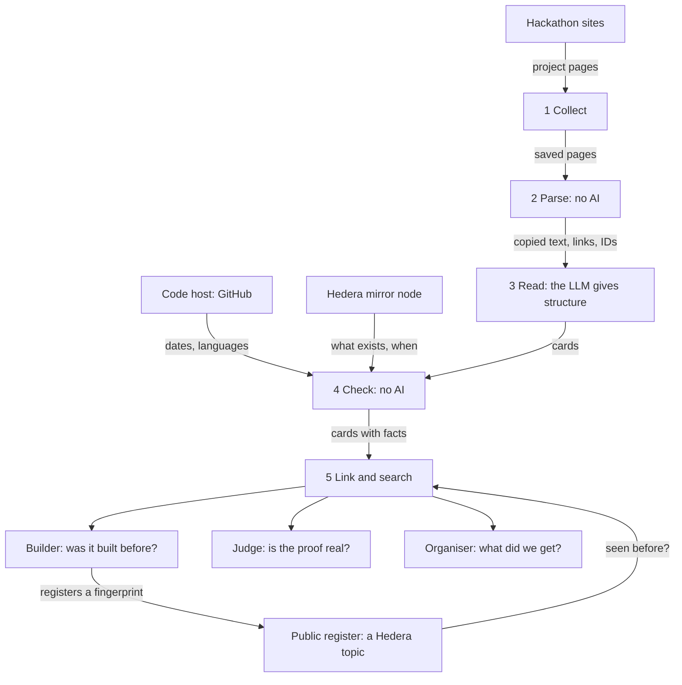

# Jevadu: the design

This document explains what the tool is, how it is built, and why. The code and the tests point to its sections by number, for example "design 5.7" or "design section 11.6". So the numbers are fixed: a new section is added at the end, never in the middle.

**State on 31 October 2026.** The parts that sections 5 to 13 describe run on the real data, each change with its date. A part that is still to come says so, such as Test 4 (section 13.5), the review of the screens by both layers (section 12.3) and the first registration in the register (section 9.2). Where a number comes from a run, the text names its result file. The website runs on a laptop and as a public copy online (section 12.5).

Words in **bold** on first use are explained in section 17.

---

## 0. Summary

- **What it is:** a memory of Hedera's hackathon projects: what each one claimed, what really happened, and whether it is still alive. It holds the projects whose pages could be read, and the winners of the rest (section 1.4).
- **The one behaviour that matters most:** a builder types an idea and sees the closest past Hedera hackathon projects, each with what the Hedera **ledger** says about it.
- **Who it is for:** builders, judges and organisers of Hedera hackathons.
- **Where Hedera is used:** the tool reads the public ledger to check every claim, and it writes a public register of submissions.
- **Why it is built now:** it is an entry for the FSS Campus Edition of the Hedera Cross Campus Challenge 2026.



---

## 1. The problem

### 1.1 The problem

- Hedera has run many hackathons. Nobody can see their projects in one place.
- So builders rebuild old ideas without knowing it.
- A judge cannot tell quickly whether a project is a repeat.
- Every team writes "we use Hedera". Nobody can check that quickly.
- Nobody knows which past projects are still alive.

### 1.2 The numbers

Hedera has run at least 12 big hackathons since 2018. Seven of them publish how many projects were sent in.

| Year | Event | Projects sent in |
|---|---|---|
| 2018 | Hedera18 | not published |
| 2020 | Hedera20 | 45 |
| 2021 | Hedera21 | 54 |
| 2022 | Hedera22 | 118 |
| 2023 | Beyond Blockchain | not found |
| 2024 | Hello Future | not found |
| 2024 | Hello Future 2.0 | not found |
| 2025 | Hedera x AI | not found |
| 2025 | Hello Future Origins | 159 |
| 2025 | Hedera Africa Hackathon | more than 1,300 |
| 2025 | Hello Future Ascension | 135 |
| 2026 | Hello Future Apex | 368 |

The seven numbers add up to more than 2,100 projects. They sit on at least five different websites, so no single place holds the history. The sources are in section 18.

Hedera is also a sponsor at the events of ETHGlobal, and gives prizes there. Those projects are in ETHGlobal's showcase (section 5.7).

### 1.3 What a hackathon asks for today

The Hello Future rules ask each team to "provide your Hedera testnet on-chain account as a proof of an on-chain transaction". The same page names no automatic check and no check for repeated projects. A program can check that proof on the public ledger.

Coming back with an old project is allowed, and Hedera even invites it. The Apex event had a track named Legacy Builders: "For returning participants from past Hedera Hackathons, including Origins, to build on previous ideas or apply their experience to new concepts." So "seen before" is not an accusation. What is missing is a way to see what came before.

### 1.4 The history is already disappearing

On 9 October 2026 every site was opened by hand.

- The platforms of Hedera18 and Hedera20 are gone. An old copy of the first one still lists its winners, with no code.
- The site of Hello Future 2024 and Hello Future 2.0 cannot be opened. Its security certificate expired in September 2025.
- The submissions of Hello Future Ascension, Hello Future Apex and this year's campus challenge are private.
- For Beyond Blockchain 2023 and Hedera x AI 2025, only the winners are public.

So for eight of the twelve big events, no place was found where the submissions can still be read. They are public for four: Hedera21, Hedera22, Hello Future Origins and the Africa hackathon.

This changes what the tool can honestly say. It cannot know every project. It can know the projects whose pages can still be read, and the winners of the rest (section 4.6). It also shows why a memory is needed: what nobody keeps in one place gets lost.

---

## 2. Users and their tasks

| User | Their question | Task in the tool |
|---|---|---|
| Builder | Was my idea already built on Hedera? What happened to it? | T1: search an idea. T2: read a project card. T3: register my submission. |
| Judge | Is this submission's Hedera proof real? What is close to it? Was it sent before? | T4: check a submission. |
| Organiser | What did our past events produce? | T5: read the overview of an event. |

Nobody asked an organiser whether they want this. The assumption is that they check submissions by hand or with simple database queries. The tool does not need their permission to help builders.

---

## 3. What the tool does, and what it never does

### 3.1 In the first version

- The projects that ETHGlobal's showcase ties to Hedera: 658 projects from 14 events, 92 of them with a Hedera prize (section 5.7). This is the first source. A card says whether its project took a Hedera prize, a prize of another sponsor, or none.
- Projects from DoraHacks for two events, the Hedera Africa Hackathon 2025 and Hello Future Origins 2025, if DoraHacks gives its written permission (section 5.2). It has not answered yet.
- Winner entries for the events whose submissions are not public (section 4.6).
- One card for each project (section 4).
- A check of each project's Hedera IDs on the ledger, and of its code on GitHub (section 7).
- A search by idea, with a short comparison (section 8).
- A register of submissions on a Hedera topic (section 9).
- A website with six screens (section 12).
- Four tests with results that anybody can open (section 13).

### 3.2 Not in the first version

- Other hackathon websites.
- Accounts and sign-in.
- A plug-in for AI tools.
- Registrations signed by the team's own Hedera account (section 9.4).
- The register on the main network. The code refuses to write to any network but the test network.

### 3.3 Rules for the AI

1. It never gives a score to a project.
2. It never ranks projects by quality and never picks a winner.
3. It never says "this is a copy". It shows what is the same and what differs, and it points to the cards.
4. It never states a fact. Facts come from the parser, the code host and the ledger (section 6.4).
5. Everything it writes is marked as written by the AI, with its label and its quotes (section 6.3).

The reason: an AI used as a judge gives an opinion that is not grounded in proof. People decide, with the facts in front of them.

One consequence for the collected pages. The data of an ETHGlobal project page holds scores and a summary that the site computes by itself. The tool never reads them out and never shows them.

### 3.4 Why the two DoraHacks events

- **Same website.** Both are on DoraHacks, so one collector and one parser serve both.
- **Close in time.** Hello Future Origins ran from 21 July to 8 August 2025. The Africa hackathon ran from 1 August to 30 September 2025. A team could enter both, so real repeats are likely and "seen before" has something to find.
- **Still checkable.** Both are later than the last reset of the test network (1 February 2024), so their test IDs can still be read.
- **The judges know them.** The Africa hackathon is the biggest one.
- **The proof is asked for.** Hello Future asks each team for a test account as proof (section 1.3). That is exactly what the tool checks.

---

### 3.5 The rules, by number

The code and the tests name these rules by number, for example "design rule 9". The numbers that are missing are about how the work is organised, not about the tool. The rules for reading a site, each with a test, are in section 5.7.

| # | Rule |
|---|---|
| 1 | The AI never gives a score, never ranks quality, never picks a winner, and never says that a project is a copy. It shows facts side by side, and people judge. |
| 2 | Facts never come from the LLM. IDs, links, dates, counts and statuses come only from the parser, the code host or the ledger. |
| 3 | Every field written by the LLM carries a label (stated, inferred or not found) and exact quotes from the page. Code checks every quote against the saved page. A field with no checked quote is dropped. |
| 4 | Parser first. A titled section is copied word for word, and the LLM is never asked to rewrite it. |
| 5 | A saved page is never edited afterwards. Before it is saved, the part that shows team members is cut out, and the page is written again by the parser: the text, the links and the order of the tags stay the same. One exception: personal data that is found in a saved page later is taken out, and the reason and the old fingerprint are written next to the page. |
| 6 | No number is shown unless it comes from a test with a dated result file. A model never grades its own work. |
| 7 | All LLM calls go through Vertex AI: Gemini 3.1 Pro reads and rewrites the pages, with Gemini 4 Argon for the cards still missing when 3.1 Pro keeps answering "too many requests", Gemini 3.8 Flash does the search, and after five failures of Gemini in a row DeepSeek V4.1 Flash, which Google serves on Vertex AI, stands in for the search for ten minutes. Embeddings use Google's embedding model. |
| 8 | Only a fixed fingerprint record goes to the Hedera topic. No free text, no names, no secrets. A message on a topic can never be deleted. |
| 9 | Secrets live only in `.env`. They never appear in git, in a log, in the database or in a test file. |
| 10 | The terms of a site are read before the first request to it. Requests go one at a time, with a pause, with the name of the tool and a contact address. A block is never worked around, and the tool never signs in. |
| 11 | No personal data that the check does not need: no names, emails or photos of team members. A handle, an email address or a link to a profile that a team wrote inside its own text is hidden before the text is stored. |
| 17 | No collector runs against a live site before the maintainer has said yes for that site and for the pages that will be read. |
| 18 | The way a site is read is fixed in the code, and each rule has a test. |

## 4. The card

### 4.1 Three sources

Every field on a card comes from exactly one of three sources. The website shows which one.

| Source | Fields | Why this source |
|---|---|---|
| **Parser**, no AI | Name, short line, links, Hedera IDs, event, track, prize. The text of the titled sections of the page, word for word. | Exact and free. Nothing can be invented. |
| Code host and ledger, no AI | Programming languages, Hedera libraries named in the code's package files, dates of the code, activity of each Hedera ID. | These are facts. The tech stack comes from the code, not from what the page says. |
| The **LLM** | One plain sentence on what the project does. How it works, in 3 to 6 steps. For whom. Which Hedera services the page says it uses, and for what. A category from a fixed list. The problem and the solution when no titled section gives them. | This is reading work that rules cannot do: titles that differ, pages without titles, long text to shorten, and the same structure for every project. |

### 4.2 Why the same structure for every project

Two projects can work the same way and differ in the market: an escrow for freelancers and an escrow for rentals. With separate fields the tool can say "same mechanism, different users". That is more useful than "similar".

### 4.3 Labels on LLM fields

| Label | Meaning | What the card shows |
|---|---|---|
| Stated | The page says it | The text and its exact quote |
| Inferred | The page does not say it directly. The LLM worked it out from other sentences. | The text, those sentences, and a "less sure" mark |
| Not found | The page gives nothing about it | An empty field |

An empty field is right only when the page really has nothing. When the information is there without a title, the field is filled and marked.

### 4.4 Statuses computed by rules

- **Proof status** of the Hedera IDs: section 7.2.
- **Life status** of the project: section 7.4.

### 4.5 Categories (split once after Test 1)

Payments and remittance. Lending, saving and investing. Real-world assets and tokens. Identity and credentials. Supply chain and provenance. Sustainability, energy and climate. Health. Education. Agriculture. Gaming and entertainment. Social and community. AI agents and automation. Tools for AI agents. Developer tools. Data and devices. Public services. Other.

- **Why a list of our own.** The tracks of the events cannot do this job. They change from one event to the next, and some say nothing about the subject, like "Open Track" and "Legacy Builders".
- **One category for each project.** It is chosen by who the project serves, not by the technology inside. "AI agents and automation" is used only when an agent or an automation is what people run or get, such as a trading agent. "Tools for AI agents" is used when the project is built for AI agents to use, such as limits on what an agent may spend, an identity for agents, or a market where agents buy services. "Developer tools" is used for tools for people who build software.
- **How the list is confirmed.** On the projects of Test 1 (section 13.2), two graders each pick a category, separately. The list is accepted if they agree on at least 80% of the projects and if at most 15% land in "Other". If not, categories are merged or split once, before the full run.
- **The split of 15 October 2026.** In the run of October 2026 the two graders picked the same category on 4 of 11 projects, and neither picked "Other", so the first list of 16 was not accepted. Most differences were about tools built for AI agents, so "Tools for AI agents" came out of "AI agents and automation". The cards are made again with the new list.

### 4.6 Winner entries: a thinner card

For an event whose submissions are not public, the only thing left is the organiser's list of winners (section 1.4). Such a project gets a **winner entry**.

| | Full card | Winner entry |
|---|---|---|
| Comes from | The team's own submission page | The organiser's winners page or blog post |
| Fields | All of section 4.1 | The name, the event, the track, the prize, the description as it was published, and the link to the project's website if there is one |
| The LLM | All LLM fields | Only the category. The description is short already, so it is copied as it is. |
| Ledger and code facts | Yes | Only if the page gives an ID or a repository. Most do not. The entry then says "no ID given" and "unknown". |

**Why they are kept, although they are thin.** The search is the behaviour that matters most, and the winners are the projects a builder most needs to find. With them the search covers all twelve events. They also make returns visible: one project name stood among the winners of three events of 2025.

**What they cannot do.** They do not show the ledger check, and that check is what this tool adds. So the demo is built on full cards. Winner entries only widen the search. Every winner entry says where it comes from, and that only the winners of its event are public.

**Their dates (16 and 18 October 2026).** An organiser's list of winners gives no start and no end, so the year of each of these twelve events is typed by hand from the organiser's own post, in a file that the parse step reads. Where the post also gives the days, its line carries the first and the last day too. The saved posts give them for four events: Hello Future 2024 (22 July to 20 August 2024), Hello Future 2.0, Hello Future Origins and the building stage of Beyond Blockchain 2023. The eight others give only a length, such as four weeks, or nothing. Since no winner entry of these events has a Hedera ID or a repository, the days change no mark: they only let the check of a submission offer these events with their days.

**Where they come from.** Hedera's own winner posts, and winners pages that were copied by hand, with no request by a program. Nothing is read by a program before the rules of section 5.2 allow it.

---

## 5. Step 1: Collect

### 5.1 How each source is read

| Source | How |
|---|---|
| ETHGlobal's showcase | Simple requests. A walk through one list of the showcase finds the winners, and a run reads their pages (section 5.7). |
| DoraHacks, list of an event's projects | A real browser driven by a program, because the list is built in the browser. Only after written permission. |
| DoraHacks, one project page | A simple request. Only after written permission. |
| Devfolio | Its own data service, the one that its pages use: a search of projects, sent as JSON, finds the events and the projects of each Hedera track, and one simple request reads each project (section 5.7). |
| A project's README | The GitHub API (section 7.3). |
| Winner posts | One simple request, or a copy made by hand when the server refuses a program. |

### 5.2 Polite collection, and the terms of each site

The **terms of use** of a site are read before the first request to it. If they ask for permission, no automated request is sent before the site has said yes in writing.

**No collector runs on a site before the maintainer has said yes for that site** and for the pages that will be read. The collectors are written like every other part, and they are tested on invented sample files. The Hedera mirror node, the Hedera test network, Google's models and the local database are not collectors.

**When collection is allowed:**

- One request at a time for each site, with a pause.
- Each request says who it is: the name of the tool and a contact address. It does not pretend to be a normal browser.
- Stop after five errors in a row.
- No sign-in, no cookie, and no way around a block.
- **A no of the site.** An answer of 401, 403 or 451, or a bot check, stops everything for that site. Nothing is worked around, and nothing is sent again until a person has decided how to go on.
- **Too many requests.** When the site answers 429, "too many requests", the run stops at once. The tool sends nothing for one hour, or longer if the site names a longer time, and then it goes on five times slower. A third 429 within a day is taken for a no. Every command keeps to this by itself: the cooldown and the slower pace are written next to the count of requests.
- **A stop order.** The people who run a site can ask for a stop at any time. One switch for each site turns its collector off at once.

Collection by a program is a proof of the idea. Real use would need the sites to give the data themselves.

### 5.3 Raw pages

- Every page is saved with its address, the date and a **fingerprint** of its content. There are two exceptions to "saved as received", both made before the page is saved.
  1. **The team part is cut out,** because the sites were promised that it is not collected (section 5.7). That means the block that shows the team, the metadata that names an author, and the keys that hold people inside data blocks.
  2. **The page is written again by the HTML parser,** because the cut needs one. A test compares a saved sample page with the original after the team part was removed by hand: the visible text, the links and the order of the tags are the same. The spaces between tags, the case of the doctype and the slash of empty tags may differ. Two fingerprints are kept next to the page: of the page as saved, and of what the site sent.
- The README of a project's code is saved as text, after the part about the team and the words about people were taken out (section 5.4). The fingerprint of what GitHub sent, the numbers of what was taken out, and the name, size and version of the file are kept next to it.
- A saved page is never edited afterwards, with one exception: **personal data that is found in a saved page later is taken out.** The store has one function for that, and no other way to change a page. It writes next to the page the reason, the time, the number of places and the fingerprint that the page had before. The text that was taken out is written nowhere. The proof of the lists fails when a page differs from its fingerprint, and it counts the pages that carry such a record.
- Running the collection again skips pages that are already saved, and pages that an earlier run read and did not keep.
- Everything else in the system can be rebuilt from the raw pages with one command. This is also the backup.

**Built again on 18 October 2026** (`evals/results/20261018T102138Z-rebuild.json`, the steps at the top of `evals/rebuild.py`). A new, empty database was built from the saved pages, the saved answers of GitHub and the hand-typed files, with the mirror node asked again and the embeddings made again; the cards came back from a file that `cards --export` wrote, since the model would not write them twice, and their quotes were checked again (`cards --restore`). Of 36 counts, 33 are the same, among them every count that the site uses. The other 3 are one outdated card of the first version of the instructions, refused because its page text changed after it was made.

### 5.4 Personal data

Project pages can show team members. The tool does not store their names, emails or photos. It needs none of them. The account name inside a repository link is kept because the link needs it.

A team can also name a person inside its own text. The parser hides these words before the text reaches a table, a model or a card:

| What the team wrote | What is kept |
|---|---|
| A word that starts with "@", such as a handle on a social network | `@[name hidden]` |
| An email address | `[address hidden]` |
| A link to a profile on a social site, such as "x.com/name" or "t.me/name" | `[profile link hidden]` |
| A link to GitHub with one name only: the profile of an account | `[profile link hidden]` |
| A link to the photo of an account on GitHub | `[photo hidden]` |
| A handle inside a link, such as "medium.com/@name/a-post" | the handle becomes `@[name hidden]`, and the rest of the link stays |

The rest of the sentence stays word for word, and so does its full stop. The tool cannot tell a person from a company or from a bot of the project, so it hides all of them. Little is lost, because every card links to the page of the project.

Three things are not hidden. The name of a software package, which has a slash after its first part ("@scope/package"), also inside the link of a site of packages. Anything inside code, where an "@" belongs to the language, except an email address. A link to a repository or to a video.

**A link of a project is asked the same question.** A demo link can lead to a profile site, for example to a name on Telegram. Such a link is kept without its address: the table says that the link is there, of which kind, and on which site. So a card never says "no demo" where a team gave one. It sends the reader to the page of the project.

The step that reads the saved pages counts how many words and links it hid, and writes the number into its row in the table of runs.

**A README is cleaned before it is saved.** The README of a project's code (section 7.3) is written by the team for other developers, and it often has a part about the team: names, photos, links to profiles. Before a README is saved, two things are done:

1. A part about the team is cut out whole: its title and everything under it, up to the next title of the same or a higher level, or up to a title that names a part of the project, such as "Installation". The titles are a fixed list ("Team", "Our Team", "Contributors", "Built by", "Contact" and a few more), compared after signs, emoji and a name after a colon are taken away.
2. In the rest, the words of the table above are hidden. A Markdown or HTML link to a profile goes with its words, because those words are most often a name.

Both are counted next to the saved README. So is every Hedera ID that stood in a part that was cut out, so that one can see whether the cut ever takes something that the check needs. The text that was cut is kept nowhere.

### 5.5 A start that needs no permission: public repositories

GitHub allows a program to read public repositories through its API. A search for repositories whose README names a Hedera hackathon gives a few hundred projects. The limits are real: only projects with a public repository that names its event are found, and a README is what a team wrote for developers, not what it sent to the hackathon.

### 5.6 The sites that hold Hedera hackathon projects, and what each one allows

Checked on 9 October 2026.

| Site | Hedera events on it | Can a visitor see the projects without a sign-in? | What its rules or its answer say about a program |
|---|---|---|---|
| ETHGlobal's showcase | Projects tied to Hedera at ETHGlobal's events | Yes | Asked on 9 October 2026. **It agreed in writing** to a slow, signed read of its Hedera prize projects (section 5.7). This is the first source. |
| DoraHacks | Africa 2025, Hello Future Origins 2025 | Yes | Forbidden without its written permission. Asked on 9 October 2026. No answer yet. |
| Devpost | Hedera21, Hedera22 | Yes | **Refused on 9 October 2026.** No program ever touches Devpost. A person may browse the galleries and link to the pages. |
| Devfolio | ETHDenver 2024, 2025 and 2026, and PEC Hacks: every project of a Hedera prize track | Yes | Its terms (effective 29 December 2020) have no clause on automated access, and its robots.txt closes nothing; read on 31 October 2026. Read in the same slow, signed way as ETHGlobal's showcase (section 5.7). |
| StackUp, which is part of AngelHack | Hello Future Ascension 2025, Hello Future Apex 2026 | No | The submissions are private, so there is nothing to collect. |
| The Hello Future site, by AngelHack | The winners of Origins and Ascension, later Apex | Yes | AngelHack's terms ask for written consent. Asked on 9 October 2026. No answer yet. |
| 4hacks | The 12 campus editions of the Hedera Cross Campus Challenge 2026 | No | Excluded. The organiser keeps submissions private. |
| hedera.com | The winner posts of nine events | Yes | No rule about programs was found. |
| GitHub | The code of projects from any event | Yes | Allowed through its API. |
| Hedera's mirror node | The ledger facts | Yes | A public API, made for programs. |

For four events no submission site was found at all. The platforms of Hedera18 and Hedera20 no longer exist. These events get winner entries (section 4.6).

**What the table shows.** Almost every site that holds the submissions either forbids a program or hides the projects behind a sign-in. Devfolio is the exception: its terms have no clause on automated access (31 October 2026). So a memory of all Hedera hackathons cannot be built by a program alone. It needs the sites or the organisers to agree, or to hand over the data. This is the honest limit of the idea.

**One rule about who can say yes.** An organiser can agree for its own site and its own data. It cannot agree for another company's site.

### 5.7 How a site is read, and what ETHGlobal was asked

The way a site is read is fixed in the code, with a test for each rule. ETHGlobal was asked before any program read its showcase. It agreed in writing to a slow, signed read of its Hedera prize projects, and the other projects that its showcase ties to Hedera are read in exactly the same way. The maintainer decided that on 10 October 2026, so that the tool can show what is built on Hedera and not only what wins.

| The rule | What the code does |
|---|---|
| Only named pages | A walk reads one list of the showcase: the one with the filter "partner: Hedera". A run reads robots.txt and the pages of the projects on that list. Every other address is refused before a request is sent, also on a redirect. |
| A limit of requests | A fixed limit for each site: 800 for ETHGlobal's showcase. Every request is counted in one file, so the limit holds for all commands and all days together. |
| One time | A second run skips every page that is already saved, and every page that an earlier run read and did not keep. |
| One request at a time | One worker, a pause of two seconds, nothing in parallel. |
| Each request carries the name of the tool and a contact address | Both come from the settings. The collector refuses to start when one of them is empty. |
| No names, photos or profiles of team members | The team part is cut out before a page is saved (section 5.3). If a page shows a profile link, an avatar or a data key that holds people, the run stops. |
| Too many requests | When the site answers 429, "too many requests", the run stops at once. The tool sends nothing for one hour, or longer if the site names a longer time, and then it goes on five times slower. A third 429 within a day is taken for a no. |
| A no of the site | An answer of 401, 403 or 451, or a bot check, stops everything for that site. Nothing is worked around, and nothing is sent again until a person has decided how to go on. |
| It stops at once when asked | One switch for each site in the settings, read again before every request. It is there for a stop order from the people who run the site. |
| The collected pages stay on one laptop | The data folder never enters git. No text taken from a collected page is committed, also not in a test file or a result file. The sample pages of the tests are invented. |
| A new request before anything is published | Before the repository, the tool or its data goes public, the site is asked again. |

**How the projects are found.** No page of ETHGlobal lists the winners of one sponsor. A prize page lists prizes, and a winner is shown only on its own project page, in a block named "Winner of". But the showcase has a list with the filter "partner: Hedera". It names every project that is tied to Hedera, and its data says, for each project, which sponsors gave it a prize.

1. **A walk** reads the pages of that list, one after the other. It saves no page. For each project it keeps the address, the event and the ids of the sponsors of its prizes.
2. The list names a sponsor by a short id, not by its name. **Which id is Hedera is not guessed.** A person opens one or two project pages in a browser, sees "Winner of" and a line that starts with "Hedera", and writes their addresses into a small file. Hedera is the one id that all these pages have.
3. **A run** reads the page of every project of the list. Whether a project took a Hedera prize is read from its own page, in the block "Winner of". The run compares that with the list, and three pages in a row that differ stop it.

**The first collection, on 10 October 2026** (result file `proofs/results/20261010T194925Z-lists.json`). It read the projects with a Hedera prize first.

- The walk read 21 pages of the list: 658 projects in 14 events, 173 with a prize of some sponsor, 92 with a Hedera prize.
- The run read the 92 pages and kept all 92. The id from the list and the block on the page agreed every time.
- The site answered every request, and never with a check or a refusal.

**The second collection, on 11 October 2026** (result file `proofs/results/20261011T031418Z-lists.json`). It read every other project of the list.

- The walk was made again and kept every project: the same 658, and the list had not moved.
- The run read the other 566 pages and kept all of them. Of the 658 projects, 92 took a Hedera prize, 81 a prize of another sponsor only, and 485 no prize. The list and the block on the page agreed every time.
- Once the site asked for a slower pace ("too many requests"). The tool waited one hour and went on at ten seconds between two requests, as section 5.2 says.
- 732 requests were sent to the site over both collections, out of the limit of 800.

---


**Devfolio (31 October 2026).** Devfolio was not asked: its terms have no clause on automated access and its robots.txt closes nothing. It is read in the same way all the same, with a switch of its own, the tool's name and the maintainer's address in each request, one request at a time with a pause, a count of requests on disk with a limit of 1,000, and a refusal remembered. Its pages build themselves from Devfolio's data service, so the tool asks that service directly, as the pages do:

- **The find.** The search of projects, sent as JSON, with the word "hedera" and no event, meets the events where a project entered a track of a Hedera sponsor. Each such event's own page data then gives its dates and all its tracks with their sponsors, and the search lists every project of each Hedera track. The find keeps the names of the projects, their events and the ids of the tracks: no text of a project and no person, not even the judges that an event's data names. On 31 October 2026: 1,276 projects of all Devfolio carried the word, 4 events had a Hedera track, and 107 projects entered one.
- **The read.** One request for each project. The answer holds the project, its members and its event; it is saved without its members.
- **A trap.** Devfolio files some prizes of a track under another sponsor: the first prizes of ETHDenver 2025's Hedera tracks sit under "Organizer". So a prize belongs to the track whose name it carries, and the sponsor of that track decides whether it is a prize of Hedera. A prize that no track names, such as "Winner", is the event's own.
- **What it does not meet.** An event whose Hedera tracks no project with the word "hedera" entered.

## 6. Steps 2 and 3: Parse and Read

### 6.1 The parser

The parser is ordinary code. It does three things.

1. It pulls out the name, the short line, the links and the full text.
2. It finds Hedera IDs with a pattern: numbers that look like `0.0.12345`. It keeps the words around each ID, because they often say what the ID is.
3. It finds section titles from a list of known words and copies the text under each title, word for word.

On free-form project pages the titles differ a lot. Many pages have neither a Problem nor a Solution title, and a parser cannot know that a page states its problem under a title of its own.

A page of ETHGlobal's showcase has a fixed shape instead: a short line, "Project Description" and "How it's Made". A team can put titles of its own inside these two texts, so a section ends at the next known title, not at the next title.

A trap for the parser: a version number like "0.0.3" has the same shape as a Hedera ID. The words around a number decide what it is.

**The parser of ETHGlobal's pages.** A page tells each fact twice: in what it shows, and in the data of the page. The parser reads both and refuses a page where they differ, for the name, the short line, the event and the prizes. It guesses nothing. A text is kept block by block (a paragraph, an item of a list, a title, code), word for word, and a test compares the blocks with the page letter by letter. A title that a team wrote inside a text stays a block of that text.

For a Hedera ID there are five rules:

- A number below 1001 belongs to the network itself and is never taken as an ID. The first number that a user can own is 1001: the setting `firstUserEntity` of the node software.
- A number whose digits count up or down, from four digits on, such as `0.0.12345` or `0.0.54321`, is an example and not an ID (22 October 2026). In the whole collection there were 36 of them, and each one, read in its place, was an example.
- The default accounts of Hedera's local node, `0.0.1002` to `0.0.1031`, are not IDs, and neither are the transactions that they paid (22 October 2026). A team that tests on its own computer gets these numbers, and on the real networks the same numbers belong to other accounts. The range comes from the README of the local node (`hiero-ledger/hiero-local-node`), read on 22 October 2026.
- The network is taken from the words only when the words near the ID name one network and no other. A wrong network is worse than none: the ledger would be asked about another thing.
- An EVM address is kept only when a HashScan link names it, because the same address can live on another chain.

The data of each page also holds scores that the site computes. The parser never reads them, and a test plants loud scores and checks that none comes out.

Words about people are hidden in the short line, in the two texts and among the links before anything else is done with them (section 5.4). A Hedera ID next to a hidden word is still found, and the words that are kept around it name nobody.

### 6.2 What the LLM is asked

The LLM gets the page text and the sections the parser copied. It fills the LLM fields of section 4.1 in a fixed form. It is told:

- Use only what the page says.
- For each field, give the label and copy the exact sentences that support it.
- Do not rewrite a section that was already copied.
- Do not write IDs, links, dates or numbers as facts.

### 6.3 Labels and the quote check

A program checks every quote: after spaces and letter case are made uniform, the sentence must be found in the saved page.

| What the LLM gave | Result |
|---|---|
| Label "stated" and at least one quote that is found | The field is kept as stated |
| Label "inferred" and supporting sentences that are found | The field is kept as inferred |
| A quote or sentence that is not found in the page | That quote is removed |
| No quote left after the check | The field is dropped and logged |

This check runs on every project. It catches invention. It does not catch a wrong reading of a real sentence. For that, people grade a sample (section 13.2).

### 6.4 Facts never come from the LLM

IDs, links, dates, counts and statuses are produced only by the parser, the code host and the ledger. If the LLM writes one, it is ignored.

### 6.5 Cache and versions

Each LLM answer is stored with the model name, the version of the instructions and a fingerprint of the input. Running again with the same three gives the stored answer and costs nothing. A change in any of the three is visible in the data.

**The caches.** Only exact caches: a stored answer is given back only for exactly the same input, so a cache cannot change an answer. They all live in PostgreSQL, next to the ledger of the costs: the saved page, the card fields, the embeddings, the facts of the ledger and of the code with the time of their reading, the embedding of a typed idea, and the comparison of the search.

- A fact is never inside a cached text. It is read from the tables when the page is drawn, so a cached text cannot carry an old fact.
- The list of results never waits for the model. The comparison appears when the model has finished.
- No cache gives the answer of one question to a similar question. That kind of cache can show the answer to another idea.
- The answers of the mirror node are asked again after seven days.
- Of a typed idea, only a fingerprint is kept, and its comparison for 24 hours.

---

## 7. Step 4: Check

### 7.1 Hedera IDs and networks

Hedera has two networks that matter here: the **main network**, with real money, and the **test network**, for practice. The same number is a different thing on each. So an ID is always stored with its network.

- If the page names the network near the ID, or gives a HashScan link, that network is used.
- If not, both are asked.

For each ID the **mirror node** is asked: what kind of thing is it (account, topic, token or contract), when it was created, how much happened on it, and when the first and the last activity were. The raw answer is stored with the time of the question.

**Built on 18 October 2026: a single transaction.** A page or a README often names one transaction: a link to it on HashScan, or its ID in the text. A transaction is one action on the ledger, such as a transfer, the creation of a token or a message to a topic, and its ID is the account that paid for it and the moment it was sent: `0.0.12345-1700000000-123456789`. It is now its own kind of Hedera ID. The mirror node says what the action was, whether it succeeded and when the network agreed on it, and the proof rule judges it by that moment; a failed transaction counts as empty. The account that paid is kept too, as before. The mirror node refuses the other way of writing it, `0.0.12345@1700000000.123456789` (measured on 18 October 2026), so every transaction is kept in the first form. On the real collection: 223 transactions in 93 projects; 90 of these projects now show a transaction as proof, and none of them depended on it.

**Built on 22 October 2026: a scheduled transaction.** A project can make a transaction that runs later, at a set time or once enough keys have signed it. Hedera keeps it as a **schedule**, with its own ID, and HashScan shows it at `/schedule/`. A schedule is now its own kind of Hedera ID. A HashScan link to it names it, and so does the word "schedule" right before the ID, but never a "fee schedule", which is the list of fees of a token: a first version that took the word anywhere near an ID gave one token a wrong status on the pages of Test 3. The mirror node says when the schedule was made and when it ran, and the proof rule judges it by these two days. A schedule deleted before it ran counts as empty, like a deleted contract. The mirror node also says "deleted" of a schedule that ran at its time, and that one is not empty; a schedule that expired without running was still made, and is not empty either. On the 50 pages of Test 3 there are 7 schedules, on 4 pages (section 13.4).

**Built on 23 October 2026: the history of an ID.** The step `history` reads once, from the mirror node, every event of each own ID whose kind fits its page: the transactions of an account (from the day it was made), the messages of a topic, the calls of a contract, a token and each NFT minted, a schedule, a transaction. Each event keeps its moment and its Hedera service, at most 2,000 for one ID; a history that the limit cuts says so. An ID that several projects name is left out, as a shared service may be (section 8.4). It feeds the ledger story (sections 7.5 and 13.8).

### 7.2 The proof rule

An ID that exists proves almost nothing: nearly every small number exists on Hedera as something. So the rule looks at the kind of thing and at the dates.

The window of an event runs from 30 days before it started to 14 days after it ended.

| Status | When |
|---|---|
| Proof found | The ID exists. Its kind fits how the page describes it. It was created or active inside the window. |
| Found, but the dates do not fit | The ID exists, but nothing happened on it inside the window. |
| Found, but empty | A topic with no message, a token never issued, a deleted contract, a failed transaction, or a schedule deleted before it ran. |
| Not found | The ID does not exist on the network. |
| Cannot be checked | The ID is on the test network and older than its last reset (1 February 2024). |
| No ID given | The page and the README give no Hedera ID. |

The numbers 30 and 14 are a first choice. Test 3 (section 13.4) tells whether they are right.

**What the code adds to the table.**

- Two more statuses that the table implies. *Found, but as another kind of thing:* the ledger says that the ID is another kind of thing than the page says. *The end of the event is not typed in yet:* the dates are not judged, in place of a guess.
- A word of the page can mean more than one kind. A contract can make a token, and a contract has an account, so "token" and "account" fit a contract. "Topic" fits only a topic. The ledger decides what a thing is, never the page.
- A thing that was made before the window and was used both before and after it gets one more question: did anything happen on it inside the window?
- For a project, the best status of its IDs counts. An ID whose page names no network is asked on the test network and on the main network.
- No page gives the end of its event, so it is typed into a file by hand. For an event of one weekend, the last day is the day of the judging, which the data of its project pages shows.

**What this check does not show.** It does not show that the project is good. It does not prove that the ID belongs to the team: a team could paste somebody else's ID. The rule does not compare the ID with the team's code or its dates. What helps a judge see it: when another project of the collection names the same ID, the card links the two (section 8.4), and an ID that several teams name is shown as a shared service, not as any team's own (section 8.4).

**An ID that another project names too, in the check of a submission (1 November 2026).** When a project of the collection with other code names the same ID, the check counts only the ID's own dates, when it was made and first and last used; its use in between, which the one more question finds, may be the other project's, so it proves nothing for the submission, and the ID's line says so. The case that showed it: a repository built for ETHOnline 2026, checked against ETHDenver 2026, got "proof found" from its builder's testnet account, which the builder had used during ETHDenver 2026 for another project.

### 7.3 Facts from the code

The GitHub API is asked with a read-only token. Without a token the limit is 60 requests per hour. With a token it is 5,000 per hour. Requests go one after the other, the limit headers are read, and every answer is stored. Until 25 October 2026 a repository was asked again only when a team registered it, because its line must be read in the README at that moment (9.2). Since then every answer is asked again once it is a day old, because a repository keeps changing after its event (below, "Read again"); GitHub's limits are far above what the tool sends (read on docs.github.com on 18 and 25 October 2026).

**How GitHub is asked.** The rules of section 5.7 hold here too: the name of the tool and a contact address in every request, at least one second between two requests, a limit of requests counted on disk over all runs, and a stop switch in `.env` (`COLLECT_GITHUB`), read again before every request. GitHub's own rules, read on its documentation on 11 October 2026, are kept as well:

- The version of the API is named in every request: 2026-03-10, the newest. None of its changes touches what the tool asks.
- A 404 ("no README", "no repository") and one blocked repository are answers. They are saved, and the run goes on.
- A rate limit (a 403 or 429 with "x-ratelimit-remaining: 0", a retry-after or a message) is handled like a 429 of any site: the run stops, the tool waits at least one hour and goes on five times slower. The run also stops by itself when fewer than 100 requests are left in GitHub's hour.
- A 401 or any other no stops everything until a person decides.
- A moved repository answers 301. The new address is followed, and only inside the API, so the token is never sent anywhere else.

**The README.** One request for each repository asks for its README. Projects with the same code share one repository and one README. The Hedera IDs in a README are found by the same rules as on a page (section 6.1), kept for each project of the repository, marked as found in the README, and judged by the same proof rule (section 7.2). The step is `python -m hackathon_memory.pipeline readmes`. Run again, it asks only for what is missing, and it writes the IDs of a project again only when they changed.

For each repository: does it exist, when was it created, when was the first and the last change, how many changes, how many contributors, which languages. The package files are read to see whether a Hedera library is named. The README is searched for Hedera IDs, because many project pages give none.

**The facts of a repository, as built.** One request for each repository asks for its facts (`python -m hackathon_memory.pipeline code`). The answer also holds the account that owns the repository: its photo, and for some accounts a name and an email address. None of it is kept. Before saving, only a fixed list of fields stays: the link, the dates (made, last push), the state (archived, a fork), the language, the size, the short name of the license, and the description with the words about people hidden. The number of changes and the contributors are not read; the libraries are read from the code itself (below).

**The check of one submission (16 October 2026).** The check of screen S3 asks GitHub for one repository, with the same client and the same rules: three requests, the facts, the README and the newest commit (since 18 October), one after the other. The answers are saved, so a repository is never asked for twice, also when it already belongs to the collection. Of the newest commit only its ID and its date are kept: the names and the addresses of the people who made it are dropped before saving.

**Where Hedera stands in the code (21 October 2026).** The Hedera IDs of a project show what exists on the ledger. The code shows how the project calls Hedera. So the code of each repository is read once, whole:

- **Two requests for each repository.** `GET /repos/{owner}/{repo}/tarball` answers 302 with an address on `codeload.github.com` (GitHub's documentation "Download a repository archive (tar)"); the archive of the default branch is downloaded from there as a stream. The client follows this one redirect, only to that host and only over https. The download carries the name of the tool and a contact address and no token. Both requests are counted in the limit of requests and paced like every other. A no or a 429 of the archive host is judged like an answer of GitHub, and downloads that keep breaking off stop the run like errors in a row.
- **Read on the computer of the tool, never kept.** Every file of the project's own code is read, in no order of importance. The folders of other people's code and of generated files (node_modules, vendor, dist, build and the like) and the lock files are skipped, a file over 1 MB is skipped, and a file named .env is never opened. Plain text matching, no AI (section 6.4). What is kept:
  - the Hedera packages that the package files name: npm, PyPI, Go, Cargo, Maven, Swift and NuGet (the names of all dependencies are kept too, for a later rule; the rest of a package file can name its authors and is not kept);
  - the files that import a Hedera library;
  - the Hedera services that the code calls, by the class names of Hedera's SDKs (TopicCreateTransaction and the like), which are the same in every language; a class name counts only with a Hedera library in the file or in the package files;
  - signs: Hedera's JSON-RPC relay (Hashio), a Hedera chain ID in EVM settings, a Hedera network taken from an EVM tool (the Hedera chains of viem and wagmi, a thirdweb chain made from a Hedera chain ID, a network of Hardhat, Truffle or Foundry named after Hedera), Hedera's system contracts in Solidity, and the mirror node read by the code;
  - mentions: the files that name Hedera, Hashgraph or Hiero at all. The weakest sign, kept apart: a mention is not a use.
- **The commit.** git writes the commit of an archive into its header, so the commit that was read is kept, and a link to a file opens that file as it was read.
- **Saved and written.** A small record under `data/raw/api.github.com/`, with the fingerprint of the archive and how long the reading took; then the table `hedera_in_code` and five columns of `repositories` (migration 0014). The step is `python -m hackathon_memory.pipeline hedera_code`. It runs in "all", after the facts of the code, and does not ask for a repository that GitHub already said is gone or blocked. With `--no-requests` it builds the table again from the saved records.
- **The check of a submission (S3)** reads a repository that the tool has not read yet within 50 MB and 30 seconds, and keeps the reading only when it reached the end, so that the step reads a large repository whole later.
- **Measured on 21 October 2026** (`evals/results/20261021T190159Z-code-times.json`): the code of 579 repositories was read whole, and 2 had been deleted. A reading, with its two requests and their pauses, took 3.45 seconds at the median, under 10.8 seconds for 90 of 100 and under 17.7 seconds for 95 of 100; the longest took 100 seconds, and all of them together about an hour. The archives weighed 1.2 MB at the median and under 37 MB for 95 of 100. 558 of the 579 stay under both limits of a check.
- **Found** (`evals/results/20261021T190200Z-code-findings.json`): of the 658 projects with a full card, the code of 508 shows a use of Hedera (a Hedera package, an import of a Hedera library, a call to a Hedera service or another sign), 23 only name Hedera, and 50 show nothing; the code of 77 could not be read (deleted, or not on GitHub). Of the 373 projects that name no Hedera ID on their page or in their README, the code of 242 shows a use of Hedera.
- **What it cannot do.** It says what the code names, not whether a line runs. It does not see Hedera used from another repository, or through a tool that it does not know.

**The Hedera IDs of the code (24 October 2026).** The page and the README say which IDs a team claims. The code names more: in 40 repositories drawn at random from the collection, 20 named an ID in their code that their page and README do not, mostly in settings files and in source code (`evals/ids_in_code.py`, `evals/results/20261023T224559Z-ids-in-code.json`). Most of these prove nothing, because code also names things that many teams use, such as a public token, the account of a service or a number from a tutorial. So the reader of the code (format 3) keeps every ID that a file names, by the rules of the page (section 6.1), with the files where it stands and never the words around it (in a file of example settings the next line can hold a key), and the check gives a project only the IDs of its code for which all of these hold:

- no page and no README of the collection names it, and the code of no other repository, in any of its forms: it is the project's own. An EVM address and the 0.0 ID of one contract are one ID, and only the ledger's answer shows that an address stands for a 0.0 ID, so an ID of the code is looked at again after that answer (28 October 2026: five projects held one contract twice, by its address in the README and by its 0.0 ID in the code);
- the ledger finds it as the proof rule does for an ID whose kind nobody gave: not empty, and used inside the window of the project's event (section 7.2);
- it was made on the ledger inside that window: the team most likely made it for this event.

Measured with this rule before it was built, on the same 40 repositories (`evals/results/20261023T230450Z-ids-in-code.json`): 13 had a proof from their page or README, and 9 more would get one from their code. Most of the IDs of the code that the ledger knows are accounts (103 of 128), such as the account that runs the team's program.

- **Kept apart.** The candidates of each repository are in the table `ids_in_code`; an ID that passes becomes a row of `hedera_ids` with `found_in = 'code'` and the file where it stands (migration 0017). Everything that reads the IDs of a project (the card, the filters, the charts, the ledger story, the life rule) sees only those. Test 3 measures the reader of the page and of the README, so it leaves them out.
- **On the screens.** An ID of the code says where it stands: "in the code, config/ids.ts", linked to the file at the commit that was read, and why it counts. When only IDs of the code prove a project's use of Hedera, its mark says "Proof: found in the code".
- **The check of a submission (S3)** weighs the IDs of its code in the same way, against the hackathon chosen, at most the 10 that stand in the most files, since a person waits. Without a hackathon there is no window: the check says how many own IDs the code names, and asks for the hackathon.
- **Fewer questions.** The check asks about at most 30 candidates of a project, the ones in the most files first (on 24 October 2026, 16 of 273 projects had more, up to 199: lists of other people's things), and about an account first, since most IDs of the code are accounts: two questions in place of four. Hedera gives the numbers of its things in order on each network, one counter for all kinds (of 959 things that the tool knows with their day of making, none stands out of that order), so a candidate whose number lies outside the numbers known to be made just before and just after the window was made outside it, and is not asked about. These bounds come from known things, so they can only miss a proof, never give one. On 24 October 2026 they ruled out 1,433 of 2,917 questions.
- **What it cannot tell.** Whose an ID is. A repository can hold a copy of somebody else's code, for example a fork of a library kept in a folder of its own, and an ID of that copy passes when it was made during the event. The file is shown with every ID of the code, so a person sees where it stands.
- **Read again.** The archives read before the reader kept IDs are read again, once (`python -m hackathon_memory.pipeline hedera_code --again`, two requests for each repository). A saved reading is never edited, so a reading made again is saved in a folder of its own, one for each version of the reader, and the newest reading that holds code is the one used. The check of a submission reads such a repository again the same way.

**Read again, as the repositories change (25 October 2026).** A repository lives on after its event: a team pushes, rewrites its README, renames the repository, makes it private or deletes it, and a repository that was private can become public. The facts, the README and the newest commit of every repository are asked again once their newest answer is older than a day (`REFRESH_AFTER_HOURS`, 24 by default):

- **Nothing saved is replaced.** The first answers stay where they were saved. An answer asked again is saved in a folder of its own, one for its address and its moment (`data/raw/api.github.com/again/`), and the newest answer is the one that every step and screen uses.
- **A conditional request.** A request asked again carries the ETag of the last answer (`If-None-Match`). GitHub answers 304 when nothing changed, and "making a conditional request does not count against your primary rate limit if a 304 response is returned" (GitHub's "Best practices for using the REST API", read on 25 October 2026). A 304 is saved too, as a small record with no body, so the tool knows the newest moment at which GitHub confirmed an answer, and the screens show that moment.
- **What follows.** The Hedera IDs of a README are found again when the README changed, and the check step judges the new ones. The code is read again, whole, only when the newest commit differs from the commit of the last reading (git writes the commit into the archive). A repository that came back from "gone" is read like a new one.
- **The limit.** GitHub's limits are counted on disk as before, and the limit over all runs becomes a limit for each day: at most 4,000 requests in a day. One round asks about 1,950: three for each of the 651 repositories, and two more for each repository whose commit changed. The pause of one second, the stop switch, the stop on a no and the stop before GitHub's hourly limit stay as they were.
- **When.** `python -m hackathon_memory.pipeline refresh` asks again for everything older than its age, then runs the steps that depend on it: the READMEs, the facts of the code, the reading of the code, the timelines of the projects that came back (section 8.7), the check of the IDs on the ledger, which keeps how each ID is set up, the histories, and what the calls of the own contracts reached (section 7.5). While the website runs, the same work goes on in the background, one repository at a time, the oldest answers first, at the same pace; it stops when the switch is off. A card can be read again at once with its button "Read again now" (section 12.1, S2). Each reading of a project, by its button, by a round of the website or by the step, compares what the tool holds about the project before and after it: the last push, the README, the commit whose code was read and the Hedera services the code calls, the Hedera IDs with their status on the ledger, the transactions of its own IDs, how they are set up, and the calls of its contracts that reached Hedera's services. What changed is kept with the time of the reading, in plain words such as "README changed" or "12 new transactions of its own IDs"; a reading by the button is kept also when nothing changed. Every visitor sees the newest one (28 October 2026). The check of a submission asks GitHub again when its newest answer is older than an hour, so a repository made public after a first check is found.
- **What is never read again.** The pages of the sites that were asked for permission: a page is asked for once (sections 5.7 and 5.3). A submission page does not change after its event, and the card that the model wrote from it stays.

### 7.4 The life rule

A **sign** is one of two dates: the last push of code to the repository, or the last activity on the ledger of the project's own IDs. A **sign of life** is a sign later than 30 days after the last day of the event. Before that line, the work is most likely still the work of the event, with its late fixes.

| Status | When |
|---|---|
| Active | A sign of life in the last 90 days |
| Quiet | A sign of life, but none in the last 90 days |
| Stopped | No sign of life, and the event ended 90 days ago or more |
| Too early to tell | No sign of life yet, and the event ended less than 90 days ago |
| Unknown | No date of the code and no activity of an ID, or the end of the event is not known |

**Why these numbers.** The 90 days follow the OpenSSF Scorecard, a common checker of open-source projects. Its check "Maintained" looks at the previous 90 days, and it calls a project younger than 90 days too new to assess. The 30 days leave a margin for the late fixes that follow an event, so that the work of the event is not taken for a project that lives on.

**How the rule reads the signs.** An ID that a project with other code names too is not a sign: it is most likely a shared service used by many teams (section 8.4), and its activity says nothing about this project. The line is the end of the last day of the event plus 30 days. When the end of the event is not known, no sign can be judged: the project is unknown, and the reason is shown. The rule guesses no end. The plain listing of the search shows the status, the reason and the date of the last sign.

**A hackathon that has not ended (25 October 2026).** In the check of a submission the hackathon chosen can still be running, such as the one a team is about to submit to. Then the status is "too early to tell", and the reason says that the hackathon is not over, with its last day. Before, the reason said "the event ended less than 90 days ago", which is false for a running hackathon. The sentence of a check names the hackathon that the activity is counted from, as the card does, so that the same repository with two hackathons shows why its two answers differ.

**When each sign was read (25 October 2026).** The status is computed when the page is shown, with that day's date, from the newest answers that the tool holds. So each sign says when it was read: "Last push: 18 September 2026, read from GitHub on 25 October 2026", and the last activity with the day the mirror node was asked. The answers are asked again once they are a day old (section 7.3), so a status cannot drift for long on an old answer.

### 7.5 The ledger story

**Built on 23 October 2026.** The card of a project puts three sources side by side for each Hedera service: the words of its page, the calls of its code, and the transactions of its own Hedera IDs. A transaction is one action on the ledger, such as a message to a topic, the minting of a token or a call to a smart contract. The first measure (section 13.8) found that a page and the ledger disagree mostly about services, and seldom about dates. So the services lead, and the time follows in words. It serves judges first, and anyone who wants to check what a page says about Hedera.

| Part | What it holds |
|---|---|
| The IDs | The own IDs whose history was read (section 7.1). Each is named by this project only, or only by entries that share its repository (one team's code sent to several hackathons, since 28 October 2026), counted by the thing that the ledger names, so that an EVM address and the 0.0 ID of one contract are one ID that two teams can name in its two forms (28 October 2026, night: two registries of the standard ERC-8004 counted as the own contracts of two teams, each naming them in one form), its kind fits its page (the status "proof found", "the dates do not fit" or "found, but empty"), and it counts on the network where its status is best, as in the proof rule (section 7.2). |
| The time | The table counts the transactions from 30 days before the first day of the event to 30 days after its last day: from the start of the window of the proof rule to the line of the life rule (section 7.4). When the days of the event are not known, it counts every transaction and tells no time. |
| Before and after | The transactions outside that time, counted apart, by service, with the first or the last day. Only those of the project's own topics, tokens, contracts, schedules and single transactions count: a builder often keeps one account for years and across projects, so the old and the later transactions of an account say nothing about this project. |
| The page | The page's own words: its short line and the texts that the parser copied, never the AI summary. A service is named by the words of the measure: "consensus service", "HCS", "Hedera topic", "HCS topic", "consensus topic" or "topic ID" for the Consensus Service; "token service", "HTS" or "Hedera token" for the Token Service; "smart contract" or "Solidity" for smart contracts; "scheduled transaction", "schedule service" or "HSS" for scheduled transactions; "file service" or "HFS" for the File Service. The table shows the words as the page wrote them. The page is not checked for HBAR, and its cell says "not checked" with an (i) of its own: nearly every project moves HBAR to set itself up. |
| The code | The reading of section 7.3: every source file of the repository, not only its package files. The code calls a service when a source file names one of the SDK classes of that service, such as TokenCreateTransaction, in a project that uses a Hedera library; a package alone never counts. For smart contracts, Solidity that calls Hedera's system contracts is a call too (EVM: the Ethereum Virtual Machine, which also runs Hedera's smart contracts). An EVM project that only points its tools at Hedera, with the JSON-RPC relay, a Hedera chain ID or a Hedera network of Hardhat, viem or the like, shows "EVM setup": most Solidity projects reach Hedera this way, but it is not a call by itself. The reading matches text: it cannot tell whether a line runs, and a class name in a comment counts. |
| In a check | The same table for a submission (screen S3), with its README in the place of the page: its prose only, since a word in a block of code or in an address names no service, and without the marks of Markdown. Its IDs are those of the README whose kind fits, without a shared service or an ID that a project with other code names (section 8.4). Their histories are read from the mirror node during the check, as in the step `history`, and kept: a second check within 7 days takes them from the table, as it does the facts of the ledger. Without a hackathon, every transaction counts and no time is told. The README's lines that name a service open under the table, and each word of the README marks its place there. |
| What stands out | Sentences that the code makes from these facts, with no AI. A service that the page names, and that no transaction of its IDs shows in that time, nor a call of its contracts (from its contracts, below). A service that its IDs show at least 3 times in that time, and that the page does not name. When every service that the page names shows, one sentence says so. |
| Where the page says it | Each word of the page in the table, and in a sentence of the first kind, is a button. It marks every place where the page's own texts on the card name that service, and brings the next place into view at each press, with its number ("place 2 of 3"). A person reads the claim in its own words without searching the page: a page can also name a service as a plan for later, and only a person judges that. |

The ledger shows only the IDs that a page gives, and a team can use a service through an ID that it never names. So a sentence says what the IDs show, and never that the team did not use a service. The card keeps the rules of the measure, with one difference: the measure looked for a named service at any time, and the card looks in the time of its table.

A card shows the ledger story only when the project has an own ID whose kind fits. While the history of such an ID is not read yet, the card says so.

**Why no chart, on 23 October 2026.** On the collection of that day (`evals/results/20261023T032718Z-ledger-signal.json`, its part `on_the_screen`), 250 of the 254 projects with a history have transactions in the time of the table, and only 11 have transactions of their own things before that time and 6 after it. A timeline of "before, during, after" would show one bar for nearly every card, so the time is told in words. The same file counts the sentences: a service that the page names and its IDs do not show, on 80 cards (the 77 of S3, and 3 whose transactions of that service fall only outside the time); a service that its IDs show and the page does not name, on 70; and every named service shown, on 135.

**The days, drawn (25 October 2026).** That measure counted the time before and after the event, not the days inside it. The days differ from card to card (`evals/ledger_days.py`, `evals/results/20261025T050256Z-ledger-days.json`): of the 349 projects with a transaction in the time of the table, 63 were active on one day, 72 on two, 147 on three to five, 44 on six to ten and 23 on more; 214 were active on 3 days or more (61%, range 56% to 66% by project), over a rule fixed before the reading at 25%. All 349 were active during the event, 60 also before it and 64 also after it. So a strip of days follows the facts of the ledger story, in the same card:

- one column for each day of the time of the table, the days of the event marked, and, since 28 October 2026, one for each day before and after it on which the project's own things have a transaction (below); the transactions before and after that time are also said once, under it;
- one row for each service with a transaction, in the order of the table;
- a square for each day with a transaction, in one colour, darker for more transactions on a log scale, with a border in the full colour so that a light square still stands out from the page; a square names its day, its service and its number in the line under the strip when the pointer rests on it or when it has the focus of the keyboard, and opens the first transaction of that day on HashScan;
- the same numbers in a table that opens under it ("The days as a table"), for a screen reader and for anyone who wants the numbers.

**The whole time (28 October 2026, night).** A strip that stopped 30 days from the event hid what a project's own things did long before or after it: one contract of a project had at least 2,000 calls, the first of them 20 months before its event, and a project whose two contracts were only used a year after its event drew no strip at all. So the strip also draws every day before and after the time of the table on which the project's own things (its topics, tokens, contracts and schedules) have a transaction, however far from the event. Its accounts are drawn only in the time of the table, as the time before and after counts them: an account is often kept for years and across projects. A time of more than 30 days with no transaction that the strip draws is cut out of it: a hatched band marks the place, its length stands under it ("1 yr 2 mo"), and its note gives its first and last day; when two bands stand too close for both lengths, the longer one says its length. So the days around the event keep their width, and the event is drawn even when it has no transaction, beside the days of the things that were used before or after it. The numbers under the strip (what its IDs did, who took part, on how many days) still count the time of the table only, and say its dates. A history is read from its start, up to 2,000 transactions, so the days of a busy thing can stop early; the card says when a history was cut. Anyone can send a transaction to a contract, a topic or a token, and the tool knows only the projects of its collection: an ID that no other project of the collection names can still be a public thing that strangers use. So the lines before and after the strip say who paid for those transactions: accounts that the page names, others, or both (29 October 2026: a contract made long before its project's event, by an account that the project does not name, had filled that project's strip with the transactions of accounts that the project does not name). Where the limit stopped a reading, the card says so where it counts (29 October 2026): a note before the table names the ID and the day of its last transaction read, and says that the card's numbers are at least these; the line after the event says "not known" instead of "none", and a count before it says "at least"; and a hatched band after that day is a time that was not read, not a time with no transaction. Before, the card said "none" after the event of a project whose public contract had been read only up to 15 months before it.

**Depth of use (25 October 2026).** The judges of a Hedera hackathon weigh a "meaningful" use of Hedera. A program cannot measure that: it is a judgment, and the tool never judges (section 3.3). What the ledger can tell is what the use was, as facts. So the history of each own ID keeps, for every transaction, its kind as the mirror node names it (such as CRYPTOTRANSFER or TOKENMINT), whether it succeeded, the account that paid for it, and the other accounts that took part: the accounts of its transfers of HBAR, tokens and NFTs, the payer of a message to a topic, the caller of a contract (by its EVM address), the account that holds a minted NFT. The holders of a token are asked once with the token. The accounts of the network are left out: the node that each transaction names, and the accounts that Hedera's page "Network accounts" names for fees and rewards, 0.0.98, 0.0.800, 0.0.801 and 0.0.802, with the treasury of the network, 0.0.2 (read on 25 October 2026). The card adds, for the time of the table:

| Part | What it says |
|---|---|
| What its IDs did | The kinds of transaction with their numbers, in plain words: "202 messages to a topic", "169 NFTs minted", "12 failed". |
| Who took part | How many accounts other than the project's own IDs took part, and how many accounts hold its tokens now. The tool cannot tell a user from an account that the team made for a test, and the (i) says so. |
| On how many days | The days with a transaction during the event, and the days before and after it in that time. |
| Signs that stay on paper | Facts, each in one sentence: a topic with no message; a token that only its treasury holds; a contract never called after its creation; own IDs that only moved HBAR, such as setting up accounts; a Hedera package in the code and no call to a Hedera service; and IDs that other projects name too, with no own ID. |
| How they are set up | Since 28 October 2026, the check of the IDs (section 7.1) keeps, from the same answer of the mirror node, how each own ID is set up on the ledger now: a token is a coin or a collection of NFTs, with a limit of supply or none, the keys that can still act on it (admin, supply, freeze, KYC, wipe, pause, fees, metadata) and its custom fees, the fees that Hedera itself takes on each transfer for the token's collector (fixed, fractional or a royalty on the sale of an NFT, with its share); a topic has a submit key, so only its holder writes to it, or none, so anyone can; an admin key that can change or delete it; and a fee for each message (HIP-991); an account has one key, ED25519 or ECDSA (the kind that EVM wallets use), or a key made of several keys or held by a contract (a key list or a threshold key). The words carry the day of the check, since keys and fees can change. Sources: Hedera's pages on custom fees, on topics and on keys. |
| From its contracts | Since 28 October 2026, a step reads, for each own contract, its calls in the time of the table, the first 100 at most, and for each call its actions, the calls that it made inside the EVM: an action of the kind SYSTEM reaches one of Hedera's system contracts, which give a contract the services of the network (Hedera's page "System Smart Contracts", read on 28 October 2026): the Token Service at 0x167, the exchange rate at 0x168, random numbers at 0x169, the Account Service at 0x16a and the Schedule Service at 0x16b. The card says how many of the calls read reached each one, and that only the first 100 were read when there were more. The calls are read again like the rest (section 7.3): by the step `refresh`, by the rounds of the website, five contracts a round, and by the button of a card, a contract that was never read, or that was read while its time was still open and longer ago than the age of a reading; a contract read after its time is never asked again, since its calls in that time cannot change. A call that reached the Token Service, the Account Service or the Schedule Service counts for that service in the table, beside the transactions of the IDs, so the card never says that a service shows no use when the team's contracts used it. |
| Who made it | Since 29 October 2026, for each own contract, topic, token and schedule, the account that paid for the transaction that created it, and when: from its history when that holds the creation (a contract's does), or else from one question to the mirror node, the transactions of the moment of its creation (the step `makers`, each thing asked once). The card says, for each account, what it made and when, and whether the project lists that account. A thing made more than 30 days before the event, by an account that made none of the project's other things and that the project does not list, gets one more sentence: it may belong to someone else, such as a public service. A project's README had given the price oracle of Pyth, made 20 months before its event by Pyth, as one of its own contracts. |

**On the main network (28 October 2026).** Hedera's main network is where real value moves; the test network is free and reset from time to time. A team that names an own ID on the main network, which the main network knows as that kind, made in the time of the event or later (from 30 days before its start), has put something there. The card and the result carry a tag "Mainnet" for it, with an (i). Only an ID that the page, the README or the code names on the main network counts: nearly every number of an account also exists on the main network as somebody else's account, and a well-known token made years before the event is not the team's. On the collection of 28 October 2026, 5 projects carry it (`evals/results/20261028T172705Z-depth.json`).

No score, no rank and no word such as "meaningful", "weak" or "real": a person reads the facts side by side. In a check of a submission the same facts come from the README's own IDs. Measured on the whole collection before it is shown (section 13.9).

**One card (28 October 2026).** The ledger story and the depth of use were two cards, and they said three things twice: the time of the table, the transactions before and after it, and the page's words about Hedera, marked in the table and then quoted. They are now one card, "Hedera services: page, code and ledger": the table and what stands out, then the days, the time before and after (once, under the days), what its IDs did, who took part, on how many days, and the signs that stay on paper; the line of the reading ends it. The page's sentences are not quoted: the buttons of the table mark them in the page. In a check of a submission, the same card is made from the README's own IDs.

---

## 8. Step 5: Link and search

### 8.1 What is compared

An **embedding** model turns a text into a list of numbers. Texts with close meanings get close numbers. For each project the model reads the fields that describe the idea: what it does, how it works, the problem and the solution.

Which fields give the best search is not known yet. Test 2 (section 13.3) compares the choices, including "the page as it is".

**What runs today: the page as it is.** Until the fields of the card exist, each project is embedded from its name (as the title), its short line and its two texts, with the words about people already hidden (section 5.4). The step is `python -m hackathon_memory.pipeline embed`. Every call goes through the meter and its budget (section 11.4). The fingerprint of the text is kept with the embedding, so a project is embedded again only when its text or the model changes.

### 8.2 The search

The search uses two methods together and merges their results:

- by meaning, with the embeddings;
- by words, with a normal text search over the name, the short line, the card fields and the original text.

Each method finds what the other misses. The original text is always searched, so a weak LLM field cannot hide a project.

**How it runs today** (`python -m hackathon_memory.search "<an idea>"`):

- **By meaning.** The idea is embedded as a search question and compared with every project embedding (an exact search, section 11.6).
- **By words.** BM25 over the name, the short line and the two texts, on PostgreSQL's own English stems, with the usual numbers k1 = 1.2 and b = 0.75. PostgreSQL's own ranking was tried first and dropped: its documentation says that its ranking functions "do not use any global information". They count how often a word stands in a project, not how rare the word is, and every project here says "Hedera" and "token".
- **The merge.** Reciprocal rank fusion with the constant 60 (Cormack, Clarke and Buettcher, 2009). Each list gives as many projects as the listing shows, the default of Elasticsearch's own fusion. A first try with 50 projects from each list put the closest project in meaning out of the first ten. Test 2 compares these numbers.
- **The listing.** For each project: the event, the prize, the result of the proof rule, the links, and for each Hedera ID what the mirror node answered and on which day. Nothing in it is written by a model, and the place in the list says only how close a project is to the idea.
- **The idea.** It is kept nowhere. Its embedding is kept for one day under the fingerprint of the idea, so the same idea is not paid for twice. An idea holds at most 4,000 characters, from its cost: each 1,000 characters add about 0.024 cent to a search (the embedding, and the comparison that reads the idea again), so 4,000 keep a search within about 0.1 cent of a one-line idea.

The user can filter by organiser, event, year, category, proof status, the main network, life status and prize. Each filter can keep several values at once (1 November 2026): a project with any of them stays, and the filters still all apply together. The numbers of each filter count the projects that the other chosen filters keep, so each number says how many projects its value shows with the rest of the choice; a filter's own values do not narrow its numbers, so another of its values can still be added. The organiser filter (30 October 2026) keeps the hackathons of one organiser: ETHGlobal for the events of its showcase, where Hedera is one sponsor among others, and for every other hackathon the organiser that its list of winners names (Hedera, or Hashgraph Online for the Hedera x AI Hackathon), which the parser keeps as the sponsor of each entry's prize. The main network filter (31 October 2026) keeps the projects that carry the tag "Mainnet" of section 7.5, whose team put an own ID on the main network, or those that do not. The eight filters stand in one row: the year, the main network and the activity, with short values, have narrower columns. The prize filter (added on 24 October 2026) offers the projects that won a Hedera prize, and among them the projects known only from an organiser's list of winners (section 4.6), whose own page is gone or was never public. Since 28 October 2026 it also offers the projects that won a prize of another sponsor, and no Hedera prize, as the block "Winner of" of their own page says.

**The ways to search (16 October 2026).** The maintainer asked whether the ways of searching should be separate choices, each with its speed and accuracy. Six ways ran on the counted cases of Test 2 (`evals/search_modes.py`, `evals/results/20261016T023934Z-search-modes.json`):

| Way | Known projects in the first 10 | Middle time | Cost of a search |
|---|---|---|---|
| Words only | 23 of 57 | 0.5 s | nothing |
| Meaning only | 36 of 57 | 0.1 s | nothing |
| Meaning and words, the default until then | 34 of 57 | 0.6 s | nothing |
| The 30 closest by meaning, put in order by the search model | 42 of 57 | 2.0 s | about 0.2 cent |
| The 30 first of both lists, put in order by the model | 41 of 57 | 2.6 s | about 0.2 cent |
| The model picks from the short line of every project | 41 of 57 | 2.4 s | about 1.6 cents |

The order by the model was better than the old default in 10 cases and worse in 3, so it was the default from 16 October 2026, until it moved behind its own button (20 October). Since 28 October 2026 the page opens on keyword search, the maintainer's choice: it needs no call to Google, so it answers when Google does not, and semantic search is one click away; the order by the model comes from its button, over the semantic results. Meaning, words and the order by the model are offered on the search page (below), each with its numbers read from the result file. The model reads one line for each project and answers numbers only; it does not score or judge a project. Its service was sometimes much slower than usual (95 of 100 searches under 72 seconds, against 2 in the middle), so its call is made once and given up after 8 seconds; then the page keeps the order by meaning and says so. Picking from every project is not offered: it found no more and costs about seven times as much.

**A stand-in when Gemini keeps failing (24 October 2026).** That day Google's service answered the search model with errors for minutes at a time, and the page said "did not respond in time" also for errors that came back in 5 seconds. Now the page says which: late, failed, or the budget spent. After five failures in a row, DeepSeek V4.1 Flash, an open model that Google serves on Vertex AI, orders the 30 closest and writes the comparisons for 10 minutes; then Gemini is asked again. The maintainer asked for it on high thinking, after a benchmark against Gemini. The benchmark ran the counted cases of Test 2 with the same instructions and the same 30 projects for each model (`evals/search_fallback.py`, `evals/results/20261024T051625Z-search-fallback.json`):

| Order | Known projects in the first 10 | Middle time | Cost of a search | Failed calls |
|---|---|---|---|---|
| The order of meaning, no model | 36 of 57 | none | nothing | none |
| Gemini 3.8 Flash, LOW | 42 of 57 | 28.7 s | about 0.14 cent | 20 of 56 |
| DeepSeek V4.1 Flash, no thinking | 40 of 57 | 1.6 s | about 0.08 cent | 1 of 56 |
| DeepSeek V4.1 Flash, thinking "high" | 38 of 57 | 123 s | about 0.7 cent | 3 of 56 |

A failed call keeps the order of meaning for its case, so Gemini's 42 holds 20 such cases; on the 36 cases where Gemini answered, it found 27 of 37, DeepSeek without thinking 25 and the order of meaning 21. Thinking on "high" found fewer and took two minutes in the middle, too long for a page, so the stand-in does not think. The page waits 10 seconds for its order: 49 of its 56 calls came back within 7 seconds (one of them a failure), and the other 7 took 29 to 47 seconds. Its comparisons wait 30 seconds, as Gemini's do; they were not measured. Its calls go through the meter and the budget, at DeepSeek's own prices by the maintainer's decision ($0.30 a million input tokens, $1.20 a million output tokens, its thinking counted as output). The page names the model that gave the order and wrote the comparisons.

**Typing errors.** The same cases ran with two typing errors in each idea (`evals/results/20261016T030409Z-search-modes-typos.json`). Every way moved by at most 3 of 57, and the search by meaning found as many as without errors, because the embedding reads through them. So no layer that corrects spelling is added.

**Quick results, and the model only when asked (16 October 2026, later).** A person must always know when the model works. So:

- While the idea is typed, the page shows quick results after a pause of half a second, by meaning, or by words when the person chooses words. By meaning they use only the embedding model, which turns the text into numbers and writes nothing (about 0.0005 cent a search in the cost ledger). The page calls them quick results.
- One button says what the search model will do: read the 30 projects closest in meaning, put the ten most similar first, and write for each of them what is the same and what differs, in about 3 to 10 seconds, for about 0.6 cent. Only this button calls the search model. The measure above is the reason it exists: 42 of 57 known projects in the first ten, against 36 by meaning only.
- The order of the model and its comparisons are kept for one day under the fingerprint of the idea, the filters and the model. A reload, the back button, or the same search again shows them without a new call.
- **The three example ideas** under the search box are the tool's own words, not a person's, so their embedding, the order of the model and its comparisons are kept for good (22 October 2026). After the first time, a click on an example never waits for Google and costs nothing.
- In each result, the words of the idea are marked, except a short list of common ones such as "app", "user" or "without", which say little about one idea (18 October 2026). How often a word appears is no guide: "payment" stands in 35% of the projects and "app" in 14%.
- A filter works on the quick results at once, with no model. It keeps the projects of the 50 closest that have its value, so the number next to a value is the number of projects the filter leaves (16 October 2026: before, a filter searched again among all the projects with its value, and a value marked 16 gave a list of 50). The model's order for the new filters is asked only with the button again, and kept for one day for those filters.
- Ten projects a page, with numbered pages; a search shows its 50 closest projects. The way "meaning and words" stays in the measure, and the page offers meaning, words and the order by the model.

**What a result shows.** Its short line, with the words of the idea marked by PostgreSQL's ts_headline after the text is escaped, and in the way by words also the part of the page where the words stand.

**Why no separate search engine.** The collection holds 826 projects. PostgreSQL already gives the search by meaning (pgvector), by words (BM25 in SQL), marked words (ts_headline), search operators (websearch_to_tsquery) and near spellings (pg_trgm), with no copy of the data to keep in step. Meilisearch's own comparison says that PostgreSQL is enough for thousands of documents, and Elasticsearch runs as a server of its own. A separate engine is considered again if the collection grows by tens of times, or if typing errors start to matter.

### 8.3 The comparison

For the first results, the LLM reads the cards and the user's idea. For each project it writes what is the same and what differs, and it names the card fields it used. If this call fails, the page still shows the cards. It runs after the results are shown, at the thinking level LOW, and is given up after 30 seconds; the page says when it is slower than usual.

**The card or the full text? (measured on 18 October 2026)** The comparison could read the whole text of each page instead of its card. For the 9 ideas of Test 2, both were asked (`evals/results/20261018T044605Z-compare-inputs.json`): a middle time of 7.1 seconds with the cards and 7.8 with the full texts, and 4.3 against 7.7 cents for the 9 ideas; one call on a full text failed after 342 seconds. Which one writes the more right sentences is for a person to read: the sentences stand side by side in a local page, and the cards stay until then.

**Graded on 18 October 2026** (`evals/results/20261018T085521Z-compare-inputs-grades.json`). Of the 80 pairs with both answers, the full text was the more specific in 30, both were alike in 50, and the card was never the more specific. Where the two answers stated different facts, the project's page was read (8 projects): the answer from the card was wrong 3 times, for instance that a project did not charge by the five seconds when its page says it does, and it missed the main likeness 3 times; the answer from the full text was right each time. The reason: a card is a summary, so a detail that it leaves out reads as missing from the project. The comparison keeps reading the cards, by the maintainer's decision: the full text costs about 80% more, and one call on it failed after 342 seconds.

**Since the evening of 18 October 2026 (instructions compare-2).** The comparison is told that the texts of a project are a short summary of its page, not the whole page. When they do not mention something, it writes that the texts do not say it, and never that the project does not do it. The comparisons kept under the old instructions are asked again.

**The check of a submission** (screen S3) uses the same comparison on a button: the README of the submission stands for the idea, and its closest past projects are compared with it.

### 8.4 "Seen before"

Two entries are the same project when they share the same repository link, or the same Hedera ID on the same network. This is exact matching, with no AI. An ID counts by the ID that the ledger gives the thing on that network, so an EVM address and the 0.0 ID of one contract are one ID (28 October 2026: a README that named a contract by its address was not matched with a page that named its 0.0 ID; the groups of the collection stayed the same).

One trap: some IDs are services that many projects use, like a popular token. An ID that appears in more than three projects with different repositories, or in two projects with different repositories at one event, is treated as a shared service. It is shown as such and is not used for "seen before". A public service can also be named by one project only, and then nothing in the collection says that it is shared: one README gave the price oracle of Pyth among its own contracts, and its card drew 20 months of Pyth's calls as the team's. So, since 29 October 2026, a table of public services (`public_services`, migration 0022) holds the services that their owners list themselves, each with its source and the day it was read: the price oracle of Pyth (from Pyth's list of its contracts) and Circle's USDC (from Circle's page of USDC addresses), on both networks. Such an ID is never a project's own, joins no projects, and the card names it with its source. The step `makers` shows the ones that no list holds yet: a thing made long before the event by an account that made none of the team's other things.

**Since 18 October 2026.** The second part of the rule is new: three teams of one event, each with its own code, named one account of the main network, and the first part alone made them one group, with a fourth project. The groups of the collection went from 2 with 7 projects to 2 with 5 (`evals/results/20261018T092000Z-overview.json`). The card of a project names the projects it is linked to, and why; the charts show the projects linked across events first.

**Since 1 November 2026.** An account joins no projects either. A builder most often keeps one account for every project, so two projects that use one account share a builder, not a project: one testnet account made one timeline of two different projects of one builder, at ETHOnline 2026 and ETHDenver 2026, and another account did the same for two projects of another builder. Contracts, tokens, topics and the other things that the ledger finds still join projects. The card still names such a link, in these words: the same account, not necessarily the same project. The groups of the collection went from 4 with 9 projects (`evals/results/20261031T234422Z-overview.json`) to 2 with 5 (`evals/results/20261101T083148Z-overview.json`).

A returning name is a hint, not "seen before". Two teams can pick the same name.

### 8.5 Groups for the overview

For an event, the overview counts projects by category, by proof status and by life status.

### 8.6 The graph of a list

**Built on 24 October 2026.** The same list can be seen as a graph (screen S7): which groups of projects it holds, and, with an idea, how close each project stands to it. Nothing in it is written by a model, and nothing ranks a project by quality: closeness is similarity of meaning.

- **Which projects.** The 50 closest of a search, or every project of the list on the screen: a filtered list, or, with neither an idea nor a filter, the whole collection (826 projects; added on 24 October 2026). The groups of the whole collection take about 4 seconds the first time (3.2 s for its 340,725 similarities, 0.8 s for the groups), so the groups of a list are kept for 10 minutes; its page, about 0.7 MB, is sent compressed, about 0.1 MB. A list of more than 1,000 projects asks for a filter.
- **Groups.** The projects are grouped by meaning alone, from their embeddings (section 8.1), with Ward's method: it starts with each project alone and, step by step, joins the two groups whose joining spreads their embeddings least, until a number of groups that follows the size of the list is left: one group under 6 projects, 2 under 16, 3 under 30, and 4 from 30. Four is the most because only four colours of the reference palette stay apart for every reader when any two of them meet, in both themes. No threshold of similarity is used: in a list the similarities lie close together (for 120 projects of ETHOnline 2026, 8 pairs in 10 lie between 0.72 and 0.82), so one threshold joins nearly every project into one group, or leaves nearly every project alone. Measured on 31 October 2026 (`evals/results/20261031T104649Z-graph-groups.json`, with the tool's own code on 853 lists like those the graph draws: the 50 closest around each of the 826 projects, each of the 26 events, and the whole collection): the silhouette of the cut, how much nearer each project is to its own group than to the nearest other group (from -1 to 1), is under 0.1 on average for every kind of list and any number of groups from 2 to 8 (about 0.04 for the lists around a project), and at most 0.17 for a single list, while the usual reading needs more than 0.25 for even a weak structure. The projects of a list form one continuous cloud of meaning, so no number of groups is right by the data: two groups score a little higher than four in 468 of the 826 lists around a project (0.048 against 0.037 on average), far too little to make a structure. The rule stays, and the (i) of the graph says that a group is a region of the map, not a category that the data proves.
- **Names.** A group is named after its most central project, the one closest in meaning to all the others of the group ("Like Allowance"), with its number of projects and the category that most of them share, with how many share it (section 6.3). The category alone does not tell groups apart: around an idea about AI agents, every group is mostly "Tools for AI agents". A group of which more than half of the projects are known only from a winners' list says so in place of the category: such a project has a name and a line and no page (a median of about 200 characters of text, against about 3,000 for a page), so these projects group together by the shape of their text more than by their idea. In the whole collection they make two of the four groups (118 of 124, and 34 of 34). Names made of the words that a group uses more than the rest of the list were tried and dropped: they gave words such as "later" and "open".
- **Places.** With an idea, the idea stands in the middle, and each project stands as far from it as it is far in meaning, from the closest of the list to the farthest, in the part of the circle that belongs to its group; the first 10 of the list are numbered as in the list. Without an idea, the groups stand in a grid, each under its name, its most central project in the middle. In both, the projects most typical of a group stand at its middle and the least typical at its edges. The numbers follow the list on the screen: in Gemini's order or the keyword order a number can stand farther out than a later one, since the distance always follows meaning, and the note says so (24 October 2026, later).
- **What a group tells.** The groups are made from how close the projects are to each other, not to the idea: the idea only chose the 50 projects. So a group is one kind of answer among the closest projects, and its size shows how many took that way. The list of each group says how many of its projects won a Hedera prize and how many have a Hedera proof, as counts, with no share (24 October 2026, later).
- **Zoom.** Ctrl and the wheel, or a pinch of a touchpad, zoom around the pointer, up to 8 times; a drag moves the zoomed graph, and three buttons zoom in, out and back. The dots, the lines and the names keep their size on the screen, so dots that touch come apart and a line can be followed (24 October 2026, later). Two fingers on a touchpad move the zoomed graph too, and at its edge they scroll the page; the picture takes the whole width of its card, so a zoom fills the card (24 October 2026, evening).
- **Crowns (31 October 2026).** Among the first 10 of a search, a small crown stands above each project that won: filled gold for a Hedera prize, outlined grey for another sponsor's prize only, so colour is never the only sign. A project known only from a winners' list won a Hedera prize, so it wears the gold one. The key names both, the lists under the graph say it in words, and a crown keeps its size and its place above its dot when the graph zooms.
- **Lines.** A strong line joins projects with the same code or the same Hedera ID (section 8.4). When the pointer rests on a project, a dashed line goes to its closest project of the list: the one whose embedding is the most similar to its own (the cosine similarity of the two lists of numbers, section 8.1). A click keeps that line, with both projects lit, until a click on an empty place (24 October 2026, later); while it is kept, the pointer shows other projects with their own lines, and the kept one stays (24 October 2026, evening). A right click keeps a project lit with its closest one and their line, for as many projects as one likes, in the order of the clicks; a right click on it again lets it go (30 October 2026). Each click on an empty place lets go of the latest project kept, by a click or by a right click, one at each click (30 October 2026, evening). The closest project can stand in another group: Ward's method makes each group tight as a whole, so a project at the edge of its group can stand closer to one project of another group than to the rest of its own; the card of the dot then names that group. The key under the graph names both lines, the strong one and the dashed one (30 October 2026). Lines from every project to its closest one were drawn first and dropped: most of them cross from one group to another, and the graph became a tangle.

### 8.7 The timeline of projects that came back

**Built on 31 October 2026.** When a project came back to another hackathon, by the same repository or the same Hedera ID other than an account (section 8.4), its card shows a timeline: the linked projects, the oldest event first, whatever they won, and between two of them, how they are linked and how the code changed. Nothing in it is written by a model.

- **Which projects.** The groups of "seen before" (section 8.4), with those of their projects whose event has a known last day, two or more. A prize plays no part.
- **Each entry.** The dates and the name of the event, the name of the project, what it won, the one line of its page, what its own Hedera IDs did in the time around its event (section 7.5), from the ledger, whose times nobody can change, and its code at the end of its event: the newest commit of its own repository on or before the last day, or that the repository had no commit yet on that day.
- **Between two entries.** When the entries do not all have one repository, how the two are linked, in the words of the linked projects: the same repository, or the same Hedera ID. With the same repository, GitHub's count of the change from the newest commit on or before the last day of the first event to the newest commit on or before the last day of the next: the commits, the files changed, the lines added and removed, and a link to GitHub's own page of the comparison. GitHub lists at most 300 files of a comparison, so at 300 the counts are a floor, and the card says "at least". The same commit at both ends gives "No commit between the two." With two repositories, or one with none, the code is not compared, and the card says so; so does a comparison that GitHub no longer gives, as after a history written again.
- **What is kept.** Two kinds of answer of GitHub's API, each asked once: the newest commit on or before a day (`commits?until=`), kept as its ID and its date, as for the version of the code (section 7.3), and the comparison of two commits (`compare/{base}...{head}`), kept as its numbers only. The names and addresses of the people of the commits, their messages and the names of the files are not kept (design rule 11). The allow list of the GitHub client refuses ".." in an address, so that no address leaves `/repos/`; the three dots between two commit IDs of a comparison are the one exception.
- **The limit, said on the card.** The date of a commit is the one that its maker gave it, and a history can be written again, so the part of the code is the team's word, unlike the times of the ledger. The card says so under the timeline.
- **When it is asked.** The step `python -m hackathon_memory.pipeline timeline`, which also runs in `all`, and the reading again of section 7.3 (the step `refresh`, the rounds of the website and the button "Read again now"): each asks only for what a timeline still lacks, and a second run asks nothing. So a project that a new list brings back gets its timeline at the next reading, with nobody asking for it.

---

## 9. Hedera integration

### 9.1 Reading

The ledger is the ground truth for every claim a project makes about Hedera (section 7). Reading goes through the mirror node, which is free and needs no key. Each card links to HashScan so anybody can see the same record.

### 9.2 Writing: the public register

A **topic** is a public message list on Hedera. Nobody can edit or delete a message, and Hedera gives each one a number and a time.

1. A team enters its repository link, its event and, if it wants, its Hedera account.
2. The tool computes a fingerprint from them.
3. The tool posts one small record to the topic.
4. Hedera adds the number and the time.
5. The tool reads the record back from the mirror node and shows the receipt, with a HashScan link.

If the same fingerprint appears again later, at any event, the tool says "seen before" and shows the first date.

**Who writes (18 October 2026).** A registration is the team's own. Before the button, the page gives a line made from the link and the event, such as `jevadu: 7K2F9QXD`. The team adds it to the README of its repository, and the button reads the README on GitHub again and writes only when the line is there. Only who can change the repository can add it, so a stranger cannot register a team's code, and the line says that the team agrees to the record. Judges and organisers only read. The projects of the collection are never registered: they are not the tool's to register.

**The line through GitHub (30 October 2026).** At the team's request, Jevadu's GitHub App adds the line itself. The person signs in with GitHub, which gives the site a user access token that can do only what both the person and the app may do (GitHub's docs, "Generating a user access token for a GitHub App"). The site checks that the app is installed on the repository and that the person may write to it, then adds the line at the end of the README of the default branch, as a commit of the person's own; a repository with no README gets one. The token serves that one request and is never kept. The first time, GitHub's page of the install comes first, and its way back starts the sign-in again. The proof does not change: only who can write to the repository can add the line, by hand or through the app.

**A hackathon of the list (18 October 2026).** A registration names a hackathon of a list: an event of the collection, or one added by hand from its organiser's announcement. The first one added is the FSS Campus Edition of the Hedera Cross Campus Challenge 2026. Its registration opened on 10 August 2026, and that is its first day. Its submission opened on 19 October 2026 and closes on 7 November 2026, its last day. A name or days typed by each team would differ from team to team. Days typed in serve the check only, which writes nothing.

**Why a ledger and not a normal database.** Hedera's hackathons run on several websites that do not share data. A register that belongs to none of them makes sense. And nobody, including the people who run the tool, can change a date afterwards.

### 9.3 The record

- A fixed form with a version number, the fingerprints and the event. Nothing else.
- No free text, no names, no links in clear text. A message can never be deleted, so nothing personal may go in.
- Far below 1 KB, because a longer message is cut into pieces. The record of the Gate A proof has 102 bytes.
- Only the tool's own account can write to the topic. This keeps strangers from filling it.

**Built on 18 October 2026: version 2 of the record.** In compact JSON:

```json
{"v":2,"event":"ethglobal.com/prague","code":"<64 hex>","commit":"<40 hex>","account":"<64 hex>"}
```

- `code` is the SHA-256 of the repository's link, written in one spelling. The link itself is never written: it holds the name of its owner. Anybody can compute the fingerprint of a link again and find its records.
- `commit` is the ID of the newest commit of the repository when it was checked. It is computed from every file of that version, so a record says which code existed at that time, and not only which address. If the repository is later deleted or made private, the record still proves this; only a copy of the code can show the code again. Version 1, without it, was never written.
- `account` is the SHA-256 of the team's Hedera account, and only when the team gives one.
- `event` names the event by its site and the short name in its address, or by its first and its last day when the collection does not hold it (`days/2026-10-01/2026-10-20`).
- About 250 bytes. A record above 384 bytes, or one that is not this form, is refused before anything is sent. A code is written once for one event, and a registration without a known version of the code is refused.
- The topic is created once with `python -m hackathon_memory.hedera.registry open`, which then checks on the mirror node that it has no admin key and the tool's key as its submit key. Until it exists, the page says that the register is not open. **Created on 22 October 2026:** topic `0.0.11126502` on the test network, with the memo "Jevadu register"; the mirror node confirmed that it has no admin key and the tool's key as its submit key. It replaces the topic of 21 October, `0.0.11106500`, whose memo still carries the working name and cannot change; that topic holds no registration.
- The records are read back from the mirror node page by page, with the filter `sequencenumber=gte:`. On 16 October 2026 the test network's node answered `gt:0` with no message and `gte:1` with the first one.
- **A topic for rehearsals (25 October 2026).** The first record of a code for a hackathon can never be undone, and a second press writes nothing. So a press is rehearsed on a second topic, made by `python -m hackathon_memory.hedera.registry open --rehearsal` with the same keys and the memo "Jevadu rehearsal" (`HEDERA_REHEARSAL_TOPIC_ID`). The website writes to it only when it is started with `--rehearsal`, and then every page says so in a band at its top, with the number of that topic; the band scrolls away with the page, so the box of the register says it again above its button ("the practice topic ..., not the register"), and its receipt is titled "Registered on the practice topic" (review of 28 October 2026). Every other start uses the register.

### 9.4 What the register proves, and what it does not

It proves that a fingerprint was registered through the tool at a given time, and that the README of the repository carried the team's line at that time, which only someone who could change the repository can add. It does not prove that the team took part in the hackathon: only its organiser knows that. Nor does it prove who pressed the button: in the first version the tool's account does the writing. A stronger form, where the team signs with its own account, came on 29 October 2026 (section 9.6).

### 9.5 The keys of the topic

A topic can have two keys.

- The **admin key** lets its holder change the settings of the topic or delete it. Hedera's documentation says: "If no Admin Key is specified, the topic is immutable."
- The **submit key** decides who may post. With no submit key, anybody can post.

The topic is created with **no admin key**, and with a **submit key** that the tool's account holds.

- **Why no admin key.** The register must belong to nobody. With an admin key the register could be deleted, or the right to write could be handed to somebody else quietly. Without it this is impossible, and anybody can check that on HashScan.
- **Why a submit key.** Without it, any stranger could post false records.
- **The price.** A lost or stolen submit key cannot be replaced. A new topic would be created, and the method screen would say so.

### 9.6 The team signs with its own wallet

Since 29 October 2026 a team can sign its registration with its own Hedera account. Before, a record proved that a registration went through the tool at a given time, not which account agreed to it: the tool's account wrote every record (section 9.4).

- **What is signed.** A short text that every part of the record gives again: "Jevadu register", the hackathon, the fingerprint of the repository, the commit and the account, one per line. The wallet shows it before the team signs.
- **Two kinds of wallet.** The two buttons name a kind, not one wallet: "Sign with a Hedera wallet" opens WalletConnect's list of the Hedera wallets that it supports, and "Sign with an EVM wallet" uses the wallet of the browser. The list opens inside the window of the check: a modal window leaves the page behind it out of reach. A Hedera wallet such as HashPack signs through Hedera's own WalletConnect library (`@hashgraph/hedera-wallet-connect` 2.1.3, the method `hedera_signMessage`), for an account with either kind of key. WalletConnect is a standard bridge between a website and a wallet; it needs a project ID from its maker, Reown, which is free and not a secret (`WALLETCONNECT_PROJECT_ID`). An EVM wallet such as MetaMask signs with `personal_sign` (EIP-191), and only for an account whose key is of the ECDSA kind, the one that also has a 0x address; the mirror node gives the Hedera account of that address.
- **What the site checks.** Before it writes, the site reads the account's key from the mirror node and checks the signature with the Hedera SDK: an Ed25519 signature of the prefixed text, or an ECDSA signature of its Keccak-256 hash, which is what both wallets sign. An account made by sending test HBAR to a 0x address, as the faucet does, has no key on the ledger until it pays for a first transaction (Hedera's page of the testnet faucet: "Auto Account Creation"); an EVM wallet's signature for it is checked by the address that made it, recovered from the signature as Ethereum's `ecrecover` does, against the account's 0x address. It also checks that the signed commit is still the latest one. A wrong or stale signature writes nothing.
- **The connected wallet.** Since 30 October 2026 the box names the wallet that is connected, with its address and its Hedera account, also after a refresh: the wallets keep the connection (WalletConnect brings back its session, and an EVM wallet tells the site, with no question to the person, which addresses it may see), and the browser keeps only which kind of wallet was connected last. "Sign with this account" signs in one click, and "Use another wallet" ends the connection, in the wallet too where the wallet allows it. Once the wallet has signed, the box says "Signed" and offers no signing again, and the register's button has the focus. An address with no Hedera account yet gets the steps to make one: Hedera's testnet faucet makes it for a 0x address, with no sign-in (docs.hedera.com, "Hedera Testnet Faucet", read on 30 October 2026). When the register refuses a signature because a newer commit reached the repository (adding the line to the README makes one), the box takes the newer commit, so the next signature names it.
- **The record.** Version 3 of the record adds the account in plain words, how it signed (`hedera` or `eip191`) and the signature in base64 (section 9.3). An account in plain words is the team's own choice: a signature can only be checked against a known account. Without a signature, the record stays of version 2.
- **Who pays.** The tool still writes the record and pays for it, and the topic keeps its one submit key (section 9.5): the team only signs, so its account pays nothing.
- **What it proves.** That the holder of that account agreed to this record, which anybody can check again from the record and the account's key on the ledger. It still does not prove that the team took part in the hackathon.

One trap: the Python example in Hedera's own tutorial sets an admin key. This topic must not.

---

## 10. Data model

The store is PostgreSQL. The main tables:

| Table | One row is | Filled by |
|---|---|---|
| events | A hackathon, with its dates and its website | By hand |
| projects | A project page, with its name, short line and the place of its raw page | Parser |
| sections | A titled section copied from a page | Parser |
| links | A repository, video or site link of a project | Parser |
| hedera_ids | An ID found on a page or in a README, with its network and the words around it | Parser |
| ledger_facts | The mirror node's answer for an ID, with the time of the question | Check |
| repo_facts | The GitHub facts of a repository | Check |
| card_fields | One LLM field of a card, with its label, its quotes, the model and the version of the instructions | Read |
| embeddings | The list of numbers for a project | Link |
| registrations | A record read back from the topic | Register |
| llm_calls | One call to a model: the model, the tokens, the time, the cost. Numbers only, never a text. | Every step that calls a model |

The proof status and the life status are computed from the facts. They are not typed in.

---

## 11. Tech stack by need

Each choice is justified by what the job needs and by a source. "Already installed", "easy" and "free" are not reasons.

### 11.1 The choices

| Job | What the job needs | Choice | Why |
|---|---|---|---|
| Language | One language for collection, data, the tests and the website | Python 3.11 | One language means one copy of each rule. Python is the stronger one for the measuring. Its one weak point, the Hedera write, was tested first. See section 11.5. |
| Collect lists that a browser builds | A real browser that waits for the page by itself | Playwright | Not installed yet. The first source did not need a browser. |
| Collect pages | A simple request, where the site allows it | requests and BeautifulSoup | It works for ETHGlobal's showcase, and it is lighter than a browser for the site. |
| Store | Rows with links between them, text search, vector search and filters in one query, several programs writing, easy hosting | PostgreSQL with pgvector | The standard way to mix normal data, text search and vector search. |
| LLM | Reads English and answers in a fixed form | Gemini 3.1 Pro to read and rewrite the pages, Gemini 3.8 Flash for the search, both on Vertex AI | Section 11.3 |
| Embeddings | Good on short English text, with one mode for documents and one for questions | Google's embedding model, confirmed by Test 2 | Section 11.3 |
| Ledger facts | Read access to Hedera's history | The mirror node, with plain requests | Free, no key. |
| Code facts | Read access to repositories | The GitHub API with a token | Section 7.3 |
| Register | Create a topic, post a message | hiero-sdk-python | Hedera's own tutorial uses it for exactly these two actions. It is labelled "pre-alpha", so Gate A tested it first, and it passed. |
| Website | Six screens, forms, lists with filters, one slow check with progress | FastAPI with server-made HTML pages and a little HTMX | The rules live in one place, in Python. One service to run. |
| Run anywhere | One command starts everything | Docker Compose | A judge and the maintainer must run the same thing. |
| Tests | The same checks every time | pytest, plus the tests of section 13 | |

### 11.2 Options that were rejected

| Option | Why not |
|---|---|
| SQLite | It would work at this size. Its only real advantage is "no setup". It allows one writer at a time, its vector add-on is young, and it is awkward to host next to a website. |
| Selenium | Playwright fits the job better: it waits for the page by itself. |
| No LLM, only embeddings | That is a cost reason, not a need. Half the pages have no usable titles, and the same structure for every project needs reading. |
| A local LLM | The reading needs a strong model, and the data is public, so there is no privacy reason. |
| A separate JavaScript website | It would put the rules in two languages. Two copies drift apart. |
| Big data tools | Section 11.6. |
| Redis | A table in PostgreSQL holds the caches (section 6.5), and PostgreSQL also holds the list of jobs (section 11.6). There is one program on one machine. |
| Cache-augmented generation (CAG) as the search | It puts all the knowledge into the prompt of the model. The knowledge is too big for that and it changes, each search would cost more, and the model, not the code, would pick the projects. |
| A cache that answers a similar question | It can give the answer of another idea. Redis's own documentation says that such a cache gives up the guarantee that a hit is correct. |
| A GitHub Actions job for the pipeline | A job of GitHub starts on an empty machine, and the pages and the database are not in git (section 5.7). GitHub runs the lint and the tests on every push. |

### 11.3 The LLM and the embedding model

There are two layers of LLM. The models and their thinking levels are settings, so a change of model is a change of one line.

**The first layer reads the pages and rewrites them into cards. It uses Gemini 3.1 Pro,** for the quality of the rewrite. When it keeps answering "too many requests", Gemini 4 Argon makes the cards still missing (1 November 2026: the 106 cards of Devfolio), and a project shows the card of 3.1 Pro when it has one, else the card of Argon, which names its model (GEMINI_REWRITE_STAND_IN_MODEL). Facts from Google's own pages, read on 9 and 10 October 2026:

- It is a public preview model. Google may change or retire it.
- It can be forced to answer in a fixed form.
- It thinks at the level LOW, MEDIUM or HIGH. The thinking tokens are billed as output.
- It costs 2 dollars for a million tokens in and 12 out, for prompts up to 200,000 tokens.

**The search puts the closest projects in order and compares them with the idea of the user. It uses Gemini 3.8 Flash.** It is generally available. It costs 0.75 dollars for a million tokens in and 3.75 out until 31 December 2026, then double.

**The pages are read at the thinking level HIGH, the search runs at LOW.** One call of each layer on a short text took about 15 to 45 seconds at HIGH and cost 1 to 3 cents (the result files of the Google proof have each number). A search that makes a person wait that long is slow, so the level of the search was measured again on 15 October 2026, on 9 ideas written by the maintainer (`evals/results/20261015T013838Z-compare-levels.json`). The comparison of the 10 closest projects took 26.0 seconds in the middle at HIGH and 7.5 seconds at LOW, and cost about three times more at HIGH. Every project got its two sentences at both levels. Since 16 October 2026 the search runs at LOW.

**A model sometimes gives a bad answer.** On the first live runs, one model once returned text that was not valid JSON, and the other once answered with a server error. So a bad answer is asked for again, up to three calls in all, and an error of the server is retried up to four calls with growing waits. Every call is counted in the cost, also a failed one.

**The cost of every call is counted.** Every call goes through one client that writes a line to a ledger: the model, the tokens, the time and the cost, from a dated price list. There are three budgets: one for the work before the tool is shown, one for the tool while people use it, and one for its public copy (section 12.5). A call that could go over the budget is not made. A price that is not in the list is never guessed.

**The embedding model.** The search uses `gemini-embedding-2` (the setting `GEMINI_EMBEDDING_MODEL`), chosen on 11 October 2026 from Google's pages. It is generally available on Vertex AI, also in the region "global". It reads 8,192 tokens of a text, so almost every page is read whole, and its price is on Google's price page, so every call is counted with its cost. It takes no task type: a short prefix in the text says whether it is a document or a search question. The first proof used `gemini-embedding-001`, which reads 2,048 tokens and whose price is not on that page. Test 2 compares the models on the same known pairs.

None of these choices is trusted blindly. Test 1 measures the LLM fields, and Test 2 the search.

### 11.4 Costs

| Thing | Cost |
|---|---|
| The first layer, once for each project | Not measured on a full page yet. One call on a short text cost about 3 cents. |
| The search, for each search | About 0.5 cent for the comparison at LOW, and 1.6 cents at HIGH, as measured on 9 ideas. The embedding of the idea costs about 0.0005 cent. |
| The Hedera test network | Free test money |
| Reference: the main network | About 1 cent to create a topic, 0.08 cent for a message |

### 11.5 Why Python and not JavaScript

Both languages could build this tool. The question is which one leaves the smaller and safer gap.

| What the project needs | Python | JavaScript |
|---|---|---|
| Read pages, call Google's models, use PostgreSQL | Official or standard libraries | The same |
| Correct statistics for the tests: ranges by project, agreement between two graders | Standard, tested libraries | Fewer ready tools, more written by hand |
| Create a topic and post a message on Hedera | A community library, labelled "pre-alpha", that Hedera's own tutorial uses | One of Hedera's official libraries |
| Let a user sign with a wallet inside the browser | Not possible | The usual way |

- **Where Python is weaker.** The Hedera write. But this gap is two calls that either work on day one or do not. Gate A tested them on the real test network, and they work.
- **Where JavaScript is weaker.** The measuring. A mistake there is silent: it gives a wrong number that looks right.
- **The last line does not apply.** In the first version the tool's own account writes (section 9.4), so nobody signs inside the browser.

### 11.6 Production level, and why no big data tools

**The size, in numbers.**

| Thing | Size |
|---|---|
| Projects that could be counted, over eight years | About 2,100 |
| One saved page of ETHGlobal's showcase | About 80 KB (measured on 92 pages) |
| All saved pages, for 3,000 projects | Well under 2 GB |
| All embeddings, for 3,000 projects | About 37 MB |

Everything fits on one laptop many times over. Even a hundred times more fits on one ordinary server.

**What big data tools are for.** Tools like Spark and Kafka split the work over many computers. They are made for data that does not fit on one machine, or for thousands of events per second. This tool has neither. A founding engineer of Google's BigQuery wrote in 2023 that "the vast majority of customers had less than a terabyte of data". Such a tool would add machines, cost and ways to fail, and would solve no problem that exists here.

**What production really needs.** Not big tools. Careful habits, each with the smallest tool that does the job.

| Need | The smallest tool that meets it |
|---|---|
| The tables will change without losing data | Every change to the tables is a numbered script, applied once, with a checksum |
| A step that fails halfway is safe to run again | Each step checks fingerprints and skips what is done |
| Slow work must not freeze the website | A list of jobs kept inside PostgreSQL, and a worker that takes them one by one |
| Knowing what ran, when, and what failed | One record for each run, and plain logs |
| Bad data is stopped at the door | Typed records, and rules inside the database |
| Nothing is lost | A backup of the database. The raw pages are a second copy. |
| The same result on every machine | Docker, and the tests run on every push |
| The cost stays under control | The cache of LLM answers, and the count of what was spent (section 11.3) |

**One limit to know.** The embeddings have 3,072 numbers each. The search add-on of PostgreSQL can build its fast index only up to 2,000 numbers for its normal type. At this size no index is needed: the exact search is fast enough, and it misses nothing. The Gate A proof measured it: an exact search over 3,000 vectors took 27 ms.

**What really stands between this tool and production.** It is not a tool.

1. **The right to the data.** Almost every site that holds the submissions forbids a program or hides the projects (section 5.6). Production needs their written agreement, or a feed that they offer.
2. **Somebody who runs it:** a server, the cost of the models, and answers to the people who write in.
3. **People who come back to use it.**

---

## 12. The website

### 12.1 The screens

No page is built before its row here is agreed. For each screen: who uses it, what they must decide, and what must be on the screen for that.

| # | Screen | Who | What they decide | What must be on the screen |
|---|---|---|---|---|
| S1 | Search | Builder | Is my idea new on Hedera? | A box for the idea. Quick results while the idea is typed, said to be quick: by keyword first (since 28 October 2026), or by meaning at one click (semantic search). A button that says what the model will do, in how long and for how much, and then orders the closest and compares them. The closest projects as a grid of ten cards, each with its one-sentence description, event, proof status and life status, and after the button what is the same and what differs. Filters in one row under the box. Numbered pages. Under the results of an idea, one sentence invites a builder back: "Building this? Before you submit, check your GitHub link here." The proof mark and the activity mark of a card are links: each opens the card of the project at the part that explains it (added on 24 October 2026). The view chosen beside the list, cards, graph or insights, stays when the idea changes, when a filter is chosen and when the search is cleared (24 October 2026, later). When Gemini gives no order, the page says whether it was late or failed; after five failures in a row its stand-in orders and compares for ten minutes, and the page names the model that did (8.2, 24 October 2026).; a result whose team put an own ID on the main network carries the tag "Mainnet" (7.5, 28 October 2026). |
| S2 | Project card | Everybody | What is this project really? | Opens over the results, on most of the screen, with the results still seen behind it; on a phone, on the whole screen. The three sources, visibly separate. Each LLM field with its label and quotes. The original text. Links to the page, the code and HashScan, and buttons at the head of the card for the page, the code and the live demo, when the page links one. The date of each check. The previous and the next card of the list. The projects it is linked to, when there are some (8.4). Under the code, what the code says about Hedera (7.3): its Hedera packages, the Hedera services that it calls, the signs, the files that import a Hedera library and those that only name it, each with its number of files and links to the first ones at the commit that was read; or, in plain words, why it was not read. (Added on 21 October 2026.) Above the facts of the ledger, the ledger story (7.5): a table of the Hedera services with the words of the page that name each one, whether the code calls it, and the transactions of the project's own IDs in the time around the event; under it, in sentences, what stands out, what happened before and after that time, which IDs were read and on which day. Each word of the page in that table is a button: it marks the places where the page names that service, and brings them into view one after the other. (Added on 23 October 2026.) An ID taken from the code says the file where it stands, and a proof that only the code gives says so: "Proof: found in the code" (7.3, added on 24 October 2026). The proof mark at the head of the card leads to "On the ledger", which opens with the window of the event and its dates and says that the best result among the IDs is the project's; each ID then says why it counts or not. The activity mark leads to the line of the activity under the code, which gives the end of the event, the last push of the code, the last activity of the project's own IDs, and the rule. Every one of these sentences is made by code from those facts. (Added on 24 October 2026 as a box "How this was judged" at the head of the facts; later that day the box went into "On the ledger" and the code, where the same facts stood twice.) A part that a mark leads to comes into view a little under the top of the window, lit for a moment by a tint and a ring, which stand still when the computer asks for less motion, with no frame of the focus (24 October 2026, evening: with less motion it was not lit at all). On 25 October 2026: each date of GitHub and of the ledger says when it was read (7.4); beside the head of the card, on its right, a block of the readings says when the card's sources were last read and holds the button "Read again now"; while it reads, the block shows its steps (GitHub, the code, the IDs on the ledger, their new transactions, what the calls of its contracts reached), each marked when done, and then what changed, or that nothing did; the newest reading stays there for every visitor, whoever made it (7.3, 28 October 2026); one card, "Hedera services: page, code and ledger", holds the table of the ledger story, the strip of its days, the time before and after, what its IDs did, who took part, on how many days, and the signs that stay on paper (7.5, 28 October 2026). On 28 October 2026, evening: an ID that its page or README names with no network is asked on both networks, and when one of them knows it, the other's "not found" is not shown, so the card never says "Not found" beside the proof of the same ID; a card with no repository and no Hedera ID, as every entry of a winners' list, has nothing to read again and shows no block of the readings; the strip of days widens: Ctrl and the mouse wheel over its days (or a pinch of a touchpad) widen or narrow them around the pointer, and two small buttons, + and −, do it from the middle of what is in view; the names of the services stay in place, the days scroll sideways, and the dates under them follow the widening. On 28 October 2026, night: under what its IDs did, how they are set up (read on the day of the check) and the calls of its contracts that reached Hedera's own services; at its head, the tag "Mainnet" (7.5). Later that night: the strip of days also draws the days of the project's own things long before and after the event, and cuts out a time of more than 30 days with no transaction, a hatched band with its length under it; the event is drawn even when it has no transaction (7.5). On 31 October 2026: for a project that came back, by the same repository or the same Hedera ID, whatever it won, a timeline above the projects it is linked to (8.7): the linked projects, the oldest event first, what each won, the line of its page, what its own IDs did around its event and its code at the end of it, and between two of them how they are linked and how the code changed by GitHub's count, with a sentence that says the dates of commits are the team's own; the box of linked projects names only the others. |
| S3 | Check a submission | Judge | Can I trust this submission's claims? | A box beside the box of the idea: the GitHub link of a repository and, if the judge wants, its hackathon, from the list of hackathons (the ones running now first, then the past ones whose days are known, in a group for each year; those added by hand among them; a box above the list searches it by name, since 1 November 2026) or with its first and last day typed in. The tool is a memory of past hackathons, not a live view, so without a hackathon the check shows every fact with its own date and judges none, and an (i) says so. The steps while the check runs, in the window over the page. Then the proof status with the facts of each Hedera ID of the README, the life of the code, the version of the code, "seen before", and the five closest past projects by the meaning of the README; each of them opens in the same window, with a way back to the check. No model writes, except on the button "Compare these 5 with Gemini" at the head of the closest projects. What the code says about Hedera, as on the card (7.3); a repository that the tool has not read yet is read during the check, within 50 MB and 30 seconds. (Added on 21 October 2026.) Above the facts of the ledger, the ledger story of the README's IDs (7.5). While the check runs, the window shows its steps in order, each with its state as the server reports it: waiting, running, done, or done at once from a saved answer. One bar shows the time spent against the time that the steps still to come may take, from the measures of the reading of the code and of the histories: it keeps moving, jumps forward when a step ends early, and never fills before the answer is there. Under a slow step that runs, one line says how long it usually takes, from its dated measure. (Added on 23 October 2026.) The own IDs of the code, weighed against the hackathon chosen, each with the file where it stands; without a hackathon, how many there are, and a request to choose it (7.3, added on 24 October 2026). The proof mark brings into view "On the ledger", which opens with a sentence that says what the mark says and why, and the activity mark the line of the activity (added on 24 October 2026). Without a hackathon, IDs that the ledger knows give the mark "Proof: IDs found, no hackathon chosen", in blue, and the sentence asks to choose the hackathon to judge their dates (24 October 2026, later: the words "found, dates not judged", in grey, were not understood). On 25 October 2026: the line of the activity names the hackathon that it is counted from, and for a hackathon that is not over yet it says so, with its last day (7.4); GitHub is asked again when its newest answer is older than an hour (7.3); each date says when it was read; the strip of days and "Depth of use" of the README's own IDs follow the ledger story (7.5). On 28 October 2026, night: the strip of days draws the whole time of the README's own things, as on the card (S2). |
| S4 | Register | Builder | Do I want my submission on the public register? | Reached from the result of S3, at the head of its right column, beside the title. Without a hackathon, when the collection keeps a project with the same code, it names that project's hackathon and offers to check the code again for it, so that a team registers in one step. What will be written, in plain words, before the button. Existing registrations with the same fingerprint. Only for a hackathon of the list (9.2). Before the button, the line that the team adds to its README, by hand or with one click through Jevadu's GitHub App (30 October 2026); at the press, the README and the newest version of the code are read again. After the button: the receipt with number, time and link, or what stops the record, at the top of the box, which stays as it was so that the team can put it right and press again (30 October 2026). A repository registered for several hackathons carries one line for each, one under the other; each press looks only for the line of its hackathon, and the box lists every earlier record (added on 25 October 2026). Started with `--rehearsal`, the website writes to the rehearsal topic, and a band at the top of every page says so, with its number (9.3, 25 October 2026). |
| S5 | Charts of a list | Organiser | What did this event produce? | A switch beside the grid shows the same list as charts: the whole collection, a search, or the filters of an event and a year. The charts sit in four tabs, so that no tab holds more than four blocks: Overview (the proof status, the life status, and the projects linked across events, first when the list holds some, with their number), Hedera services (the services that the code calls, the Hedera packages that the code names, and the kinds of ID that the ledger confirms), Winners (what the projects with a Hedera prize use in their code, next to the others, and the insights in sentences) and Events (the themes, the events, and the projects of each event with a link to its page). Without the page's script, the four parts show one under the other; with it, one part shows at a time, the arrow keys move between the tabs, and the tab chosen stays for the visit. The counts are for all the projects and for those with a Hedera prize; what the code shows is counted among the projects whose code was read. What winners use is two shares side by side, of the projects with a Hedera prize and of the others, each with 20 projects or more; it says what winners used, not why they won. A share only with 20 projects or more behind it. Counted from the tables when the page is made, with the same tally as the dated overview job (evals/overview.py). The insights in sentences, each with its numbers: linked projects that each won a Hedera prize at more than one event, the categories with the most Hedera prizes, and how many winners and other projects were still worked on after the event; a sentence appears only when the list holds enough projects for it. (The tabs, the code and what winners use added on 22 October 2026.) The table of the events shows its first 10 rows, with "Show 10 more" and "Show all" under it (24 October 2026, later). A chart of one to three rows keeps a height of 140 pixels, and its bars are at most 20 pixels thick, so a filter that leaves few rows does not flatten them (24 October 2026, evening). |
| S6 | Method and limits | Everybody | How far can I trust this tool? | A window opened from the bottom of every page: the steps of the search, the test results with their ranges, what the tool cannot do, and what exists elsewhere. |
| S7 | Graph of a list | Builder, organiser | Which groups of projects stand around my idea, and which groups does a list hold? | A third switch, between "Cards" and "Insights", shows the same list as a graph (8.6): a dot for each project, in the colour of its group, each group named after its most central project, with its size and its most common category. With an idea, the idea in the middle, each project as far from it as it is far in meaning, and the first 10 numbered as in the list. A strong line joins projects with the same code or the same Hedera ID. When the pointer rests on a dot: its name, its event, one sentence, its proof, its group and its closest project, with a dashed line to it; a click opens its card. A legend of the colours and the line, an (i), and under the graph the same groups as lists of links, which a keyboard, a screen reader and a phone use; the picture itself is hidden from screen readers. With neither an idea nor a filter, the whole collection; a list of more than 1,000 projects asks for a filter. In the card of a dot, the title of each fact stands out from its value. (Added on 23 October 2026, built on 24 October 2026.) Later that day: a click on a dot keeps its dashed line and its closest project lit after its card is closed, until a click on an empty place; Ctrl and the wheel, or a pinch of a touchpad, zoom around the pointer, a drag moves the zoomed graph, and three buttons zoom in, out and back, while the dots, the lines and the names keep their size on the screen, so close dots come apart; the project of each "Like ..." opens its card from the name of the group; the list of each group shows its first 10 projects, with "Show 10 more" and "Show all", and says how many of its projects won a Hedera prize and how many have a Hedera proof; the card of a dot names the group of its closest project when that project stands in another group; and when the numbers follow Gemini's order or the keyword order, the note says that the numbers follow that order and the distance follows meaning. In the evening of 24 October 2026: the picture takes the whole width of its card, so a zoom fills the card instead of a window in its middle; two fingers on a touchpad move the zoomed graph, as a drag does, and at its edge they scroll the page again; the dot that a click keeps stays lit, with its line, while the pointer shows other dots; and the names and the dots of the picture are never underlined. |
| S8 | Tour | A first visitor | Do I want to be shown around before I start? | On the first visit of the search page, once its first screen is gone, a small offer in a corner: "Take the tour" or "No thanks"; nothing starts by itself, and the choice is kept in this browser, so the offer does not come back. The tour lights one part of the page at a time, with a ring in the main colour around it and a shade over the rest, deeper in the dark theme, where the part hardly stood out (30 October 2026), and with a title and two or three plain sentences: the box of the idea, the two searches, Gemini's button, the filters, the results, the views, the check of a submission, the (i) marks, and where the tour starts again. Back, Next and "Skip the tour" on every step; the key Escape and any click outside the note end it too, also on the part that it lights: while the tour runs, the page does not react to clicks (30 October 2026, evening). "Take the tour" at the bottom of every page starts it again (30 October 2026). |
| S9 | Visits of the public copy | The copy's owner | What did the visitors look at, and what is left of the public budget? | An unlisted page, /owner/visits, for the copy's owner only; anybody else is sent to the sign-in. The public budget: spent, left, and spent today against the cap of a day. In all: the visitors, their places, the sites they came from, the projects opened most, the searches and the checks. Then each visitor, the one seen last first: the place that Vercel finds for the address, the browser, the site it came from, and its actions in order, in words; searches typed one after another count as the last one. |

Every screen also needs three more states: while loading, when there is nothing to show, and when something failed. Each one says in plain words what happened and what to do.

**The third version of the page (16 October 2026).** After a second test of the website:

- **One page.** Every screen opens on the search page. The card of a project, "How it works", the common questions and the list of sources open as windows over it, and opening them never loses the search.
- **No bar of links at the top.** The bottom of the page holds the name of the tool, "How it works", the common questions, the sources, and where the data comes from.
- **Each term and mark explains itself.** A small (i) stands next to it. On a computer, its text opens when the pointer rests on it or when it gets the keyboard focus; on a phone, with a tap. It closes with Escape, with a tap outside it, or when the pointer leaves both the (i) and its text, so it can be read with the pointer on it (WCAG 2.2, criterion 1.4.13).
- **References, as in an encyclopedia.** A term that a newcomer may not know (Hedera, a Hedera ID, a topic, a token, a smart contract, the mirror node, HashScan, the test network, an embedding) carries a number that opens an outside source, Hedera's own documentation first. The window of sources lists them all.
- **A short first screen.** The first visit of a browser opens with the name of the tool for about one second. Any key or tap skips it, and it is left out when the system asks for less motion.
- **Shapes while loading.** While a list or a card loads, its shape is drawn in grey.
- **A search is kept until the person clears it.** The address holds it, so a reload or the back button shows it again. The order and the comparisons of the model are kept for one day (section 8.2), so they are not asked for again. The browser keeps the last search, so a later visit finds it, until the person clears the box.

**The fourth version of the page (16 October 2026, later).** After a third test, the page still looked dated. It now uses Tabler 1.6.1, a design system built on Bootstrap 5, with Chart.js 4.5.1 for the charts and IBM Plex Sans as its type. All three are MIT or SIL Open Font licensed and were checked against the npm registry. htmx still loads the parts of the page, and the windows are still the browser's own dialog and popover.

- **The idea takes the width.** The box of the idea is wide, and the check of a submission (S3) stands beside it.
- **Charts for every list** (S5), with a switch between cards and charts.
- **Filters that follow the search.** The numbers of a filter count the 50 projects closest to the idea. A chosen value stays offered, with 0, even when none of them has it.
- **Several values in one filter (1 November 2026).** Each filter opens a short list with a small box before each value, so a list can keep two events, two categories or more at once. The list stays open while its boxes are ticked, and Escape or a click outside closes it. The address keeps the values of one filter in one parameter, joined by `|`, and takes them also in the parameter given once for each value.
- **Clear words for the two orders.** "Quick order" and "Gemini's order" are two switches with an (i), and a button clears the search.
- **Each event links to its own page**, on ETHGlobal or on the organiser's list of winners.
- **Contrast.** Tabler's teal gives white text a contrast of 3 to 1, and WCAG AA asks 4.5 to 1. The light theme uses a deeper teal, and the dark theme a lighter one with dark text; the coloured pills and labels get darker text. axe-core finds no problem on the real collection in seven views, in both themes and at both widths.

What the look avoids, after the same test: the common look of generated websites, such as harsh gradients, stock icon sets, a pure white background, a shadow on every element, three feature cards in a row, emoji, glass effects, the fonts Inter, Geist and Space Grotesk, a coloured stripe on the side of a box, large soft corners, purple with black, neon or pastel colours, and an animation on every hover.

**The fifth version of the page (18 October 2026, evening).** After a fourth test by the maintainer:

- **A switch of the theme.** "light, dark, auto" stands at the top right of every page. The choice is kept in the browser and applied before the page is drawn, and "auto" follows the computer. It is one small control, so the page still has no bar of links at the top.
- **The live demo at the head of a card,** next to the buttons of the project's page and of its code, when the page links one.
- **The register box at the head of the check,** in the space beside the title, with the faster way of S4.
- **The list of hackathons in groups.** A browser's own list cannot colour a part of a line, and a list built by hand would lose the keyboard and the screen reader. So the hackathons running now come first, then one group for each year, and the days of a line leave out the year of their group: "ETHGlobal Cannes 2026 (3 to 5 April)" under 2026.
- **A wider "How it works".** The window is 1040 pixels wide. The lines of text keep their width, so that they stay easy to read, and the table of the ways to search takes the whole width. Its three steps carry their numbers again.
- **Errors in plain words.** No waiting state stays on the screen after a request that failed. In a window, the content says what happened and what to do; the list and the forms keep what they showed, with a line above them. The page stops waiting after 90 seconds. An error that no part of the server expects gets a short page in plain words, and the server keeps the details in its log.

**The sixth version of the page (20 October 2026).** After a fifth review by the maintainer:

- **A calmer dark theme.** Light text on a dark page spreads a little in the eye (halation), more for people with astigmatism, and a saturated colour seems to vibrate on a dark ground (Material Design's guidance for dark themes: lighter, less saturated colours). For most readers, dark text on a light page reads best (Nielsen Norman Group, 2020, after Piepenbrock and colleagues, 2013), so the switch keeps its three choices. The dark theme is no longer green: its text is off-white (12 to 1 on the page instead of 14 to 1), its headings are no longer pure white, its one accent is a soft blue (8.7 to 1) with a soft amber in the charts, a chosen switch is a tint instead of a bright block, and the letters and lines have a little more space. axe-core finds no problem in either theme.
- **The words of a normal product.** The page uses the usual words of the field, such as semantic search, keyword search, embedding, mirror node, HashScan and testnet, each explained once in its (i), and no longer paraphrases them. The labels: "Search: Keyword, Semantic", "Sort and compare with Gemini", "Search order" and "Gemini's order", "Cards" and "Insights", "Activity" after the event, "AI summary" for the fields written by the model, "Most similar past projects" in a check, and "Register on Hedera testnet". What each label means did not change: the AI writes only after its named button, and it never scores a project. **Since 28 October 2026** the page says that Gemini does not score or judge projects once, where Gemini is called: its sort and comparisons, the comparisons of a check, the AI summary, and one common question. It does not repeat "no AI", "no score" or "people judge" elsewhere, and it has no sentence that defends the tool or speaks of how it was made; what a part shows, and its limits, are explained in its (i).
- **What a failure says (28 October 2026).** Every failure says what happened and what to do, in the place that it would have filled: an address that the site does not have is a page that says so, not the framework's JSON; a link to a project that the collection does not hold opens the window with that sentence; a check of a repository that GitHub does not show and that the collection never saw says only that, with no page of empty facts around it; a refusal of the network says what it means for the register ("the site's Hedera account has run out of HBAR"), never the code of Hedera's status, which goes to the log; a database that does not answer is said to a visitor first, then the command for whoever runs the site; a reading again that fails says why and offers to try again.
- **Insights in sentences** above the charts (S5). The data holds two groups of projects linked across events, and one of them won a Hedera prize at three events, so "the teams that won most" is a sentence, not a ranking. A share needs 20 projects or more, as in the charts.

### 12.2 Marks and their legend

The statuses and the labels are shown as small marks. Each mark has one meaning, defined once, and a small (i) next to it that explains it, wherever it is shown. A mark is never only a colour: it always has words. An (i) explains only the mark or the title it stands next to: each tag at the head of a card has its own (28 October 2026, night: one (i) for all the tags explained the event, both prizes, the winners' lists and the main network at once, on a card with one tag), and the filter of the events and the chart of the events have their own too.

**The site's own files (28 October 2026, night).** The page links its own script and styles with a fingerprint of their content, and the server asks a browser to check its copy each time it uses one (an answer "not modified" when it is the newest), so a change of the site never runs with an older script. A browser that kept the earlier script showed the buttons of the strip of days, which did nothing.

### 12.3 Two review layers

- **Layer 1.** Each task T1 to T5 is done on the running site in a real browser, on a computer's screen, in the light and the dark theme (since 24 October 2026 the reviews leave phones out: the tool is shown on a laptop; what the site already does on a phone stays), moving through the page as a person does. The findings are written to a file, each one marked as sure or unsure.
- **Layer 2.** The maintainer does the same tasks, accepts or rejects each finding, and adds new ones.

What is checked on every screen:

1. Does the screen show what the person needs to decide? (section 12.1)
2. Is it clear what the system is doing, above all during the slow check?
3. Are the words plain and the same everywhere?
4. Can the person go back and correct a mistake?
5. Does every button and link say what it does? "Click here" and "Submit" are not enough.
6. Does every mark have its legend?
7. Is the text readable, with enough contrast, in both themes?
8. Does every error say what went wrong and what to do?

### 12.4 Why a study before the build

A page generated by an LLM without guidance comes out badly. Nielsen Norman Group tested AI design tools on a real project and called the result "good from afar, but far from good": weak hierarchy, poor contrast, uneven spacing. So each screen is described first.


### 12.5 The public copy

The same site runs a second time as a public copy at `jevadu.mohamedyaakoubi.com` (29 October 2026): on Vercel's free plan, which is for non-commercial use only, with its database on Neon's free plan. Both stop when a free limit is reached, until the next month, and never charge. Its database is the laptop's, copied with PostgreSQL's own pg_dump and pg_restore, every table alike. The limits are those of a public site with no accounts:

- **Not indexed.** Every page says `noindex`, in `robots.txt`, in the header `X-Robots-Tag` and in a meta of the page, on the laptop too: the site is reached by its link only.
- **Two switches, off until turned on** (both on since 30 October 2026). `ai` for every call to a model, which costs money, and `register` for a record written on Hedera. They are kept in the database and set by a command (`python -m hackathon_memory.web.switch ai on`). With the AI off, the search is by keyword and says so; everything else works.
- **A budget of its own.** The public copy counts its calls to a model under an environment of its own, `public`: 30 dollars in all and 5 dollars a day (`LLM_BUDGET_PUBLIC_USD`, `LLM_BUDGET_PUBLIC_PER_DAY_USD`), apart from the budgets of the test work and of the tool in use, so that strangers can never spend their money. When it is spent, the search is by keyword and says so.
- **An allowance for each visitor, one time only, never renewed.** A visitor may ask Gemini 12 times (`PUBLIC_AI_PER_VISITOR`): each press of one of its buttons for an idea counts once, however many calls its answer takes, and an answer kept for a day costs nothing again. Then 200 searches by meaning (an embedding costs about two thousandths of a cent: this count only stops a program that would ask for thousands), 10 checks, 10 readings again and 3 registrations. The meter counts just before each call to a model, so only what is really asked is counted. The page says how many asks are left, and why when none is.
- **The copy's owner** (30 October 2026). The GitHub account named in `PUBLIC_OWNER_GITHUB` signs in with GitHub on an unlisted page, `/owner`, through Jevadu's GitHub App; its browser then holds a sealed pass for 90 days, and its checks, readings again and registrations are not counted. Any other account changes nothing, and the token of the sign-in is not kept. Gemini's allowance and the copy's budget still hold.
- **A watch on the spending** (`finops/watch.py`, 30 October 2026). The meter refuses a call past a cap by itself, so the watch stops nothing: four times a day, a job of GitHub Actions (`costs`) reads where the budget stands and what the visitors used, writes it in the job's summary, and fails once 80% of a cap is spent, which GitHub sends by email. It reads with a role of the database that may only read the spending, the visitors' uses and the switches, and it installs only the database driver. A run is billed as one minute of a Linux runner, about 124 in a month, from the 2,000 that GitHub Free includes for private repositories.
- **Why 12.** One ask, the order of the 30 closest and the comparison of the first ten, cost at most about 0.0073 dollars with Gemini 3.8 Flash at the level LOW (the meter's ledger, 29 October 2026), so a visitor who uses everything spends about 0.1 dollar. The copy is reached by its link only, so its visitors are counted in hundreds, not thousands: 12 asks let about 300 such visitors use everything within the 30 dollars. Most ask a few times, so the budget holds many more.
- **Who a visitor is.** A salted hash of the address that the host gives (Vercel's header, or Cloudflare's through the tunnel; an IPv6 address by its /64 network) and of the name the browser gives itself, so people who share an address, on a campus or behind a mobile network, each have their own allowance. One address holds the allowances of at most 25 visitors, so another browser name is no way around the count. Never a cookie that a visitor could delete, and never the address itself. A visitor who changes both network and browser gets a new allowance: no site without accounts can stop that, and the budget of its own keeps the money safe.
- **A person, as Cloudflare's Turnstile says** (`web/turnstile.py`, 30 October 2026). Before the copy uses Gemini, GitHub or Hedera for a visitor (an ask of Gemini, a check, a reading again, a registration), Turnstile must have found them to be a person in the last 24 hours. Its widget runs on the page with `appearance: interaction-only`, so most visitors never see it; when Cloudflare wants a click, a box shows at the bottom right of the page, and an open window closes so the box can be clicked. The widget's token goes to the server at once, which spends it with Cloudflare's siteverify, checks that it names this site's action (`visitor`), and keeps a pass for the visitor (the table `visitor_passes`). A token is spent once and holds 300 seconds, so one that is refused is never sent again: the widget makes a new one, three in all. The visitor's address is not sent to Cloudflare: Cloudflare does not say what a different address does, and a browser may reach Vercel by IPv6 and Cloudflare by IPv4. A program that changes its address or its browser's name for a new allowance must solve the challenge again each time. The search by meaning asks for no pass, so the tool's main use never waits for one. Each place asks for the pass first and says why it waits; the count of an allowance asks again, so a place that forgets cannot spend one. Without both keys (`TURNSTILE_SITE_KEY`, `TURNSTILE_SECRET_KEY`), nothing is asked.
- **On Vercel, as functions** (`web/vercel_app.py`, loaded through `jevadu.py`). A request may land on any copy of the site and nothing runs between requests, so a check and a reading again are done within their request, and no round runs in the background. Only `/tmp` may be written: the data folder is made there when a copy starts, with links to the saved pages and answers of the deployment and copies of the counts of requests, so a check can save GitHub's new answers. The visitor's address is the one that Vercel writes itself, `x-vercel-forwarded-for`, which a visitor cannot give. Only the code, the result files of the tests, the saved pages and answers and the counts are sent to Vercel (`.vercelignore`).
- **Google with no key.** The organizations that Google makes today forbid keys of service accounts. The copy signs in by Workload Identity Federation: Google trusts the token that Vercel gives each request and lets it act as `jevadu-gemini`, a service account that may only call Vertex AI. `python -m hackathon_memory.llm.account switch` sets this up in a project, writes the copy's settings on Vercel and deploys it again, so a new Google account is one command. `/health` says whether the copy reaches its database and whether Google takes its sign-in; it asks no model, so it costs nothing.
- **Vercel's firewall** (30 October 2026, set with Vercel's CLI, `vercel firewall`). Bot Protection challenges traffic that does not behave like a browser, and lets verified bots such as search engines through; the AI bots ruleset denies the known AI crawlers. One rule limits each address to 300 requests a minute; past that, its requests are challenged rather than refused, because a campus shares one address and its people pass the check by themselves. A second rule lets `/health` bypass the rest, so that the scripts that check the copy still reach it. A browser that passes a challenge has a session of an hour. A request of the page that Vercel challenges comes back as an answer of 429 with the header `X-Vercel-Mitigated: challenge`; that page cannot work inside a part of this one, so the page's script asks for the whole page again, once a minute at most, and the browser passes the check there. Attack Mode, which challenges every visitor, stays off unless the copy is attacked. Vercel's own protection against floods is always on.
- **Counting the visits** (1 November 2026). Vercel's Web Analytics counts the pages of the public copy in Vercel's own dashboard: the pages seen, where the visitors came from, their countries and devices, with no cookie. The visits of the copy's owner, signed in with GitHub, are left out: the pages do not load its script for the copy's owner. On Vercel's free plan it counts pages only, never actions, and never the path of a single visitor.
- **What the visitors do** (1 November 2026, screen S9). Each action of a visitor of the public copy is one row of `visit_actions`: a search and its words, the filters, a card opened, the graph or the charts, a check, a registration, a comparison, a note read. A row keeps the visitor's salted code, never an address or a name; the place that Vercel finds for the address (its headers `x-vercel-ip-country`, `-country-region` and `-city`); the other site the visitor came from, without its query; and the browser and the system in two words. The copy's owner is left out, reads the rows on /owner/visits next to what is left of the public budget, and deletes them after the event (`python -m hackathon_memory.web.visits delete --yes`). The footer of the public copy says so to every visitor.
- **Cloudflare** keeps the name, as a DNS record that points to Vercel, with no proxy: through Cloudflare's proxy, Vercel would see Cloudflare's addresses instead of the visitors'. The tunnel to the laptop (`python -m hackathon_memory.web.tunnel setup` and `run`) stays possible for a copy served from the laptop.
- The laptop's own site, started without `--public`, has no switch and no count.
---

## 13. How we measure

### 13.1 The principle

When something is said to be checked or measured, a file must prove it. Reasoning is not a measurement. Every test leaves the same things:

| Thing | What it is |
|---|---|
| A guideline | What counts as right, partly and wrong, with examples |
| A test set | Fixed cases, frozen with their date |
| A runner | The script that runs the test |
| A review sheet | When a person grades |
| Dated results | One folder for each run: every case, every grade, every error |
| A short report | The numbers with their ranges, the pass mark, examples of what failed |

Rules for every test:

- The pass mark is written down before the run.
- The numbers are kept separate, never mixed into one score.
- A few wrong cases are planted on purpose, to see that the test catches them.
- A case that could not run is counted as an error of the system, not as a wrong answer.
- A model never grades its own work.
- Every number is given with its range. A measured 95% on 300 separate items means the true value is probably between 92% and 97%. On 30 items it would be between 79% and 98%, which is too wide to show anybody.
- The range is computed by project, not by field. The fields of one page tend to be right or wrong together, so 300 fields from 60 pages tell less than 300 separate items.
- The cases of a test are never used to write or improve the instructions of the LLM. A separate small set serves for that.
- No text taken from a collected page is committed (section 5.7). A result file holds the address, the name of the field, the grade and the numbers. The texts and the quotes stay in the local data folder.

### 13.2 Test 1: the LLM fields

**The question a judge will ask:** how do you know the AI keeps the knowledge and does not misunderstand a project?

**The answer:** three guards and one test. The guards are the labels (section 4.3), the quote check (section 6.3) and the original text that is always shown and searched (section 8.2). The test measures how well they work.

- **Cases:** 60 real projects, picked at random from groups. The groups depend on the source. On ETHGlobal's pages they are formed from what really differs there, for example the length of the text and whether a Hedera ID is given. The groups are fixed before the 60 are drawn.
- **Not used for tuning:** the instructions of the LLM are written and improved on 15 other projects, never on these 60.
- **Grading:** the maintainer sees the page and the card side by side, field by field, with the quotes, and grades each field right, partly or wrong. A second grading of the same sample is made separately, by a model that is not the one under test, before it sees the first grades. The report says how often the two agree.
- **When a grading does not cover every project:** a grader's numbers come from the projects it graded in full, and the pass marks use a grader who graded every project. In the run of October 2026, the second grading covered all 60 projects and the maintainer graded 10 of them. This rule was added on 15 October 2026, after the grading and before the key of the planted cards was opened.
- **Four numbers:**
  1. Faithful: of the filled fields, how many the page really supports.
  2. Kept: when the page had the information, how often the card has it.
  3. Honest labels: is each label right, and how many inferred fields are right.
  4. Quote check: how many fields passed the program's check.

### 13.3 Test 2: the search

- **Cases:** pairs of projects that are the same idea, and pairs that only look alike. The exact repeats of section 8.4 give some pairs for free. The maintainer also writes ideas in plain words, as a builder would type them.
- **The number:** how many of the known similar projects appear in the first 10 results.
- **What is compared:** the page as it is against the LLM fields, and one embedding model against another.
- **Code against model, on the same pages.** A card made by code alone is made for every page. The model reads the 15 pages for tuning and the 60 pages of Test 1. On those 60, the maintainer marks once which Hedera services each page names and which theme fits. Code then scores each way against these marks: the search, the services, the theme, and the cost of a page. The rule for "better" is written before the run, and the first layer runs on all pages only after it.

### 13.4 Test 3: Hedera IDs and the proof rule

- **Cases:** pages where the IDs were checked by hand on HashScan and the right answer was written down.
- **The numbers:** how many IDs the parser found, how many it invented, and how often the proof status agrees with the hand check.

**Begun on 18 October 2026.** The guideline (`evals/test3/guideline.md`) was written before any page was checked. The 50 pages (`evals/sets/test3.json`) were drawn from three groups fixed before the draw: 15 with an ID on the page, 20 with an ID in the README only, and 15 with no ID found, the last group for the IDs that the tool missed. The sheet (`python -m evals.test3.sheet`) shows each page and its README with every string shaped like an ID; the facts of the ledger are asked with plain HTTP, not with the tool's code (`evals.test3.facts`); `evals.test3.run` gives the three numbers with their ranges. Three planted IDs, which stand in no text, must be counted as missed.

**Run on 18 October 2026** (`evals/results/20261018T185311Z-test3.json`; the report is `evals/test3/report-2026-10.md`). A second reader, a language model that is not part of the tool, found 156 IDs on 34 of the 50 pages. The tool found all of them (100%; pass mark 95%) and gave 148 of them the same status (94.9%, range 89.2% to 98.7%; pass mark 90%). It also counted 22 IDs that are not the project's (12.4%, range 3.9% to 23.3%; pass mark at most 2%, not met): 10 of a local network that one project runs on its computer, 5 example values, and 7 scheduled transactions, a kind that the guideline does not count. The statuses differ 5 times because the tool took the kind word of a neighbouring line, and twice because it does not count the move of a token inside the window. The first reading of the READMEs was cut at each README's first code block by a reading aid; a first run on it is not valid, and the READMEs were read again in full after it, so that second reading is not blind for ten projects whose IDs the first run had shown.

**Runs on 22 October 2026** (the last two sections of the report). Three changes of the reader followed: a number whose digits count up or down is an example, the default accounts of Hedera's local node are not IDs, and a schedule is read as a scheduled transaction. The tool then found all 156 IDs again, gave 148 the same status, and counted 8 of 164 IDs that are not the project's (4.9%, not met): one number of a local network and 7 schedules (`evals/results/20261022T094640Z-test3.json`). The maintainer then decided that a schedule counts as an ID, and the guideline got a dated last section. The 50 pages were read again for schedules, which found the same 7 and no other. With them: found 163 of 163 (100%), invented 1 of 164 (0.6%, range 0% to 2.1%), status 154 of 163 (94.5%, range 89.1% to 98.2%), all three marks met (`evals/results/20261022T110121Z-test3.json`). This changed the test after a run, so the report keeps both results.

### 13.5 Test 4: usability

The task list T1 to T5, the findings file of layer 1, and the sign-off for each screen (section 12.3).

### 13.6 Pass marks (fixed on 9 October 2026)

No outside standard gives these numbers. A pass mark is a decision about how much error the use can accept. The marks are fixed before the runs and are not moved afterwards.

| Test | Pass mark | Why this number |
|---|---|---|
| Test 1, faithful | At most 5% of the filled fields are graded wrong. The low end of the range for "not wrong" is 90% or more. | A wrong sentence about a real team's project is the worst error of this tool, so it gets the strictest mark. |
| Test 1, honest labels | At least 90% of the labels are right. | The "less sure" mark tells the reader what to trust less. If more than one label in ten is wrong, the mark means nothing. |
| Test 1, kept | At least 85%. | A missing detail does less harm than a wrong one: the original text stays on the card and in the search. |
| Test 1, planted cards | Each grader catches every planted wrong card in the projects it graded, and every planted card is graded. | This tests the graders, not the model. |
| Test 2 | At least 80% of the known similar projects are in the first 10 results. | A builder reads the first screen. If one known project in five is missing there, "nothing similar" cannot be trusted. |
| Test 3 | At least 95% of the IDs found, at most 2% invented, and the proof status agrees with the hand check at least 90% of the time. | This is ordinary code with exact right answers, so the marks are high, and a miss is a bug to fix. |
| Test 4 | The maintainer can do every task without help, and no "sure" finding stays open. | A screen that cannot be used alone is not finished. |

**If a mark is missed.** The report says so, and the method screen shows the real number. The mark is not moved.

### 13.7 What the tests cannot prove

They cannot prove that every card is right. They give a measured error rate on a fair sample, an automatic check on all cards, and a way for any user to see the source.

### 13.8 The ledger story, first measure

- **The question:** before the ledger story is built (the activity of each project on the ledger over time, by Hedera service, next to what its page names and what its code calls), does it show a judge facts that the card of today hides, often enough to be worth building?
- **The rules:** written before any history was read (`evals/ledger_story/guideline.md`): five signals, and the decision: worth building if at least 20% of the projects show S1 (active before the window), S3 (a service named that none of its IDs shows) or S4 (a service its IDs show that the page never names).
- **Run on 23 October 2026** (`evals/results/20261023T023136Z-ledger-signal.json`, report `evals/ledger_story/report-2026-10.md`): 254 projects, 1,021 own IDs on their own network, 64,078 events. 135 projects (53.1%, range 46.9% to 59.1%) show at least one of the counted signals, so the ledger story is worth building. The disagreement is mostly about services: 77 projects name a service that none of their IDs shows, and 70 show a service that their page never names; 10 were active before the window. A check with looser words gives 74.8%.
- **Built on 23 October 2026** as the ledger story of the card (section 7.5): the services lead, and the time follows in words.

### 13.9 Depth of use, first measure

- **The question:** what does the ledger tell about the use of Hedera beyond "this ID exists, made during the event" (section 7.5, "Depth of use")? Counts only, for the whole collection, so that a sentence of the pitch or of a screen rests on a dated file.
- **What is counted:** the projects with own IDs whose history was read; among them, those whose IDs took transactions with other accounts than their own, those whose token other accounts hold, those active on several days, and each sign that stays on paper. Each share with its range by project.
- **A check of the counting:** the facts of a sample of projects are counted a second time by a separate, plain reading of the mirror node, and the two countings must agree. A program that counts is checked by another way of counting, not by itself (section 13.1).
- **The script:** `evals/depth.py`, which writes `evals/results/<time>-depth.json`.
- **The first run, on 25 October 2026** (`evals/results/20261025T095654Z-depth.json`): the second counting agreed on 7 of 20 projects. Two differences were in the tool: the network's treasury, 0.0.2, was counted as an account that took part, and the history of an account was asked from the moment of its making rounded up, which left out its own creation about half the time. Two were in the second counting: it added up only the six kinds of transaction that a card names, and it asked the mirror node's list of transactions for an account by its EVM address, which that list does not take. All four were fixed, and the histories of the accounts were read again.
- **Run on 28 October 2026** (`evals/results/20261028T055059Z-depth.json`): 453 projects have a depth of use, and every history behind them keeps what each transaction was. 351 projects had transactions of their own IDs in the time of the table. Among them, accounts that the page does not name took part for 311 (88.6%, range 85.2% to 91.7% by project); the tool cannot tell a user from an account that the team made for a test. Accounts that the page does not name hold the tokens of 40 (11.4%). 219 were active on 3 days or more (62.4%, range 57.3% to 67.5%), and 146 had a transaction that failed (41.6%). 91 of the 453 (20.1%, range 16.6% to 23.8%) show a sign that stays on paper: a token held only by accounts that the project names (30), a contract never called after its deployment (26), accounts that only moved HBAR (17), a Hedera package and no call to a Hedera service (14), no ID of their own (5), a topic with no message (3), a token that no account holds (1). The second counting agrees on all 20 projects drawn (seed 20261025), for the transactions and for the other accounts, from 2 to 1,104 transactions and from 0 to 36 accounts.
- **Run on 28 October 2026, afternoon** (`evals/results/20261028T141459Z-depth.json`, then `evals/results/20261028T142124Z-depth.json`): an ID that only the entries of one repository name now counts as their own (section 7.5), and the step `refresh` of that morning had read new IDs in the code and the README of four projects. 457 projects have a depth of use. The second counting first agreed on 19 of 20: for an own ID that is one transaction, it counted the moment but none of the accounts, where the card counts the one that paid and the accounts of its transfers; the mirror node's answer showed the card right. Fixed, it agrees on the same 20 projects. 355 projects had transactions of their own IDs in the time of the table. Among them, accounts that the page does not name took part for 315 (88.7%, range 85.4% to 91.8% by project) and hold the tokens of 42 (11.8%). 222 were active on 3 days or more (62.5%, range 57.5% to 67.6%), and 148 had a transaction that failed (41.7%). 92 of the 457 (20.1%, range 16.6% to 23.9%) show a sign that stays on paper: a token held only by accounts that the project names (31), a contract never called after its deployment (27), accounts that only moved HBAR (17), a Hedera package and no call to a Hedera service (14), no ID of their own (4), a topic with no message (3), a token that no account holds (1). The second counting agrees on all 20 projects drawn (seed 20261025), for the transactions and for the other accounts, from 1 to 2,768 transactions and from 0 to 61 accounts.
- **Run on 28 October 2026, night** (`evals/results/20261028T172705Z-depth.json`): after every ID was asked again, its setup kept, and the calls of the own contracts read (section 7.5), the numbers above stay: 457 projects with a depth of use, 355 with transactions in the time of the table, 92 of the 457 with a sign that stays on paper, and the second counting agrees on the same 20. The three reads: 293 of the 457 say how their own IDs are set up; 21 have a token with custom fees and 10 a token with no key, 57 a topic that only the holder of its submit key can write to and 1 a topic with a fee for each message, 238 an account with an ECDSA key and 9 an account with a key made of several keys. The calls of the own contracts of 24 projects reached one of Hedera's system contracts: the Token Service for 18, the Schedule Service for 10, and the Account Service, random numbers and the exchange rate for 1 each. 5 projects carry the tag "Mainnet".
- **Run after the own rule counted an ID by its ledger ID** (`evals/results/20261028T190129Z-depth.json`, section 7.5): the same numbers, and the second counting agrees on the same 20. The own activity of three projects, which had counted contracts of other teams under the other form of their name (two registries of the standard ERC-8004, and one contract that seven other projects name), is smaller: from 152, 148 and 700 transactions in the time of the table to 99, 92 and 337.
- **Run after the public services** (`evals/results/20261029T160737Z-depth.json`, 29 October 2026, section 8.4): the price oracle of Pyth and Circle's USDC are no project's own any more. The same 457 projects with a depth of use and 355 with transactions in the time of the table; 93 with a sign that stays on paper (was 92: one project's only own ID was Circle's USDC, so it now has no ID of its own), and 100 that name a service that their IDs never used in that time (was 101). 279 of the 658 still show something that their page does not say. The overview of the same evening (`evals/results/20261029T160638Z-overview.json`) did not change.

---

## 14. Build order and gates

### 14.1 Why this order

- The risky parts come first. Three things could stop the project: the lists cannot be collected, the Hedera library fails, or the Google models do not answer as needed. Gate A tests all three first.
- The whole path comes before any nice page. Gate B proves that real projects go from a website to a search result with ledger facts.
- Every phase ends with something that can be seen or run.

### 14.2 Gate A: four small proofs

| Proof | It passes when | State on 11 October 2026 |
|---|---|---|
| Lists | The collector lists every project that ETHGlobal's showcase ties to Hedera, by the rules of section 5.7. | Passed on 11 October 2026 for all 658 projects. It had passed on 10 October for the 92 with a Hedera prize, which were read first. `python -m proofs.lists` |
| Hedera write | A topic is created on the test network with the keys of section 9.5, a small message is posted, and the mirror node returns it. | Passed. `python -m proofs.hedera_write` |
| Google models | One call to each of the two layers returns a valid form for one real text. One embedding call returns a list of the expected size. | Passed. `python -m proofs.google_models` |
| Database | PostgreSQL with pgvector runs in Docker and answers one vector query. | Passed. `python -m proofs.database` |

Each proof writes a dated result file to `proofs/results/`, with what it does not prove.

### 14.3 Gate B: the thinnest full path

From an empty database, one command processes 50 real projects through collect, parse, check and store. For three written ideas, the first 10 results come back, and each result shows facts read from the mirror node. Only a plain debug listing exists.

**How the ideas are judged.** The ideas are written without reading any project page first (a decision of 12 October 2026). Words written after reading a page lean on that page, and the search by words would then find it too easily. A blind idea has no known project, so each of its first 10 results is marked on the maintainer's scale of three: "yes" (close to the idea, or sharing a big part of it), "n/a" (about something else, but of some small use for the idea) or "no" (unrelated, and of no use). A scale of three shows more than yes or no, above all when nothing is close.

Two kinds of ideas are judged. Three ideas were written on purpose about things that the data may not hold, because a builder's idea may really be new. They say "expect: none": they show what the search does when nothing is close, and they need only their marks. Three more ideas, about common themes of Hedera hackathons, expect close projects: each needs at least one "yes" in its first 10 results. Every result is marked. An idea may still name a known project; then that project must be in the first 10.

The proof is `python -m proofs.gate_b`, with `--questions` and `--results` for another file of ideas. `python -m proofs.gate_b --marks` reads the marks of one or more results files. The ideas, the results and the marks stay out of the repository; the result files hold file names, places and numbers only.

### 14.5 What is cut first if time is short

(Section 14.4 is the calendar of the build. It is not part of this document.)

In this order: the winner entries of the older events, the grouping by mechanism, the event overview screen, the comparison text.

Never cut: the gates, the ledger check, the register, Test 1 with at least the quote check and a smaller graded sample, and the honest method screen.

---

## 15. Setup that only a person can do

None of these values is ever committed. They go into a file named `.env`, and the file `.env.example` lists the names. The steps have the numbers that the setup check prints.

| Step | What | Where |
|---|---|---|
| 1 | A free Hedera test account: an account ID and a private key | portal.hedera.com |
| 2 | A read-only GitHub token for public repositories | GitHub settings |
| 3 | A Google Cloud project with the Vertex AI API, a location and a way to sign in | Google Cloud console |
| 4 | A password for the local database, and Docker running | The laptop |
| 8 | A name for the tool and a contact address, sent in every request of a collector | `.env` |
| 9 | One or two project pages seen by hand with a Hedera prize (section 5.7) | A browser |

A collector also needs the yes of the site, and the maintainer's yes for the pages that will be read.

---

## 16. Risks and limits

| Risk | What is done |
|---|---|
| A site says no, or does not answer in time | No program touches it. The build starts from ETHGlobal's showcase. The README says plainly which data the demo runs on, and why. |
| Too few full cards | ETHGlobal's showcase ties 658 projects to Hedera, 92 of them with a Hedera prize. The tests use what exists and state their range. Winner entries widen the search. |
| A rule for reading a site is broken by mistake | The rules are code, each with a test (section 5.7), and a proof reads what is on disk (section 14.2). |
| The LLM misreads projects | Labels, the quote check, the original text, and Test 1. |
| Many pages give no Hedera ID | The card says "no ID given". The README of the code is also searched. The share is reported. |
| The test network is reset | Old test IDs become "cannot be checked". The code facts stay. |
| An ID is pasted from another team | The proof rule cannot see it (section 7.2). When another project names the same ID, the card links the two, and an ID that several teams name is shown as a shared service (section 8.4). |
| The submit key of the topic is lost or stolen | It cannot be replaced (section 9.5). A new topic is created, and the method screen says so. |
| It is not the first of its kind | Solana's hackathon organiser built this for Solana (section 18). The ledger check is what this tool adds. |

---

## 17. Words

| Word | Meaning |
|---|---|
| Ledger | A public record book kept by a group of computers. On Hedera, payments, messages and new accounts are all written in it. |
| Main network, test network | Hedera's real network, and its practice copy with free test money. |
| Account | A wallet on Hedera. |
| Topic | A public message list on Hedera. Nobody can edit or delete a message. Hedera gives each one a number and a time. |
| Token | A coin or a certificate created on Hedera. |
| Contract | A small program that lives on Hedera. |
| Mirror node | A read-only copy of the ledger that anybody can ask for free. |
| HashScan | A website that shows mirror node data. |
| Fingerprint | A short code computed from a text. The same text always gives the same code. Nobody can go back from the code to the text. |
| Parser | Ordinary code that pulls known parts out of a page. |
| LLM | A large language model. It reads and writes text. |
| Embedding | A list of numbers that stands for the meaning of a text. |
| Range | The span in which the true value probably lies, given the size of the sample. |
| Token (of text) | A piece of a word. LLM prices and limits are counted in these. Not the same thing as a Hedera token. |
| pgvector | An add-on that lets PostgreSQL store and compare embeddings. |
| Docker Compose | A tool that starts several programs together with one command. |
| Gate | A check that must pass before the next phase starts. |
| Terms of use | The rules a website sets for its visitors. |
| API | The door a site opens for programs, with its own rules. |
| robots.txt | A small file in which a site tells programs what they may read. |
| Admin key, submit key | The two keys a topic can have. The first can change or delete the topic. The second decides who may post. |
| Walk, run | The two steps of the ETHGlobal collector: the walk reads a list and saves no page, the run reads and saves the pages of the winners. |

---

## 18. What already exists, and facts that were checked

### 18.1 What already exists

- **Colosseum Copilot, for Solana.** Solana's hackathon organiser built this idea for its own events. Its own page says its records show "what teams submitted, not what they run today". The ledger check is what this tool adds. ([README](https://github.com/colosseumorg/colosseum-copilot))
- **Two hackathon projects that search past projects.** [ETHSearch](https://github.com/pauldev20/ethglobalsearch) searches the projects of ETHGlobal's showcase by text and by meaning. [HackathAttest Agent](https://github.com/TheSoftwareDevGuild/the-guild-attestation-intelligent-agent), from ETHOnline 2025, answers questions about past hackathon projects from attestations on Arbitrum.
- **AI tools that score submissions.** There are many. DoraHacks' Hackathon AI, for example, gives each submission a score and feedback against the organiser's criteria, can approve every submission that reaches a score the organiser sets, and ranks the approved projects of each track ([its own article](https://dorahacks.io/blog/guides/hackathon-ai/)). This tool does not score (section 3.3).
- **For Hedera:** a few searches found no memory of past hackathon projects. That is not proof that none exists.

### 18.2 Facts that were checked, with the date

| Fact | Checked | Source |
|---|---|---|
| The numbers in section 1.2 | 7 Oct 2026 | [Hedera20](https://hedera.com/blog/hedera20-hackathon-winners), [Hedera21](https://hedera.com/blog/announcing-the-hedera21-hackathon-winners), [Hedera22](https://hedera.com/blog/congratulations-to-the-hedera22-hello-smart-contract-hackathon-winners/), [Hello Future trilogy](https://angelhack.com/case-study/hello-future-trilogy-hackathon/), [Africa 2025](https://africa.com/happening/2025-hedera-africa-hackathon-announces-winners-officially-becomes-the-largest-web3-hackathon-globally) |
| The proof that Hello Future asks for (section 1.3) | 7 Oct 2026 | [Program outline](https://hellofuturehackathon.dev/program-outline) |
| The mirror node is free and public | 9 Oct 2026 | [Hedera documentation](https://docs.hedera.com/reference/rest-api) |
| The test network was last reset on 1 February 2024 | 9 Oct 2026 | [Hedera documentation](https://docs.hedera.com/hedera/networks/testnet) |
| A topic message holds about 1 KB | 9 Oct 2026 | [Hedera tutorial](https://docs.hedera.com/native/tutorials/consensus/create-first-topic) |
| A topic with no admin key cannot be changed or deleted (section 9.5) | 9 Oct 2026 | [Hedera documentation](https://docs.hedera.com/hedera/sdks-and-apis/sdks/consensus-service/create-a-topic) |
| GitHub limits: 60 and 5,000 requests per hour | 9 Oct 2026 | [GitHub documentation](https://docs.github.com/en/rest/using-the-rest-api/rate-limits-for-the-rest-api) |
| The prices of the two Gemini models (section 11.3) | 10 Oct 2026 | [Gemini API prices](https://ai.google.dev/gemini-api/docs/pricing) |
| The terms of DoraHacks (section 5.2) | 9 Oct 2026 | [DoraHacks terms](https://dorahacks.io/legal/terms) |
| The terms of Devpost (section 5.6) | 9 Oct 2026 | [Devpost terms](https://info.devpost.com/terms) |
| The terms of AngelHack (section 5.6) | 9 Oct 2026 | [AngelHack terms](https://angelhack.com/terms-of-service/) |
| ETHGlobal's written yes, and Devpost's no (sections 5.6 and 5.7) | 9 Oct 2026 | The two emails, which the maintainer keeps |
| What ETHGlobal's pages show, and the numbers of section 5.7 | 10 Oct 2026 | The collector's own requests, and the result file of the lists proof |
| Most data is small (section 11.6) | 9 Oct 2026 | [Big Data is Dead](https://motherduck.com/blog/big-data-is-dead/) |
| The search add-on: exact search and its index limits (section 11.6) | 9 Oct 2026 | [pgvector](https://github.com/pgvector/pgvector) |
| AI-generated pages and their errors (section 12.4) | 9 Oct 2026 | [NN/g](https://www.nngroup.com/articles/ai-prototyping/) |

A number in this document that nothing checks automatically can go stale. If one disagrees with reality, the document is wrong, not reality.
