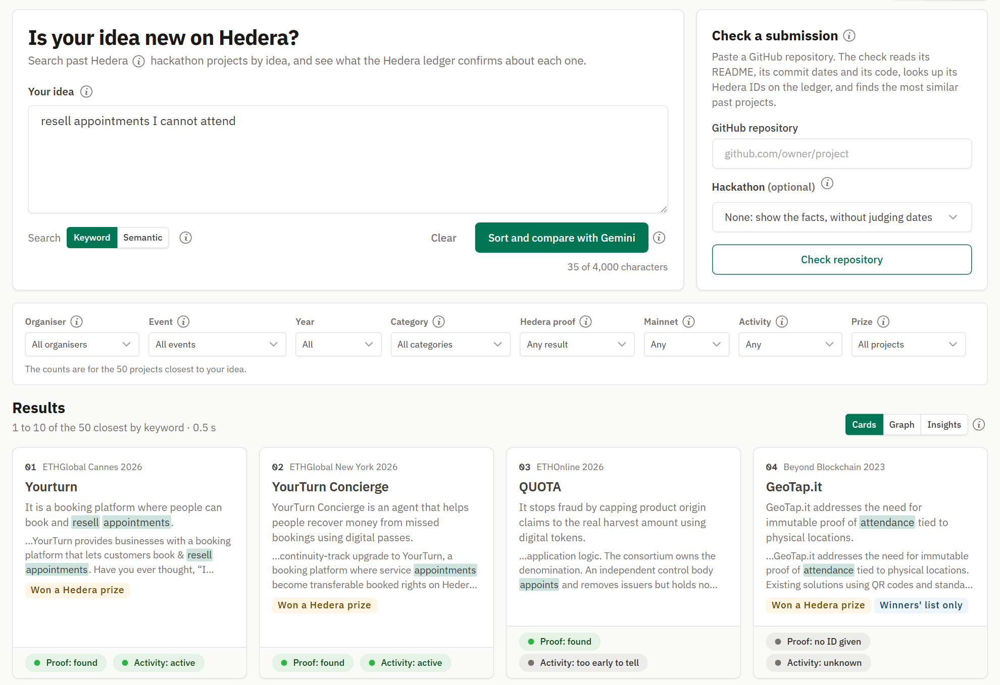
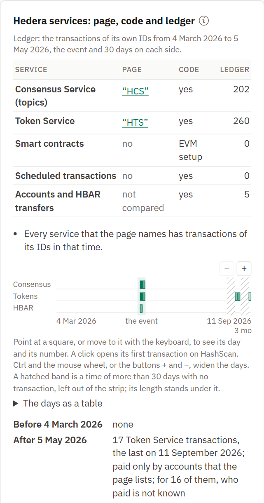
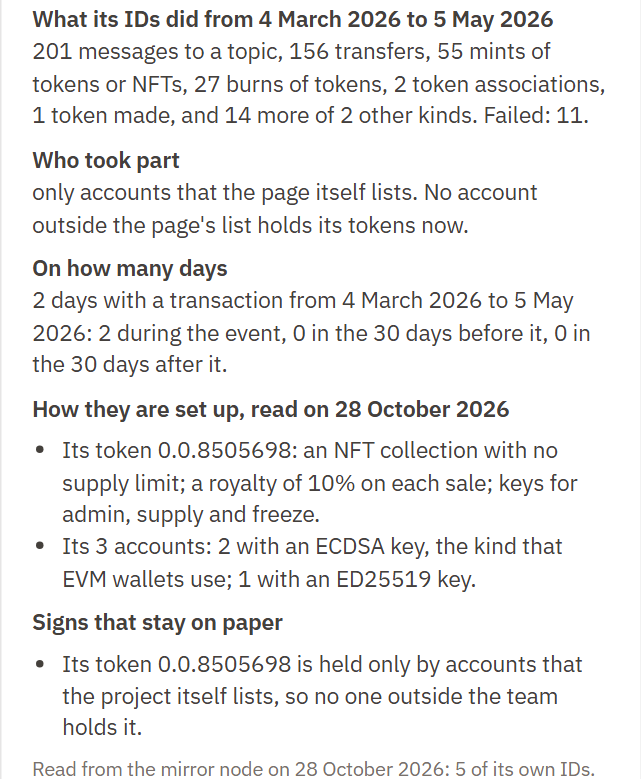
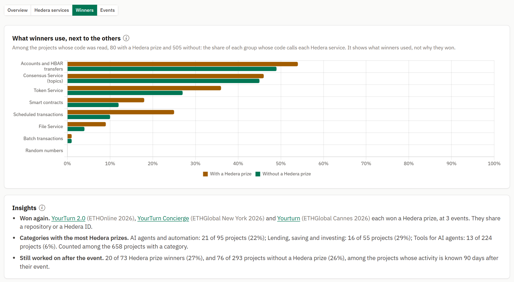
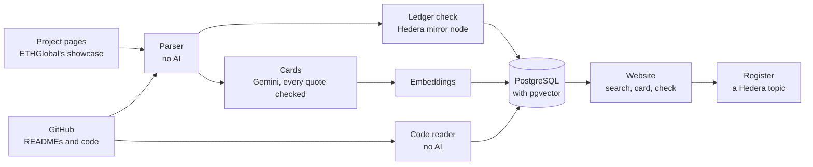

<div align="center">

<picture>
  <source media="(prefers-color-scheme: dark)" srcset="assets/logo-dark.svg">
  
</picture>

# Jevadu

**The past projects of Hedera hackathons, with what the Hedera ledger and the code say about each one.**

[](https://github.com/mohamedyaakoubi/Jevadu/actions/workflows/ci.yml)
[](https://hashscan.io/testnet/topic/0.0.11126502)
[](pyproject.toml)
[](LICENSE)

[What it looks like](#what-it-looks-like) · [How it works](#how-it-works) · [Tech stack](#tech-stack) · [What works today](#what-works-today) · [Run it](#run-it) · [Design](DESIGN.md)

<sub>Jevadu is not affiliated with, sponsored, or endorsed by Hedera Hashgraph, LLC.</sub>

</div>

> [!NOTE]
> **State on 29 October 2026.** Gate A and Gate B passed. Every project of the allowed sources is collected, parsed and checked on the ledger, the cards are written, and the three tests of quality have run. A website runs on one laptop: the search, the card of each project, insights and charts of every list, the check of a submission and the register on Hedera. The register's topic [`0.0.11126502`](https://hashscan.io/testnet/topic/0.0.11126502) on the test network has no admin key, and no registration is written in it yet. See [What works today](#what-works-today).

> [!IMPORTANT]
> **Where the data comes from.** ETHGlobal was asked before any program read its showcase. It agreed in writing to a slow, signed read of its Hedera prize projects, and the other projects that its showcase ties to Hedera are read in exactly the same way. The pages stay on one laptop. Devpost said no, so no program reads Devpost. DoraHacks and AngelHack have not answered yet, so no program reads them.

## Why

Hedera has run at least 12 big hackathons since 2018, with more than 2,100 projects that we could count. They sit on at least five different websites. So:

- builders rebuild old ideas without knowing it;
- a judge cannot tell quickly whether a project is a repeat;
- every team writes "we use Hedera", and nobody can check it quickly;
- nobody knows which past projects are still alive.

## What it does

| For | It answers |
|---|---|
| A builder | Was my idea already built on Hedera? What happened to it? |
| A judge | Is this submission's Hedera proof real? What is close to it? Was it sent before? |
| An organiser | What did our past events produce? |

## What it looks like

**Search an idea.** Type an idea and get the past Hedera projects closest to it. Each one says at once
where it was built, whether it won a prize, whether the Hedera ledger confirms its use of Hedera,
and whether the team kept working after the event.



**One project: what its page claims, what its code calls, what the ledger shows.** On the left,
each Hedera service that the page names, that the code calls and that the project's Hedera IDs
really used, with the days on which they were active. On the right, what those IDs did, who took
part, and what the page does not say: here, no one outside the team holds the project's token.

<p>


</p>

**Across hackathons.** Patterns that no single jury can see: which Hedera services the prize
winners use next to the others, one team that won a Hedera prize at three events with the same
repository, and which categories win most often.



## How it works



1. **Collect.** A program reads the public project pages of past hackathons and saves them, without the part that shows the team members. It does this only where the site's terms allow it or the site said yes in writing.
2. **Parse.** Ordinary code pulls out the name, the links, the Hedera IDs and the titled sections. No AI.
3. **Read.** An LLM gives every project the same structure. Each field it writes carries a label and exact quotes from the page, and code checks every quote.
4. **Check.** The Hedera mirror node says what each ID really is and when it was active. GitHub says when the code was written, and the code itself is read for its Hedera packages, imports and calls. No AI.
5. **Link and search.** The tool finds the past projects closest to an idea and shows the facts side by side.

## Where Hedera is used

| | How |
|---|---|
| **Reading the ledger** | The public ledger is the ground truth for every claim that a project makes about Hedera. Hedera's mirror node, a public server that answers questions about the ledger, says what each ID is, when it was made and when it was last used. Every fact links to HashScan, Hedera's public explorer. |
| **Reading the code** | The code of each project is read for Hedera's SDK packages, the files that import them, and the Hedera services that the code calls. |
| **Writing the register** | A public register on a topic of the Hedera Consensus Service. A team registers a fingerprint of its own submission, after it adds a line that the tool gives to its README, and gets a timestamp that nobody can change. The team can sign it with its own Hedera account, through HashPack or MetaMask: the record then holds the account and its signature, which anybody can check against the account's key on the ledger (design 9.6). If the same fingerprint appears again at another event, the tool says "seen before". The topic is [`0.0.11126502`](https://hashscan.io/testnet/topic/0.0.11126502) on the test network, created on 22 October 2026 with the memo "Jevadu register". |

## What the AI may and may not do

It may read pages, give them structure and find similar ideas. It may not give a score, pick a winner, say that a project is a copy, or state a fact. Facts come from the parser, the code host and the ledger.

## Tech stack

| Part | Built with | Why |
|---|---|---|
| Language | Python 3.11 | One language for the collectors, the pipeline, the tests and the website. |
| Website | FastAPI and Jinja2, with htmx 2.0.11 | The server makes the pages. htmx, a small script, replaces one part of a page at a time, so there is no front-end build. |
| Look | Tabler 1.6.1 on Bootstrap 5, Chart.js 4.5.1, IBM Plex Sans, Atkinson Hyperlegible Mono | A design system with a light and a dark theme, one library for the charts, a font for reading and a font for the IDs. |
| Database | PostgreSQL 17 with pgvector, in Docker | The facts, the texts and the vectors in one place. pgvector stores vectors in PostgreSQL. At this size an exact search needs no index. |
| AI | Gemini 3.1 Pro, Gemini 3.8 Flash and gemini-embedding-2, on Vertex AI, through the Google Gen AI SDK | Gemini 3.1 Pro writes the cards. Gemini 3.8 Flash orders and compares the results of the search, only on a button. The embedding model turns each text into a list of numbers that stands for its meaning, for the semantic search. |
| Hedera | the public mirror node, hiero-sdk-python 0.2.10, HashScan, Hedera's WalletConnect library | The mirror node for every read. The SDK sends the register's messages to the Consensus Service and checks the teams' signatures. HashPack signs through @hashgraph/hedera-wallet-connect 2.1.3, loaded in the page from a CDN; MetaMask signs with EIP-191. HashScan for the links. |
| Sources | ETHGlobal's showcase, GitHub's REST API | The project pages, with ETHGlobal's consent. The READMEs, the facts and the code of the public repositories. |
| Parsing | Beautiful Soup with lxml | Ordinary code reads every page and README. No AI. |
| Quality | pytest, Playwright with axe-core 4.14.0, Ruff, GitHub Actions | The tests, a real browser that also checks accessibility, the lint, and a clean run on every push. |
| Cost | its own meter and budgets | Every model call is counted, and a call that could go over the budget is not made. |

## What works today

### The proofs of Gate A

| Proof | State on 11 October 2026 |
|---|---|
| Database: PostgreSQL with pgvector answers a vector query | **Passed.** 3,000 vectors of 3,072 numbers, the right neighbours first, an exact search in 27 ms. The result file is in `proofs/results/`. |
| Hedera write: a topic with no admin key, a message, read back from the ledger | **Passed** on the real test network. The topic has no admin key and one submit key, a 102-byte record was read back from the mirror node, and a topic with a stranger's submit key refused our message. The result file is in `proofs/results/`. |
| Google models: the two Gemini layers (Gemini 3.1 Pro reads the pages, Gemini 3.8 Flash does the search) and one embedding call | **Passed** on the real service. Both models returned a valid form for one real text, and the embeddings have the right size. The result file is in `proofs/results/`. |
| Lists: the ETHGlobal collector | **Passed** on 11 October 2026. A walk read the 21 pages of the showcase list with the filter "partner: Hedera": 658 projects in 14 events. A run read the page of every one of them and kept all 658, each without its team part: 92 with a Hedera prize, 81 with a prize of another sponsor only, and 485 with no prize. On every page the block "Winner of" agrees with the list. 732 requests were sent to the site in all, out of the 800 that the tool allows itself for it. The result file is in `proofs/results/`. The pages are not in this repository. |

Two more things work, and both were run on the real services:

- **The cost of the models is counted.** Every call to a model leaves one line in a ledger: the model, the tokens, the time, the cost. A budget stops a call before it is made when it could go over the cap. `python -m hackathon_memory.finops report` shows where the money went. The ledger holds numbers only, never the text of a call.
- **The history is searched for secrets.** `python -m hackathon_memory.secret_scan` looks for each secret of `.env` in every commit.

The tests (1,940 of them on 29 October 2026) run before every commit, and again on GitHub at every push, on a clean Ubuntu machine. They do not prove that the services answer as the code expects. That is what the live runs of the proofs are for.

### On the real data

- **The parser.** It reads every saved project page into its facts: the name, the short line, the event, the prizes, the links, the two texts word for word, and the Hedera IDs with their network and kind. It refuses a page whose visible part and data disagree. Words about people that a team wrote into its texts are hidden first (design 5.4).
- **The check on the ledger.** Every Hedera ID is asked of the public mirror node, and the proof rule of design 7.2 says whether the dates fit the event. A single transaction that a page or a README names is judged by its own moment: what the action was, whether it succeeded, and when (design 7.1).
- **The README of the code.** The README of each project's repository is read through GitHub's API, cleaned of the part about the team, and searched for Hedera IDs, which are then checked like the IDs of a page (design 7.3).
- **The facts of the code and the life rule.** The dates of each repository (made, last push) are read through GitHub's API, without anything about the account that owns it. With the activity of the project's own IDs on the ledger, they say whether a project is active, quiet, stopped or too early to tell. Only a change later than 30 days after the event counts as a sign of life, and each date says when it was read (design 7.4).
- **Read again as things change.** A repository and the Hedera IDs of a project change after their event, so GitHub's answers (the facts, the README, the newest commit) and the facts of the ledger are asked again once they are a day old: `python -m hackathon_memory.pipeline refresh`, and the same work in the background while the website runs. A request asked again carries the ETag of the last answer, so GitHub answers "not modified" when nothing changed, which does not count against its hourly limit; nothing saved is replaced, and the newest answer is the one used. The code is read again when its newest commit changes, and a history of the ledger is read on from its newest transaction (design 7.3). The pages of the hackathon sites are never read again: a page is asked for once (design 5.7).
- **Hedera in the code.** The code of each repository is read whole from the archive of its default branch, and again when its newest commit changes, which GitHub's API gives; the archive is read on the computer of the tool and not kept. Plain text matching finds the Hedera packages that the package files name, the files that import a Hedera library, the Hedera services that the code calls (by the class names of Hedera's SDKs), other signs such as Hedera's JSON-RPC relay, a Hedera chain ID, a Hedera network of an EVM tool, the system contracts or the mirror node, and the files that only name Hedera. Folders of other people's code are skipped, and .env files are never opened. Only what was found is kept, with the commit that was read, so every file opens on GitHub as it was read. It shows what the code names, not whether it runs (design 7.3). On 21 October 2026 the code of 579 repositories was read: of the 658 projects with a full card, the code of 508 shows a use of Hedera, 23 only name it and 50 show nothing, and of the 392 projects that name no Hedera ID, the code of 259 shows a use of Hedera (`evals/results/20261022T094650Z-code-findings.json`, counted again on 22 October 2026, after example numbers stopped counting as IDs). A reading took 3.45 seconds at the median and under 17.7 seconds for 95 of 100 (`evals/results/20261021T190159Z-code-times.json`).
- **The Hedera IDs of the code.** The code also names Hedera IDs, many of them not the team's own, such as a public token. The check gives a project an ID of its code only when no page, no README and no other repository names it, the ledger finds it, and it was made during the project's event; the card marks it "found in the code" with its file (design 7.3). On 24 October 2026 every archive was read again for its IDs: 1,024 IDs went to 224 projects, and the projects with a proof went from 257 to 355 (`evals/results/20261024T014307Z-overview.json`, before, and `evals/results/20261024T024048Z-overview.json`, after). The tool cannot tell whose an ID is: a copy of somebody else's code kept in a repository can hold one; the file is shown with every ID of the code.
- **The search, as a plain listing.** Each project is embedded with Google's embedding model. An idea is searched by meaning and by words, and the two lists are merged. Each result shows its facts and what the mirror node said about its IDs (design 8.2).
- **One command for the whole path**, and the proof of Gate B that runs it from an empty database, searches ideas written blind, and leaves the results to be marked on a scale of three: yes, n/a or no.
- **The cards.** Gemini 3.1 Pro reads a page and writes seven fields: what the project does, how it works, for whom, its Hedera services, its category, its problem and its solution. Each field carries a label and quotes, and a field whose quotes are not found on the page is dropped (design 6.3). Every one of the 658 full pages has its card (16 October 2026): 8,909 of the 8,931 quotes that the model gave were found word for word in their page, and 4 fields were dropped (`evals/results/20261018T050534Z-overview.json`). The 168 projects known only from organisers' lists of winners have none.
- **The history of each Hedera ID.** The step `history` reads, from the mirror node, every event of each project's own Hedera IDs, with its Hedera service, at most 2,000 for one ID (design 7.1). Since 25 October 2026 each event also keeps what it was: its kind as the mirror node names it, whether it succeeded, the account that paid for it, and the accounts that took part; a token also keeps the accounts that hold it now (design 7.5). A first measure, with its rules written before the reading (design 13.8), found that for 135 of 254 projects (53.1%, range 46.9% to 59.1%) these histories show a fact that the card hides today: mostly a service that the page names and none of its IDs shows, or one that the IDs show and the page never names (`evals/ledger_story/report-2026-10.md`). The card of each project now shows these facts (below).

### The three tests of quality

| Test | What it checks | Result | Pass marks | Report |
|---|---|---|---|---|
| **Test 1**, the fields of the model (design 13.2) | 60 pages, each card graded field by field against its page | In the second run, with the list of 17 categories: no field graded wrong, 98.5% fully right, 99.5% of the labels right | **All four met** | [report](evals/test1/report-gemini-3.1-pro.md) |
| **Test 2**, the search (design 13.3) | Whether the known similar projects are in the first 10 results | 34 of 57 (59.7%) | 80%, **not met** | [report](evals/test2/report-2026-10.md) |
| **Test 3**, the Hedera IDs (design 13.4) | 50 pages and their READMEs, against every ID written down by a second reader | Found 163 of 163 (100%), the same status for 94.5%, 1 of 164 counted as the project's when it is not (0.6%) | 95%, 90%, at most 2%: **all met** | [report](evals/test3/report-2026-10.md) |

- **Test 2.** Most misses are tools for AI agents, a theme with many projects close to each other. The result above is the first run, on 14 October 2026. Measured again with Gemini's order on the same cases: 42 of 57 (73.7%) on 24 October 2026 (`evals/results/20261024T051625Z-search-fallback.json`), still under the mark of 80%.
- **Test 3.** The second reader is a language model that is not part of the tool, and each ID was checked against the mirror node. The one ID counted wrongly is a number of a local test network. The first run, on 18 October 2026, counted 22 of 178 (12.4%). Three changes of the reader on 22 October brought it to 8 of 164 (4.9%), and 7 of those 8 were scheduled transactions, a kind of Hedera ID that the first guideline did not list. The maintainer then added schedules to the guideline, after that run, so the report gives both results.

### The website

`python -m hackathon_memory.web` serves it at http://127.0.0.1:8000, for this computer only (design 12.1). Everything happens on one page.

- **The search.** While an idea is typed, keyword results appear at once, or semantic results at one click, as a grid of ten projects with numbered pages; no model writes anything for them. One button asks Gemini 3.8 Flash to sort the 30 closest and to say, for each of the first ten, what it shares with the idea and how it differs (design 8.2 and 8.3). Its answers are kept for one day, so a reload or the back button never asks again; for the three example ideas under the box, they are kept for good. When Gemini gives no order, the page says whether it was late or failed; after five failures in a row, DeepSeek V4.1 Flash, an open model that Google serves on Vertex AI, orders and compares in its place for ten minutes, without thinking, and the page names it. On the counted cases of Test 2 it put 40 of 57 known projects in the first ten, against 42 for Gemini and 36 for the order of meaning alone, in 1.6 seconds in the middle (`evals/results/20261024T051625Z-search-fallback.json`).
- **The card of a project** opens in a window over the list, with buttons at its head for the project page, its code and its live demo, and names the projects that it is linked to by the same repository or the same Hedera ID. When the project has Hedera IDs of its own, the card sets each Hedera service side by side as its page names it, as its code calls it, and as the transactions of its IDs show it around the event, with sentences made by code that say what stands out and what happened before and after (design 7.5). Its proof mark leads to "On the ledger", which opens with the window of the event and says for each ID why it counts or not, and its activity mark to the line of the activity under the code, with the dates behind it, the day each was read, and the rule, all in sentences made by code. A block at the top right says when its sources were last read and what the newest reading found, whoever made it; its button "Read again now" reads GitHub, the code and the ledger again for that project at once, shows each step, then says what changed or that nothing did.
- **Depth of use.** In the same card, under the table of the services, a strip of days shows when the project's own IDs were active, each service on a row, each square a day that opens its first transaction on HashScan; Ctrl and the mouse wheel, or its small buttons + and −, widen the days. It also draws the days of the project's own things long before and after the event, and cuts out a time of more than 30 days with no transaction as a hatched band with its length, so the event stays in view even when nothing happened in it. Then, in sentences made by code: what its IDs did (the kinds of transaction in plain words, and how many failed), who took part (how many accounts that the page does not list took part, which can be outside users or other accounts of the team, and who holds its tokens now), on how many days, the signs that stay on paper (a topic with no message, a token held only by the project's own accounts, a contract never called, accounts that only moved HBAR, a Hedera package that nothing calls, IDs that other projects list too). No score: a judge weighs the facts (design 7.5). The check of a submission shows the same for its README's IDs. Measured on 28 October 2026 (`evals/results/20261028T142124Z-depth.json`, design 13.9): of the 457 projects with a depth of use, 355 had transactions of their own IDs around their event, 222 of them on 3 days or more, and 92 show a sign that stays on paper, such as a contract never called after its deployment (27). A second counting by a plain reading of the mirror node, apart from the tool's code, gave the same numbers for all 20 projects it drew. The same card says how the own IDs are set up (a token's kind, supply, custom fees and keys; who may write to a topic; the kind of key of an account), counts the calls of the own contracts that reached Hedera's system contracts beside the transactions of the service they reached, and a project whose team put an own ID on the main network carries the tag "Mainnet". Measured the same night (`evals/results/20261028T172705Z-depth.json`): 293 of the 457 projects say how their own IDs are set up, 21 of them with a token that has custom fees; the contracts of 24 reached a system contract, 18 of them the Token Service; 5 carry the tag "Mainnet". All three are read again with the rest ("Read again now", the step `refresh`).
- **Filters, graph and insights.** Filters narrow the list by organiser, event, year, category, Hedera proof, the main network (the tag "Mainnet"), activity after the event and prize (a Hedera prize, another sponsor's prize, or the winners' list only). The switch "Graph" shows the same list as dots in up to four groups by meaning, found by Ward's method on the embeddings with no threshold, each named after its most central project. The groups are regions of the map, not categories that the data proves: measured on 853 lists like those the graph draws, the projects form no clearly separate groups, with a silhouette of about 0.04 on average and at most 0.17, where even a weak structure needs more than 0.25 (`evals/results/20261031T104649Z-graph-groups.json`). Around an idea, each project stands as far from it as it is far in meaning, and with no search and no filter the graph holds the whole collection (design 8.6). A click on a dot keeps its dashed line to its closest project, Ctrl and the wheel zoom the graph, the name of a group opens the card of its project, and each group says how many of its projects won a Hedera prize and how many have a Hedera proof. The view chosen stays when the idea or the filters change, and long lists show ten lines at a time. The switch "Insights" shows the same list as charts in four tabs (Overview, Hedera services, Winners, Events), counted from the tables, with a few facts in sentences and the projects linked across events first.
- **Help in place.** Each term has an (i) that explains it, with numbered sources, Hedera's documentation first. The windows "How it works", "Common questions" and "Sources and references" open from the bottom of the page. A switch at the top right chooses a light or a dark theme, or follows the computer, and a request that fails says so in plain words.
- **The check of a submission.** A box beside the idea checks one submission from its GitHub link and, if wanted, its hackathon, from a list with the hackathons running now first and the past ones grouped by year (design 12.1, S3). The tool is a memory of past hackathons, not a live view, so without a hackathon it shows each fact with its own date and judges none. GitHub is asked for the dates of the code, the README and the newest commit, and the code is read for Hedera unless it was read before (up to 50 MB and 30 seconds; a larger archive is shown in part); the Hedera IDs of the README are checked on the mirror node; and the page shows the proof, the life of the code, the projects of the collection with the same code or the same ID, and the closest past projects by meaning, each of which opens in the same window. No model writes anything, except on the button "Compare these 5 with Gemini", which writes what each close project shares with the submission and how it differs.
- **The register.** The team can then write its submission to the public register on Hedera's test network (design 9.2), from the box at the head of the check, for a hackathon of the list (when the collection already keeps the same code, the box offers that project's hackathon), once its README carries the line that the page gives: only who can change the repository can add it. One record of fingerprints and the commit ID only, read back from the mirror node, with its number, its time and a link to HashScan. Before the button, the team can sign the text of the record with its own wallet: HashPack through Hedera's WalletConnect library, or MetaMask for an account with an ECDSA key. The site checks the signature against the account's key on the mirror node and the commit against the latest one, then writes a record that holds the account and the signature; the site's account still pays (design 9.6). A repository can be registered for several hackathons: its README carries one line for each, and each press looks only for the line of its hackathon. Started with `--rehearsal`, the website writes to a second topic made for rehearsals, and a band at the top of every page says so (design 9.3).

It is not online, and its screens have not passed their two reviews yet.

### Not done yet

A first registration in the register (it needs a team's public repository that carries its line in the README), and the other facts of the code (the number of changes, the contributors).

## What already exists

Solana's hackathon organiser built this idea for Solana: [Colosseum Copilot](https://github.com/colosseumorg/colosseum-copilot). It runs inside a builder's coding agent, on the submissions of Colosseum's own hackathons, and its own page says its records show "what teams submitted, not what they run today".

Two hackathon projects search past projects too. [ETHSearch](https://github.com/pauldev20/ethglobalsearch) searches the projects of ETHGlobal's showcase by text and by meaning. [HackathAttest Agent](https://github.com/TheSoftwareDevGuild/the-guild-attestation-intelligent-agent), from ETHOnline 2025, answers questions about past hackathon projects from attestations on Arbitrum.

We found nothing like this for Hedera. Jevadu keeps the projects tied to Hedera, and adds what the ledger and the code say about each one.

Many tools score hackathon submissions with AI. DoraHacks' Hackathon AI, for example, gives each submission a score and feedback against the organiser's criteria, can approve every submission that reaches a score the organiser sets, and ranks the approved projects of each track, with its reasons, as a guide for the human judges ([its own article](https://dorahacks.io/blog/guides/hackathon-ai/)). Jevadu does not score: it puts the facts side by side, and people judge.

## Run it

You need Python 3.11, Git and Docker Desktop. On Windows:

```text
python -m venv .venv
.venv\Scripts\python -m pip install -c constraints.txt -e ".[dev]"
copy .env.example .env        (only if you have no .env yet; do not copy over an existing one)
docker compose up -d --wait db
.venv\Scripts\python -m hackathon_memory.db migrate
.venv\Scripts\python -m pytest
.venv\Scripts\python -m hackathon_memory.setup_check
```

On Linux or macOS, use `.venv/bin/python` and `cp`. Fill `.env` with your own values: it is never committed. Put a password of your choice in `POSTGRES_PASSWORD`; it only protects your own copy of the database. The database keeps the password it was first created with: if you change it later, run `docker compose down -v` once (this deletes the local database) and start it again.

`setup_check` says which of the setup steps below are done and what blocks each proof. It prints no value.

### The setup steps

The steps have the numbers that `setup_check` prints. Each value goes into `.env`, and nowhere else.

| Step | What | Where it comes from |
|---|---|---|
| 1 | `HEDERA_OPERATOR_ID`, `HEDERA_OPERATOR_KEY` | A free test account at [portal.hedera.com](https://portal.hedera.com). Copy the account ID and the private key in the DER form (a long text that starts with `30`). The tool writes to the test network only. |
| 2 | `GITHUB_TOKEN` | GitHub, Settings, Developer settings, Personal access tokens, Fine-grained tokens. Choose "Public repositories (read-only)" and add no permission. It is used to read facts about public repositories. To let the tool read the READMEs, also set `COLLECT_GITHUB=on`. |
| 3 | `GOOGLE_CLOUD_PROJECT`, `GOOGLE_CLOUD_LOCATION`, `GOOGLE_APPLICATION_CREDENTIALS` | A Google Cloud project with the Vertex AI API turned on. The location is `global`. Sign in with `gcloud auth application-default login`. If you name a sign-in file, keep it outside the project folder. |
| 3 | `GOOGLE_FEDERATION_AUDIENCE`, `GOOGLE_FEDERATION_ACCOUNT` | Only on the public copy's host: its sign-in to Google with no key, by Workload Identity Federation with the token that Vercel gives each request. `python -m hackathon_memory.llm.account switch` sets them there. |
| 4 | `POSTGRES_PASSWORD` | Any password you choose. Then `docker compose up -d --wait db`. |
| optional | `PUBLIC_SALT` | Any random text of 32 characters or more. The public copy needs it to count each visitor by a salted hash of their address and browser name, never by the address itself. |
| optional | `PUBLIC_DATABASE_URL` | The database of the public copy on its host (Neon), seen from this computer: `python -m hackathon_memory.web.switch` writes the copy's switches there. |
| optional | `PUBLIC_COSTS_DATABASE_URL` | The public copy's database, for a role that may only read the spending, the visitors' uses and the switches (the SQL is at the top of `finops/watch.py`). The watch below reads it, and so does the job `costs` of GitHub Actions, where it is a secret of the repository. |
| optional | `VERCEL_TOKEN` | A token of Vercel, for the public copy's project there: the switch of the Google account moves the copy too. |
| optional | `PUBLIC_ADDRESS_HEADER` | The header in which the public copy's host writes the visitor's address itself: `cf-connecting-ip` through the Cloudflare tunnel (the default), `x-vercel-forwarded-for` on Vercel, which `web/vercel_app.py` sets. |
| optional | `PUBLIC_OWNER_GITHUB` | The GitHub account of the public copy's owner. Signed in with GitHub on the unlisted page `/owner` (it needs the GitHub App), its browser checks, reads again and registers with no count, for 90 days; Gemini's allowance and the budget still hold. Not a secret. |
| optional | `PUBLIC_AI_PER_VISITOR` | How many times one visitor of the public copy may ask Gemini, one time only: 12 by default, so that about 300 visitors who use them all stay within its budget of 30 dollars. |
| optional | `TURNSTILE_SITE_KEY`, `TURNSTILE_SECRET_KEY` | The two keys of a Turnstile widget at [dash.cloudflare.com](https://dash.cloudflare.com) (Turnstile, Add widget, mode Managed), with the public copy's domains. With both set, a visitor of the public copy confirms being a person before the copy uses Gemini, GitHub or Hedera for them; most visitors never see the check. The search by meaning never waits for it. |
| optional | `CLOUDFLARE_API_TOKEN`, `CLOUDFLARE_ACCOUNT_ID` | For the public copy only: a Cloudflare API token with two permissions, Account > Cloudflare Tunnel > Edit and Zone > DNS > Edit for the zone of `PUBLIC_HOST`, and the account's ID. `tunnel setup` then writes `CLOUDFLARE_TUNNEL_TOKEN`. |
| optional | `GITHUB_APP_SLUG`, `GITHUB_APP_CLIENT_ID`, `GITHUB_APP_CLIENT_SECRET` | A GitHub App of your own, made once with GitHub's manifest flow, public, with the permission Contents: Read and write, the callback URL `https://YOUR-HOST/github/callback` and the setup URL `https://YOUR-HOST/github/installed`. With it, the box of the register offers "Add it for me with GitHub": the person signs in with GitHub, and the line goes into the README as a commit of theirs. The site keeps no token. |
| optional | `WALLETCONNECT_PROJECT_ID` | A free project at [cloud.reown.com](https://cloud.reown.com) (Reown makes WalletConnect). It lets a team sign its registration with a Hedera wallet such as HashPack; without it, only an EVM wallet such as MetaMask can sign. It is not a secret: every page that connects a wallet shows it. |
| 8 | `COLLECTOR_NAME`, `COLLECTOR_CONTACT_EMAIL` | A name for the tool and your own address. Both are sent in every request to a site, so that the site can see who reads it. Only needed to run a collector. |
| 9 | Project pages seen by hand | `data/by-hand/ethglobal.com/project-pages.txt`, one showcase address per line: projects that you saw yourself with "Winner of" and a line that starts with "Hedera". One is enough. The showcase list names a sponsor only by an id, and these pages tell the tool which id is Hedera. Only needed to run the ETHGlobal collector, and only with a written yes from the site. |

### The commands

<details>
<summary><b>All the commands</b>, from the proofs to the website</summary>

| Command | What it does |
|---|---|
| `python -m proofs.database` | Proof 1, on the local database |
| `python -m proofs.hedera_write` | Proof 2, on the Hedera test network |
| `python -m proofs.google_models` | Proof 3, on Google's models (it costs a few cents) |
| `python -m proofs.lists` | Proof 4, on what the walk and the run left on disk. It sends no request: it checks that the rules for reading the site were kept. |
| `python -m hackathon_memory.collect ethglobal --plan` | Shows what the collector would read. It sends no request. |
| `python -m hackathon_memory.collect ethglobal --look` | Reads robots.txt and the first page of the hand-made list, and saves no page |
| `python -m hackathon_memory.collect ethglobal --find` | Walks through the showcase list with the filter "partner: Hedera" and writes down every project of it, with the sponsors of its prizes. It saves no page. `--pages 5` reads five pages of the list and can be started again. |
| `python -m hackathon_memory.collect ethglobal` | The run. It reads the page of every project that the walk found, and saves each one without its team part. `--pages 3` asks for three new pages, so the first saved pages can be looked at before the rest is read. `--pause 10` leaves ten seconds between two requests. `--wait` lets the run wait for the end of a cooldown by itself. |
| `python -m hackathon_memory.pipeline parse` | Reads every saved project page into the database. It sends no request, and a page that was read before by the same parser is passed over. |
| `python -m hackathon_memory.pipeline readmes` | Asks GitHub for the README of every project's code that is not saved yet, then reads every saved README for Hedera IDs. `--repos 5` asks for at most five new ones, `--no-requests` sends nothing, `--wait` waits for the end of a cooldown. |
| `python -m hackathon_memory.pipeline code` | Asks GitHub for the facts of every repository that are not saved yet (the same options as `readmes`), then writes them. |
| `python -m hackathon_memory.pipeline hedera_code` | Reads the code of every repository that was not read yet, whole, from its archive (two requests each, the same options as `readmes`), and writes what it says about Hedera. A repository that GitHub already said is gone is not asked for. |
| `python -m hackathon_memory.pipeline check` | Asks the Hedera mirror node about every ID and applies the proof rule. An answer is used again for seven days. |
| `python -m hackathon_memory.pipeline history` | Reads, from the mirror node, every event of each project's own Hedera IDs, with its Hedera service and what it was. A second run reads only the IDs not read yet; `--again` also reads, once, those read before each event kept what it was. `--limit N` reads at most N. It is not part of `all`. |
| `python -m hackathon_memory.pipeline makers` | Keeps, for each project's own contract, topic, token and schedule, the account that paid for its creation: from its history when that holds it, or from one question to the mirror node. Each thing is asked once; `--limit N` asks the node at most N times. It is not part of `all`. |
| `python -m hackathon_memory.pipeline refresh` | Asks GitHub and the ledger again about what is a day old (`--hours N` for another age), with the ETag of the last answer, reads the code of a new commit and the new transactions of each history, and writes what changed. `--repos N` sends at most N requests of each kind; `--wait` waits for the end of a cooldown. |
| `python -m hackathon_memory.web --public --port 8020` | The public copy (design 12.5): no page is indexed, the AI and registering stay off until turned on, it spends from a budget of its own, each visitor has an allowance, one time only, and with the keys of Turnstile a visitor confirms being a person before Gemini, GitHub or Hedera. A Cloudflare tunnel brings it to its address; nothing of the collection leaves the computer. |
| `python -m hackathon_memory.web.tunnel setup` | Once: makes the Cloudflare tunnel "jevadu", its route to the public copy and its name (`PUBLIC_HOST`), with `CLOUDFLARE_API_TOKEN` and `CLOUDFLARE_ACCOUNT_ID`, and keeps the tunnel's own token in `.env`. A name that already points elsewhere is never replaced. |
| `python -m hackathon_memory.web.tunnel run` | Starts the public copy and the tunnel together; Ctrl+C stops both. Nothing of the collection leaves the computer. |
| `npx vercel@64.2.0 deploy --prod --archive=tgz` | Puts the public copy on Vercel, with `VERCEL_TOKEN`, `VERCEL_ORG_ID` and `VERCEL_PROJECT_ID` in the environment; Vercel loads `jevadu.py` (`[tool.vercel]` in `pyproject.toml`) and receives only what `.vercelignore` names. Its settings are the project's variables on Vercel, never `.env`. `/health` then says whether it reaches its database and Google. |
| `python -m hackathon_memory.web.switch ai on` | Turns a part of the public copy on or off (`ai`, `register`); with no argument, it says what is on, what the public copy spent of its own budget, and what its visitors used. |
| `python -m hackathon_memory.hedera.registry open --rehearsal` | Makes a second topic, with the same keys as the register, for rehearsals of a registration; `python -m hackathon_memory.web --rehearsal` then writes to it. |
| `python -m hackathon_memory.pipeline embed` | Makes the embedding of every project whose text changed. It costs money, through the meter and its budget. |
| `python -m hackathon_memory.pipeline all` | The six steps above, in order. |
| `python -m evals.sets draw` | Draws, once, the 15 pages for writing the instructions of the LLM and the 60 pages of Test 1, from six fixed groups (design 13.2). A set is never drawn again. |
| `python -m hackathon_memory.pipeline cards --set evals/sets/tuning.json` | Makes the card of every page of a set with Gemini, and checks every quote against the page (design 6.3). It costs money, through the meter and its budget; a card whose text did not change costs nothing. `--limit N` makes at most N cards. |
| `python -m hackathon_memory.pipeline cards --export FILE` | Writes every card to a file, with the address of its page. The file holds the model's answers with quotes of the pages, so it belongs in the `data` folder, out of git. |
| `python -m hackathon_memory.pipeline cards --restore FILE` | Puts the cards of such a file back into a database built again: a card comes back only when the text that the model read is the same, and its quotes are checked again. No model is called. |
| `python -m evals.depth --check 20` | Counts the depth of use over the collection, and counts it a second time for 20 projects by a plain reading of the mirror node, into a dated file of `evals/results` (design 13.9). |
| `python -m evals.ledger_days` | Counts on how many days the own IDs of each project were active around its event (design 7.5). |
| `python -m evals.code_times` | Counts how long the readings of the code took and how large the archives were, into a dated file of `evals/results`. It sends no request. |
| `python -m evals.rebuild <database in use> <new database>` | Counts the same things in the database in use and in one built again from the saved pages (its steps are written at the top of `evals/rebuild.py`), into a dated file of `evals/results`. |
| `python -m evals.cards_report evals/sets/test1.json` | Counts the cards of a set in numbers only (quotes found, labels, lengths, categories, cost) into a dated file of `evals/results`. |
| `python -m evals.test1.sheet` | Writes, once, the review sheet of Test 1 into `data/evals/test1`: each page next to its card, to be graded as `evals/test1/guideline.md` says. Open `sheet.html` there in a browser. `--name test1-card-form-2` writes the sheet of another run into its own folder. |
| `python -m evals.test1.report` | The numbers of Test 1, from the grades, into a dated file of `evals/results`. `--name` reads the sheet of another run. |
| `python -m evals.test2.ideas draw` | Writes, once, the list of projects for which the maintainer writes ideas in their own words (Test 2). `check` counts the written ideas. |
| `python -m evals.test2.run` | Test 2, the search test, into a dated file of `evals/results`. |
| `python -m evals.sets draw-test3` | Draws, once, the 50 pages of Test 3 from three groups: an ID on the page, an ID in the README only, and none found (design 13.4). |
| `python -m evals.test3.sheet` | Writes, once, the sheet of Test 3 into `data/evals/test3`: each page and its README, with every string shaped like an ID, to be checked by hand as `evals/test3/guideline.md` says. |
| `python -m evals.test3.run` | The numbers of Test 3, from the hand answers and the tool's tables, into a dated file of `evals/results`. |
| `python -m evals.search_modes` | Six ways to search on the cases of Test 2: the known projects found, the time and the cost of each, in numbers only. `--typos` puts two typing errors in each idea. |
| `python -m evals.compare_levels data/evals/test2/ideas.txt` | How long the comparison under the results takes at each thinking level, and what it costs, in numbers only. `--show` prints the sentences on the screen. |
| `python -m evals.ledger_story.run` | The first measure of the ledger story (`evals/ledger_story/guideline.md`): how often the history of the IDs shows a fact that the card hid, and, apart from it, how many cards now show each fact, into a dated file of `evals/results`. In numbers only. |
| `python -m evals.overview` | The counts of the charts of the website, for each event, into a dated file: projects by prize, by Hedera proof, by life, by the kinds of Hedera ID the ledger confirms, and by theme, the projects linked across events, and the cards with the quotes found in their page. In numbers only. |
| `python -m hackathon_memory.hedera.registry open` | Creates, once, the topic of the public register on the test network, with no admin key and the tool's key as its submit key, and checks both keys on the mirror node. Then put the topic's ID in `.env` as `HEDERA_TOPIC_ID`. |
| `python -m hackathon_memory.web` | The website, at http://127.0.0.1:8000, on this computer only. `--port` picks another port. |
| `python -m hackathon_memory.search "an idea"` | The closest projects to an idea, as a plain listing with the facts of each one. `--numbers-only` shows no name or link. |
| `python -m proofs.gate_b` | Gate B, part 1: a new empty database, the whole path with one command, and the first 10 results of each idea of `data/by-hand/gate-b-questions.txt`, written to `data/by-hand/gate-b-results.txt` to be marked. |
| `python -m proofs.gate_b --questions Q --results R` | Gate B, part 1, for the ideas of another file of `data/by-hand`. |
| `python -m proofs.gate_b --marks R1 R2` | Gate B, part 2: reads the marks of one or more results files. An idea that expects close projects needs at least one result marked "yes"; an idea that says `expect: none` needs only its marks. |
| `python -m hackathon_memory.finops report` | Where the money for the models went, and what one project page costs |
| `python -m hackathon_memory.llm.account switch` | Switches the Google account of the models in one step: one sign-in in a browser for gcloud and for this computer's models; in that account's project, a service account that may only call Vertex AI, made once; the project in `.env`, and a free call that proves it. With `VERCEL_TOKEN` in `.env`, the public copy on Vercel follows: the trust that lets it act as that service account with no key (Workload Identity Federation), its settings, a new deployment and its `/health`. `--project ID` when the account sees several projects; `--no-vercel` for this computer only. |
| `python -m hackathon_memory.finops budget` | Where the three budgets stand: the test work, the tool in use and the public copy |
| `python -m hackathon_memory.finops.watch` | Where the public copy's own budget stands and what its visitors used, read from its database; it fails once 80% of a cap is spent. The job `costs` of GitHub Actions runs it four times a day and mails a failure; the meter stops the spending at the caps by itself. |
| `python -m hackathon_memory.finops prices` | The prices in use, with the day each one begins |
| `python -m hackathon_memory.finops reconcile --billed 1.23` | Our own count against the amount on Google's bill |
| `python -m hackathon_memory.secret_scan` | Looks for the secrets of `.env` in every commit. It prints names, never values. |

Each proof writes a dated result file to `proofs/results/`.

</details>

## Design rules

The code and the tests point to these rules by number, for example "design rule 9". The numbers that are missing are about how the work is organised, not about the tool.

| # | Rule |
|---|---|
| 1 | The AI never gives a score, never ranks quality, never picks a winner, and never says that a project is a copy. It shows facts side by side, and people judge. |
| 2 | Facts never come from the LLM. IDs, links, dates, counts and statuses come only from the parser, the code host or the ledger. |
| 3 | Every field written by the LLM carries a label (stated, inferred or not found) and exact quotes from the page. Code checks every quote against the saved page. A field with no checked quote is dropped. |
| 4 | Parser first. A titled section is copied word for word, and the LLM is never asked to rewrite it. |
| 5 | A saved page is never edited afterwards. Before it is saved, the part that shows team members is cut out, and the page is written again by the parser: the text, the links and the order of the tags stay the same. One exception: personal data that is found in a saved page later is taken out, and the reason and the old fingerprint are written next to the page. |
| 6 | No number is shown unless it comes from a test with a dated result file. A model never grades its own work. |
| 7 | All LLM calls use Gemini on Vertex AI: Gemini 3.1 Pro reads and rewrites the pages, Gemini 3.8 Flash does the search. Embeddings use Google's embedding model. |
| 8 | Only a fixed fingerprint record goes to the Hedera topic. No free text, no names, no secrets. A message on a topic can never be deleted. |
| 9 | Secrets live only in `.env`. They never appear in git, in a log, in the database or in a test file. |
| 10 | The terms of a site are read before the first request to it. Requests go one at a time, with a pause, with the name of the tool and a contact address. A block is never worked around, and the tool never signs in. |
| 11 | No personal data that the check does not need: no names, emails or photos of team members. A handle, an email address or a link to a profile that a team wrote inside its own text is hidden before the text is stored. |
| 17 | No collector runs against a live site before the maintainer has said yes for that site and for the pages that will be read. |
| 18 | The way a site is read is fixed in the code, and each rule has a test. |

Comments in the code also name sections of the design, for example "design 5.7". The design is in [`DESIGN.md`](DESIGN.md), with the same section numbers. The most cited section is repeated below.

### How a site is read (design 5.7)

These rules are code, each with a test. ETHGlobal was asked before any program read its showcase. It agreed in writing to a slow, signed read of its Hedera prize projects, and the other projects that its showcase ties to Hedera are read in exactly the same way.

| The rule | What the code does |
|---|---|
| Only named pages | A walk reads one list of the showcase: the one with the filter "partner: Hedera". A run reads robots.txt and the pages of the projects on that list. No page of the list is saved. Every other address is refused before a request is sent. |
| A limit of requests | A fixed limit for each site: 800 for ETHGlobal's showcase. Every request is counted in one file, so the limit holds for all commands and all days together. |
| One time | A second run skips every page that is already saved, and every page that an earlier run read and did not keep. |
| One request at a time | One worker, a pause of two seconds, nothing in parallel. |
| Each request says who sends it | The name of the tool and a contact address are in every request. The collector refuses to start when one is empty. |
| No names, photos or profiles of team members | The team part is cut out before a page is saved. If a page shows a person where none is expected, the run stops. |
| Too many requests | When the site answers 429, "too many requests", the run stops at once. The tool sends nothing for one hour, or longer if the site names a longer time, and then it goes on five times slower. A third 429 within a day is taken for a no. |
| A no of the site | An answer of 401, 403 or 451, or a bot check, stops everything for that site. Nothing is worked around, and nothing is sent again until a person has decided how to go on. |
| It stops at once when asked | One switch for each site in `.env`, read again before every request. It is there for a stop order from the people who run the site. |
| The pages stay on one laptop | The data folder never enters git, and no text of a collected page is in a test file or a result file. |

## The event

This is an entry for the FSS Campus Edition of the Hedera Cross Campus Challenge 2026. It is built by one person, Mohamed Yaakoubi.

The line below lets this repository be registered for that event in the tool's own public register on Hedera. Only someone who can change the repository can add it, so it shows that the registration is the maintainer's own:

`jevadu: 5PZVM227`

## Licence and credits

Copyright 2026 Mohamed Yaakoubi.

The code and the documents of this repository are under the Apache License, Version 2.0, with its text unchanged. The full text is in [`LICENSE`](LICENSE), and the credit that travels with the code is in [`NOTICE`](NOTICE).

**If you copy or change Jevadu and share it,** the licence asks four things (its section 4): give a copy of the licence, mark the files that you changed, keep the copyright notices, and keep the credit of `NOTICE` in your copy. The licence gives no right to use the name Jevadu for another product (its section 6), so a changed copy should take a name of its own; it may say that it is based on Jevadu.

**Please credit the work you build on,** as Jevadu credits the work below. A line such as "Based on Jevadu by Mohamed Yaakoubi", with a link to this repository, is enough. GitHub's button "Cite this repository" gives a citation, from [`CITATION.cff`](CITATION.cff).

**Jevadu is built on the work of others:**

- htmx (0BSD), Tabler (MIT, built on Bootstrap, MIT), Chart.js (MIT), and the fonts IBM Plex Sans and Atkinson Hyperlegible Mono (SIL Open Font License 1.1). Their files and their licences are in `src/hackathon_memory/web/static/vendor/`.
- axe-core (MPL 2.0), which the tests use to check the pages for accessibility. Its file and its licence are in `tests/assets/`.
- The Python libraries named in `pyproject.toml`, each under its own licence, among them the Hiero SDK for Python.
- Hedera's public mirror node and HashScan, for every fact of the ledger, and Google's Gemini models, for the cards and the search.
- The projects themselves. Their pages and their code belong to their teams, and every card links to the page it comes from. Where the data comes from is said at the top of this README.

The licence does not cover the pages of other people's projects that the tool reads. Those belong to their authors, and they are not stored in this repository.
