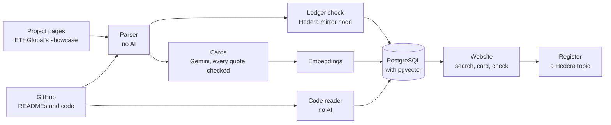

<div align="center">

<picture>
  <source media="(prefers-color-scheme: dark)" srcset="assets/logo-dark.svg">
  
</picture>

# Jevadu

**The past projects of Hedera hackathons, with what the Hedera ledger and the code say about each one.**

[](https://github.com/mohamedyaakoubi/Jevadu/actions/workflows/ci.yml)
[](https://hashscan.io/testnet/topic/0.0.11126502)
[](pyproject.toml)
[](LICENSE)

[What it looks like](#what-it-looks-like) · [How it works](#how-it-works) · [Tech stack](#tech-stack) · [What works today](#what-works-today) · [Run it](#run-it) · [Design](DESIGN.md)

<sub>Jevadu is not affiliated with, sponsored, or endorsed by Hedera Hashgraph, LLC.</sub>

</div>

> [!NOTE]
> **State on 6 November 2026.** Every project of the allowed sources is collected, read and checked on the Hedera ledger, the cards are written, the three tests of quality have run, and what the projects that reached Hedera's main network did there is read transaction by transaction. The website runs on a laptop, and a public copy runs online with an allowance for each visitor; its address is in this repository's description. The register's topic [`0.0.11126502`](https://hashscan.io/testnet/topic/0.0.11126502) on the test network has no admin key, and its first record is this repository's own ([on HashScan](https://hashscan.io/testnet/transaction/1793907784.812440465)). See [What works today](#what-works-today).

> [!IMPORTANT]
> **Where the data comes from.** ETHGlobal was asked before any program read its showcase. It agreed in writing to a slow, signed read of its Hedera prize projects, and the other projects that its showcase ties to Hedera are read in exactly the same way. Devfolio's projects of a Hedera prize track, at ETHDenver and PEC Hacks, are read the same slow, signed way: its terms have no rule against programs, and its robots.txt allows them. Each page is read once, and the tool is not commercial. Devpost said no, so no program reads Devpost. DoraHacks and AngelHack have not answered yet, so no program reads them.

## Why

Hedera has run at least 12 big hackathons since 2018, with more than 2,100 projects that we could count. They sit on at least five different websites. So:

- builders rebuild old ideas without knowing it;
- a judge cannot tell quickly whether a project is a repeat;
- every team writes "we use Hedera", and nobody can check it quickly;
- nobody knows which past projects are still alive.

## What it does

| For | It answers |
|---|---|
| A builder | Was my idea already built on Hedera? What happened to it? |
| A judge | Is this submission's Hedera proof real? What is close to it? Was it sent before? |
| An organiser | What did our past events produce? How much of it reached Hedera's main network? |

## What it looks like

**Search an idea.** Type an idea and get the past Hedera projects closest to it. Each one says at once
where it was built, whether it won a prize, whether the Hedera ledger confirms its use of Hedera,
and whether the team kept working after the event.


**One project: what its page claims, what its code calls, what the ledger shows.** On the left,
each Hedera service that the page names, that the code calls and that the project's Hedera IDs
really used, with the days on which they were active. On the right, what those IDs did, who took
part, and what the page does not say: here, no one outside the team holds the project's token.

<p>


</p>

**Across hackathons.** Patterns that no single jury can see: which Hedera services the prize
winners use next to the others, one team that won a Hedera prize at three events with the same
repository, and which categories win most often.


## How it works



1. **Collect.** A program reads the public project pages of past hackathons and saves them, without the part that shows the team members. It does this only where the site's terms allow it or the site said yes in writing.
2. **Parse.** Ordinary code pulls out the name, the links, the Hedera IDs and the titled sections. No AI.
3. **Read.** An LLM gives every project the same structure. Each field it writes carries a label and exact quotes from the page, and code checks every quote.
4. **Check.** The Hedera mirror node says what each ID really is and when it was active. GitHub says when the code was written, and the code itself is read for its Hedera packages, imports and calls. No AI.
5. **Link and search.** The tool finds the past projects closest to an idea and shows the facts side by side.

## Where Hedera is used

| | How |
|---|---|
| **Reading the ledger** | The public ledger is the ground truth for every claim that a project makes about Hedera. Hedera's mirror node, a public server that answers questions about the ledger, says what each ID is, when it was made and when it was last used. Every fact links to HashScan, Hedera's public explorer. |
| **Reading the code** | The code of each project is read for Hedera's SDK packages, the files that import them, and the Hedera services that the code calls. |
| **Writing the register** | A public register on a topic of the Hedera Consensus Service. A team registers a fingerprint of its own submission, after it adds a line that the tool gives to its README (or lets the tool's GitHub App add it), and gets a timestamp that nobody can change. The team can sign it with its own Hedera account, through HashPack or MetaMask: the record then holds the account and its signature, which anybody can check against the account's key on the ledger ([design 9.6](DESIGN.md#96-the-team-signs-with-its-own-wallet)). If the same fingerprint appears again at another event, the tool says "seen before". The topic is [`0.0.11126502`](https://hashscan.io/testnet/topic/0.0.11126502) on the test network, created on 22 October 2026 with the memo "Jevadu register". Its first record, of 5 November 2026, is this repository, signed by the maintainer's account `0.0.11235177`: [sequence number 1 on HashScan](https://hashscan.io/testnet/transaction/1793907784.812440465). |

## What the AI may and may not do

It may read pages, give them structure and find similar ideas. It may not give a score, pick a winner, say that a project is a copy, or state a fact. Facts come from the parser, the code host and the ledger.

## Tech stack

| Part | Built with | Why |
|---|---|---|
| Language | Python 3.11 | One language for the collectors, the pipeline, the tests and the website. |
| Website | FastAPI and Jinja2, with htmx 2.0.11 | The server makes the pages. htmx, a small script, replaces one part of a page at a time, so there is no front-end build. |
| Look | Tabler 1.6.1 on Bootstrap 5, Chart.js 4.5.1, IBM Plex Sans, Atkinson Hyperlegible Mono | A design system with a light and a dark theme, one library for the charts, a font for reading and a font for the IDs. |
| Database | PostgreSQL 17 with pgvector, in Docker | The facts, the texts and the vectors in one place. pgvector stores vectors in PostgreSQL. At this size an exact search needs no index. |
| AI | Gemini 3.1 Pro, Gemini 4 Argon, Gemini 3.8 Flash and gemini-embedding-2, on Vertex AI, through the Google Gen AI SDK | Gemini 3.1 Pro writes the cards; Gemini 4 Argon wrote the 106 cards of Devfolio, when 3.1 Pro kept answering "too many requests". Gemini 3.8 Flash orders and compares the results of the search, only on a button. The embedding model turns each text into a list of numbers that stands for its meaning, for the semantic search. |
| Hedera | the public mirror node, hiero-sdk-python 0.2.10, HashScan, Hedera's WalletConnect library | The mirror node for every read. The SDK sends the register's messages to the Consensus Service and checks the teams' signatures. HashPack signs through @hashgraph/hedera-wallet-connect 2.1.3, loaded in the page from a CDN; MetaMask signs with EIP-191. HashScan for the links. |
| Sources | ETHGlobal's showcase, Devfolio, GitHub's REST API | The project pages that the showcase ties to Hedera, and Devfolio's projects of a Hedera prize track (how they are read: the top of this README). The READMEs, the facts and the code of the public repositories. |
| Parsing | Beautiful Soup with lxml | Ordinary code reads every page and README. No AI. |
| Quality | pytest, Playwright with axe-core 4.14.0, Ruff, GitHub Actions | The tests, a real browser that also checks accessibility, the lint, and a clean run on every push. |
| Cost | its own meter and budgets | Every model call is counted, and a call that could go over the budget is not made. |
| Public copy | Vercel and Neon, with Cloudflare's Turnstile | The copy online runs as functions on Vercel, with its database on Neon. A visitor confirms being a person before the copy uses Gemini, GitHub or Hedera for them, and each visitor has an allowance. |

## What works today

Each number below comes from a dated result file, named under the table. How each part works is in [`DESIGN.md`](DESIGN.md).

| Part | What it does | Measured |
|---|---|---|
| **Collection** | Reads the 658 project pages that ETHGlobal's showcase ties to Hedera, in the slow, signed way that ETHGlobal agreed to in writing for its Hedera prize projects, and the 107 Devfolio projects of a Hedera prize track in the same way. Takes 168 winners from organisers' lists: 933 projects from 30 events on 6 sites. Each page is read once. | 732 requests to ETHGlobal in all, under the tool's own limit of 800. |
| **Parser** | Ordinary code, no AI, reads each page into its facts: the name, the event, the prizes, the links, the texts word for word, and the Hedera IDs with their network and kind. | 392 of the 658 ETHGlobal projects name no Hedera ID; 60 of the 92 Hedera prize winners name none. |
| **Code** | Reads each project's repository for Hedera's packages, the files that import them, and the Hedera services that the code calls. | Of the 392 projects that name no ID, the code of 259 shows a use of Hedera. |
| **Ledger** | Checks every Hedera ID of a page, a README or the code on the mirror node: its kind, and its dates against the event. Then reads what the project's own IDs did around the event. | 358 of the 658 have a Hedera ID active during their hackathon, 100 of them found only in the code. For 279, the ledger or the code shows something that the page does not say. Of Devfolio's 107 projects, 37 have a Hedera ID active during their hackathon. |
| **Main network** | For the projects that put an own ID on Hedera's main network, reads every transaction of those IDs there: its fee, the HBAR it moved, the accounts that paid, and the network's own exchange rate of its hour, so the fees are also told in dollars of their day. Then what each transaction did, in the words of the ledger and of the project's own code (the kind that a message gives itself, the function that a call ran), and what the accounts that made those IDs also made there. A project's path opens in a window from the view and from its card. | 7 of the 933 projects did. Their own IDs made 1,169 transactions there, for 59.48 HBAR of fees ($11.36), and one of them was used there after its event. 1,110 of the 1,169 are messages to two topics, and 1,090 of those messages name another network, Base. The accounts that made the IDs also made 165 contracts, 5 tokens, 2 topics and 1 scheduled transaction there that the projects do not name. On the test network, 393 projects made 141,880 transactions with their own IDs. |
| **After the event** | Counts what a project that lived on, or moved, would leave in public data: pushes to its code, use of its testnet IDs, a repository at a new owner, the same keys on the main network, and what the makers of its mainnet IDs made later. | 30 days after their event, 13.9% of repositories got a push; a year after, 3.2%. Of 767 keys behind the testnet projects, 2 are also on the main network, and 0 built anything there after the event. |
| **Cards** | Gemini 3.1 Pro writes seven fields for each full page, each with quotes that code checks against the page. A field whose quotes are not found is dropped. Gemini 4 Argon wrote the 106 cards of Devfolio; a project shows the card of 3.1 Pro when it has one. | Gemini 3.1 Pro: 8,923 of the 8,945 quotes were found word for word in their page. Gemini 4 Argon: 2,020 of 2,021. |
| **Search** | By keyword or by meaning. On a button, Gemini 3.8 Flash orders the 30 closest and says what each shares with the idea and how it differs. | Test 2, below. |
| **Website** | The search, a card for each project (with a timeline when it came back to another hackathon), eight filters that each keep one value or several, a graph, charts and the main network of any list, the check of a submission from its GitHub link, and the register. A check is kept for good, with its comparison by Gemini, and on the public copy every copy of the site shares it; the button "Read again now" asks GitHub and the ledger again, once every 3 hours for each repository or project, and only what changed is replaced. | The graph's groups are regions of the map, not proven categories: a silhouette of about 0.04. |
| **Register** | Writes a fingerprint of a team's repository and its commit to a Hedera topic with no admin key, once the README carries the line that the page gives. The team can sign it with its own wallet. | The topic `0.0.11126502` is on the test network. First registration on 5 November 2026: this repository, [sequence number 1](https://hashscan.io/testnet/transaction/1793907784.812440465), read back from the mirror node. |

Sources: the collection, `proofs/results/` (11 October 2026) and `evals/results/20261031T234422Z-overview.json`; the parser, `evals/results/20261022T094656Z-overview.json`; the code, `evals/results/20261022T094650Z-code-findings.json`; the ledger, `evals/results/20261029T082910Z-overview.json` and `evals/results/20261029T160737Z-depth.json`, and for Devfolio `evals/results/20261031T234422Z-overview.json`; the cards, `evals/results/20261031T234422Z-overview.json`; the main network, `evals/results/20261101T175806Z-mainnet.json`; after the event, `evals/results/20261101T222107Z-afterlife.json`; the graph, `evals/results/20261031T104649Z-graph-groups.json`.

### The three tests of quality

| Test | What it checks | Result | Pass marks | Report |
|---|---|---|---|---|
| **Test 1**, the fields of the model (design 13.2) | 60 pages, each card graded field by field against its page | In the second run, with the list of 17 categories: no field graded wrong, 98.5% fully right, 99.5% of the labels right | **All four met** | [report](evals/test1/report-gemini-3.1-pro.md) |
| **Test 2**, the search (design 13.3) | Whether the known similar projects are in the first 10 results | 34 of 57 (59.7%) | 80%, **not met** | [report](evals/test2/report-2026-10.md) |
| **Test 3**, the Hedera IDs (design 13.4) | 50 pages and their READMEs, against every ID written down by a second reader | Found 163 of 163 (100%), the same status for 94.5%, 1 of 164 counted as the project's when it is not (0.6%) | 95%, 90%, at most 2%: **all met** | [report](evals/test3/report-2026-10.md) |

- **Test 2.** Most misses are tools for AI agents, a theme with many projects close to each other. With Gemini's order, the same cases reach 42 of 57 (73.7%, `evals/results/20261024T051625Z-search-fallback.json`), still under the mark of 80%; in that run 20 of the 56 searches lost Gemini's answer and kept the order by meaning. The pool that Gemini orders, the 30 closest in meaning, already holds 50 of the 57 known projects (87.7%, `evals/results/20261101T222148Z-search-pool.json`), so a better order alone can reach the mark.
- **Test 3.** The second reader is a language model that is not part of the tool, and each ID was checked against the mirror node. The first run counted 22 of 178 IDs wrongly (12.4%). After three changes of the reader, 8 of 164 (4.9%), 7 of them scheduled transactions, a kind of ID that the first guideline did not list. Schedules were added to the guideline after that run, so the report gives both results.

The 2,206 automatic tests run before every commit, and again on GitHub at every push on a clean Ubuntu machine. They do not prove that the outside services answer as the code expects: four first proofs did that on the real services, the database, the Hedera test network, Google's models and ETHGlobal's showcase (`proofs/results/`). Every model call is counted against a budget that stops it before it could go over, and the history of the repository is searched for secrets.

## What already exists

Solana's hackathon organiser built this idea for Solana: [Colosseum Copilot](https://github.com/colosseumorg/colosseum-copilot). It runs inside a builder's coding agent, on the submissions of Colosseum's own hackathons, and its own page says its records show "what teams submitted, not what they run today".

Two hackathon projects search past projects too. [ETHSearch](https://github.com/pauldev20/ethglobalsearch) searches the projects of ETHGlobal's showcase by text and by meaning. [HackathAttest Agent](https://github.com/TheSoftwareDevGuild/the-guild-attestation-intelligent-agent), from ETHOnline 2025, answers questions about past hackathon projects from attestations on Arbitrum.

We found nothing like this for Hedera. Jevadu keeps the projects tied to Hedera, and adds what the ledger and the code say about each one.

Many tools score hackathon submissions with AI. DoraHacks' Hackathon AI, for example, gives each submission a score and feedback against the organiser's criteria, can approve every submission that reaches a score the organiser sets, and ranks the approved projects of each track, with its reasons, as a guide for the human judges ([its own article](https://dorahacks.io/blog/guides/hackathon-ai/)). Jevadu does not score: it puts the facts side by side, and people judge.

## Run it

You need Python 3.11, Git and Docker Desktop. On Windows:

```text
python -m venv .venv
.venv\Scripts\python -m pip install -c constraints.txt -e ".[dev]"
copy .env.example .env        (only if you have no .env yet; do not copy over an existing one)
docker compose up -d --wait db
.venv\Scripts\python -m hackathon_memory.db migrate
.venv\Scripts\python -m pytest
.venv\Scripts\python -m hackathon_memory.setup_check
```

On Linux or macOS, use `.venv/bin/python` and `cp`. Fill `.env` with your own values: it is never committed. Put a password of your choice in `POSTGRES_PASSWORD`; it only protects your own copy of the database. The database keeps the password it was first created with: if you change it later, run `docker compose down -v` once (this deletes the local database) and start it again.

`setup_check` says which of the setup steps below are done and what blocks each proof. It prints no value.

### The setup steps

The steps have the numbers that `setup_check` prints. Each value goes into `.env`, and nowhere else.

| Step | What | Where it comes from |
|---|---|---|
| 1 | `HEDERA_OPERATOR_ID`, `HEDERA_OPERATOR_KEY` | A free test account at [portal.hedera.com](https://portal.hedera.com). Copy the account ID and the private key in the DER form (a long text that starts with `30`). The tool writes to the test network only. |
| 2 | `GITHUB_TOKEN` | GitHub, Settings, Developer settings, Personal access tokens, Fine-grained tokens. Choose "Public repositories (read-only)" and add no permission. It is used to read facts about public repositories. To let the tool read the READMEs, also set `COLLECT_GITHUB=on`. |
| 3 | `GOOGLE_CLOUD_PROJECT`, `GOOGLE_CLOUD_LOCATION`, `GOOGLE_APPLICATION_CREDENTIALS` | A Google Cloud project with the Vertex AI API turned on. The location is `global`. Sign in with `gcloud auth application-default login`. If you name a sign-in file, keep it outside the project folder. |
| 4 | `POSTGRES_PASSWORD` | Any password you choose. Then `docker compose up -d --wait db`. |
| 8 | `COLLECTOR_NAME`, `COLLECTOR_CONTACT_EMAIL` | A name for the tool and your own address. Both are sent in every request to a site, so that the site can see who reads it. Only needed to run a collector. |
| 9 | Project pages seen by hand | `data/by-hand/ethglobal.com/project-pages.txt`, one showcase address per line: projects that you saw yourself with "Winner of" and a line that starts with "Hedera". One is enough. The showcase list names a sponsor only by an id, and these pages tell the tool which id is Hedera. Only needed to run the ETHGlobal collector, and only with a written yes from the site. |

The optional settings, for the public copy, the wallets, the GitHub App, Turnstile, Vercel and Cloudflare, are described one by one in [`.env.example`](.env.example).

### The commands

<details>
<summary><b>All the commands</b>, from the first proofs to the website</summary>

| Command | What it does |
|---|---|
| `python -m proofs.database` | The first proof: the local database answers a search by vectors. |
| `python -m proofs.hedera_write` | The second proof: a topic with no admin key on the Hedera test network, and a message written and read back. |
| `python -m proofs.google_models` | The third proof: one call to each Google model (it costs a few cents). |
| `python -m proofs.lists` | The fourth proof: checks, with no request, that the rules for reading the site were kept. |
| `python -m hackathon_memory.collect ethglobal --plan` | Shows what the collector would read, with no request. |
| `python -m hackathon_memory.collect ethglobal --look` | Reads robots.txt and the first page of the hand-made list, and saves nothing. |
| `python -m hackathon_memory.collect ethglobal --find` | Walks the showcase list with the filter "partner: Hedera" and notes every project; it saves no page. |
| `python -m hackathon_memory.collect ethglobal` | Reads and saves each project page that the walk found, without its team part (`--pages`, `--pause`, `--wait`). |
| `python -m hackathon_memory.pipeline parse` | Reads every saved page into the database, with no request. |
| `python -m hackathon_memory.pipeline readmes` | Asks GitHub for each project's README, then reads it for Hedera IDs. |
| `python -m hackathon_memory.pipeline code` | Asks GitHub for the facts of each repository. |
| `python -m hackathon_memory.pipeline hedera_code` | Reads the code of each repository for its use of Hedera. |
| `python -m hackathon_memory.pipeline timeline` | Asks GitHub, once, for the code of each project that came back, at the end of each of its hackathons, and how it changed when the repository is the same. |
| `python -m hackathon_memory.pipeline check` | Asks the mirror node about every Hedera ID and applies the proof rule. |
| `python -m hackathon_memory.pipeline embed` | Makes the embedding of each project whose text changed (it costs money, within the budget). |
| `python -m hackathon_memory.pipeline all` | The seven steps above, in order. |
| `python -m hackathon_memory.pipeline history` | Reads the transactions of each project's own Hedera IDs. |
| `python -m hackathon_memory.pipeline makers` | Keeps the account that created each project's own contract, topic, token and schedule. |
| `python -m hackathon_memory.pipeline mainnet` | Reads what each transaction of the own IDs on the main network cost and moved, with the network's exchange rate of its hour. |
| `python -m hackathon_memory.pipeline mainnet_what` | Reads what each of those transactions did, in the words of the ledger and of the project's own code, and what the accounts that made the IDs also made there. |
| `python -m hackathon_memory.pipeline refresh` | Asks GitHub and the ledger again about what is a day old, and writes what changed. |
| `python -m hackathon_memory.pipeline cards --set FILE` | Writes the cards of a set of pages with Gemini and checks every quote (it costs money, within the budget). |
| `python -m hackathon_memory.pipeline cards --export FILE`, `--restore FILE` | Saves every card to a file, or puts them back into a rebuilt database with no model call. |
| `python -m hackathon_memory.web` | The website at http://127.0.0.1:8000, on this computer only (`--port` for another). |
| `python -m hackathon_memory.web --public` | The public copy: no page indexed, the AI and registering off until turned on, a budget of its own and an allowance for each visitor. |
| `python -m hackathon_memory.web.switch ai on` | Turns a part of the public copy on or off (`ai`, `register`); with no argument, it says what is on and what was spent. |
| `npx vercel@64.2.0 deploy --prod --archive=tgz` | Puts the public copy on Vercel; its settings are the project's variables there, never `.env`. |
| `python -m hackathon_memory.web.tunnel setup`, `run` | The other way to host the copy: a Cloudflare tunnel from this computer. |
| `python -m hackathon_memory.hedera.registry open` | Creates, once, the register's topic with no admin key and the tool's key as its submit key, and checks both keys. |
| `python -m hackathon_memory.hedera.registry open --rehearsal` | A second topic for rehearsals; `python -m hackathon_memory.web --rehearsal` writes to it. |
| `python -m hackathon_memory.search "an idea"` | The closest projects to an idea, as a plain listing. |
| `python -m proofs.gate_b` | The whole path from an empty database, then the first 10 results of each idea of a list, to be marked by hand (`--marks` reads the marks). |
| `python -m evals.sets draw`, `draw-test3` | Draws, once, the pages of the tests. |
| `python -m evals.test1.sheet`, `evals.test1.report` | The grading sheet of Test 1, then its numbers. |
| `python -m evals.test2.ideas draw`, `evals.test2.run` | The ideas of Test 2, then the search test. |
| `python -m evals.test3.sheet`, `evals.test3.run` | The sheet of Test 3, for checking by hand, then its numbers. |
| `python -m evals.overview` | The counts of the website's charts, for each event. |
| `python -m evals.mainnet` | The counts of the main network: who put an own ID there, and what those IDs did, cost and moved. |
| `python -m evals.depth --check 20` | The depth of use over the collection, counted a second time for 20 projects. |
| `python -m evals.graph_groups` | How well the graph's groups fit the lists that it draws. |
| `python -m evals.search_modes`, `evals.compare_levels`, `evals.ledger_story.run`, `evals.ledger_days`, `evals.code_times`, `evals.cards_report` | Other measures: the ways to search, the comparisons, the ledger and the readings of the code. |
| `python -m evals.rebuild OLD NEW` | Counts the same things in the database in use and in one built again from the saved pages. |
| `python -m hackathon_memory.finops report`, `budget`, `prices` | Where the money for the models went, where the budgets stand, and the prices in use. |
| `python -m hackathon_memory.finops reconcile --billed 1.23` | Our own count against the amount on Google's bill. |
| `python -m hackathon_memory.finops.watch` | Where the public copy's budget stands; it fails once 80% of a cap is spent (GitHub runs it four times a day). |
| `python -m hackathon_memory.llm.account switch` | Switches the Google account of the models in one step, on this computer and on Vercel. |
| `python -m hackathon_memory.secret_scan` | Looks for the secrets of `.env` in every commit; it prints names, never values. |

Each proof and each measure writes a dated result file to `proofs/results/` or `evals/results/`.

</details>

## Design rules

The code follows a short list of numbered rules, and its comments name them, for example "design rule 9". The list is in [`DESIGN.md`, section 3.5](DESIGN.md#35-the-rules-by-number), and the rules for reading a site, each with a test, are in [section 5.7](DESIGN.md#57-how-a-site-is-read-and-what-ethglobal-was-asked). Comments also name other sections of the design, for example "design 7.2".

## The event

This is an entry for the FSS Campus Edition of the Hedera Cross Campus Challenge 2026. It is built by one person, Mohamed Yaakoubi.

The line below lets this repository be registered for that event in the tool's own public register on Hedera. Only someone who can change the repository can add it, so it shows that the registration is the maintainer's own:

`jevadu: 5PZVM227`

## Licence and credits

Copyright 2026 Mohamed Yaakoubi.

The code and the documents of this repository are under the Apache License, Version 2.0, with its text unchanged. The full text is in [`LICENSE`](LICENSE), and the credit that travels with the code is in [`NOTICE`](NOTICE).

**If you copy or change Jevadu and share it,** the licence asks four things (its section 4): give a copy of the licence, mark the files that you changed, keep the copyright notices, and keep the credit of `NOTICE` in your copy. The licence gives no right to use the name Jevadu for another product (its section 6), so a changed copy should take a name of its own; it may say that it is based on Jevadu.

**Please credit the work you build on,** as Jevadu credits the work below. A line such as "Based on Jevadu by Mohamed Yaakoubi", with a link to this repository, is enough. GitHub's button "Cite this repository" gives a citation, from [`CITATION.cff`](CITATION.cff).

**Jevadu is built on the work of others:**

- htmx (0BSD), Tabler (MIT, built on Bootstrap, MIT), Chart.js (MIT), and the fonts IBM Plex Sans and Atkinson Hyperlegible Mono (SIL Open Font License 1.1). Their files and their licences are in `src/hackathon_memory/web/static/vendor/`.
- axe-core (MPL 2.0), which the tests use to check the pages for accessibility. Its file and its licence are in `tests/assets/`.
- The Python libraries named in `pyproject.toml`, each under its own licence, among them the Hiero SDK for Python.
- Hedera's public mirror node and HashScan, for every fact of the ledger, and Google's Gemini models, for the cards and the search.
- The projects themselves. Their pages and their code belong to their teams, and every card links to the page it comes from. Where the data comes from is said at the top of this README.

The licence does not cover the pages of other people's projects that the tool reads. Those belong to their authors, and they are not stored in this repository.
