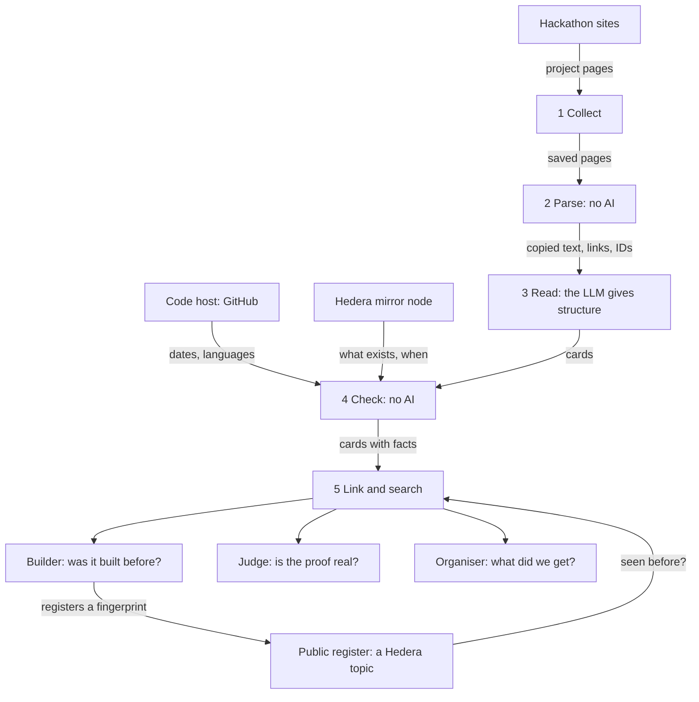

# Hackathon Memory: blueprint

Version 0.27, 20 October 2026. This is the one document that explains what we build and why. The orders are in `CLAUDE.md`. The history is in `backlog/`. A public version for readers of the repository is `DESIGN.md`: it has the same section numbers and names no working note. When this document changes something that `DESIGN.md` says, both are changed.

Section numbers are fixed. New sections are added at the end, never in the middle, because other files point to these numbers.

"I" means the owner, Mohamed Yaakoubi. Words in **bold** on first use are explained in §17.

---

## 0. Summary

- **What it is:** one place that knows every project sent to a Hedera hackathon: what it claimed, what really happened, and whether it is still alive.
- **The one behaviour that matters most:** a builder types an idea and sees the closest past Hedera hackathon projects, each with what the Hedera ledger says about it.
- **Who it is for:** builders, judges and organisers of Hedera hackathons.
- **Where Hedera is used:** the tool reads the public ledger to check every claim, and it writes a public register of submissions.
- **Why it is built now:** it is my entry for the FSS Campus Edition of the Hedera Cross Campus Challenge 2026. 20 October 2026, 19:00 closes the registration, and the submission opens that day (my words of 18 October); the day the submission closes is not written here yet. The plan below still aims at 20 October.
- **State on 10 October 2026:** Phase A is built, and the four proofs of Gate A passed on the real services (§14.2). The first collection is done: 92 pages of projects that took a Hedera prize at 14 ETHGlobal events (§5.7). Devpost said no. DoraHacks and AngelHack have not answered yet (§5.6). No collector runs on any site before my yes for that site (§5.2).



---

## 1. The problem, and why we believe it

### 1.1 The problem

- Hedera has run many hackathons. Nobody can see their projects in one place.
- So builders rebuild old ideas without knowing it. I lost several days checking by hand whether each of my own ideas already existed on Hedera.
- A judge cannot tell quickly whether a project is a repeat.
- Every team writes "we use Hedera". Nobody can check that quickly.
- Nobody knows which past projects are still alive.

### 1.2 The numbers

Hedera has run at least 12 big hackathons since 2018. Seven of them publish how many projects were sent in.

| Year | Event | Projects sent in |
|---|---|---|
| 2018 | Hedera18 | not published |
| 2020 | Hedera20 | 45 |
| 2021 | Hedera21 | 54 |
| 2022 | Hedera22 | 118 |
| 2023 | Beyond Blockchain | not found |
| 2024 | Hello Future | not found |
| 2024 | Hello Future 2.0 | not found |
| 2025 | Hedera x AI | not found |
| 2025 | Hello Future Origins | 159 |
| 2025 | Hedera Africa Hackathon | more than 1,300. Its organiser page on DoraHacks shows 1,396. |
| 2025 | Hello Future Ascension | 135 |
| 2026 | Hello Future Apex | 368 |

The seven numbers add up to more than 2,100 projects. The projects sit on at least five different websites, so no single place holds the history. The sources are in §18. Which site holds which event, and what each site allows, is in §5.6.

### 1.3 What a hackathon asks for today

The Hello Future rules ask each team to "provide your Hedera testnet on-chain account as a proof of an on-chain transaction". The same page names no automatic check and no check for repeated projects. A program can check that proof on the public ledger.

Coming back with an old project is allowed, and Hedera even invites it. The Apex event had a track named Legacy Builders: "For returning participants from past Hedera Hackathons, including Origins, to build on previous ideas or apply their experience to new concepts." So "seen before" is not an accusation. What is missing is a way to see what came before.

### 1.4 The history is already disappearing

On 9 October 2026 I opened every site by hand, and the assistant read their rules. The details are in backlog entry 04.

- The platforms of Hedera18 and Hedera20 are gone. An old copy of the first one still lists its winners, with no code.
- The site of Hello Future 2024 and Hello Future 2.0 cannot be opened. Its security certificate expired in September 2025.
- The submissions of Hello Future Ascension, Hello Future Apex and this year's campus challenge are private.
- For Beyond Blockchain 2023 and Hedera x AI 2025, only the winners are public.

So for eight of the twelve big events, we found no place where the submissions can still be read. They are public for four: Hedera21, Hedera22, Hello Future Origins and the Africa hackathon.

This changes what the tool can honestly say. It cannot know every project. It can know every project whose page is still public, and the winners of the rest (§4.6). It also shows why a memory is needed: what nobody keeps in one place gets lost.

---

## 2. Users and their tasks

| User | Their question | Task in the tool |
|---|---|---|
| Builder | Was my idea already built on Hedera? What happened to it? | T1: search an idea. T2: read a project card. T3: register my submission. |
| Judge | Is this submission's Hedera proof real? What is close to it? Was it sent before? | T4: check a submission. |
| Organiser | What did our past events produce? | T5: read the overview of an event. |

Nobody asked an organiser whether they want this. I assume they check submissions by hand or with simple database queries. The tool does not need their permission to help builders.

---

## 3. What the tool does, and what it never does

### 3.1 In the first version

- Projects from ETHGlobal's showcase that took a Hedera prize. ETHGlobal allowed this in writing on 9 October 2026 (§5.7). This is the first source. The estimate was 40 to 70 projects. The collection of 10 October 2026 gave 92, from 14 events (§5.7).
- Projects from DoraHacks for two events: the Hedera Africa Hackathon 2025 and Hello Future Origins 2025. The reasons are in §3.4. This needs the written permission of DoraHacks (§5.2), which has not come yet.
- Winner labels from Hedera's own blog posts.
- Winner entries for the events whose submissions are not public (§4.6).
- One card per project (§4).
- A check of each project's Hedera IDs on the ledger, and of its code on GitHub (§7).
- A search by idea, with a short comparison (§8).
- A register of submissions on a Hedera topic (§9).
- A website with six screens (§12).
- Four tests with results that anybody can open (§13).

### 3.2 Not in the first version

- Other hackathon websites.
- Accounts and sign-in.
- A plug-in for AI assistants.
- Registrations signed by the team's own Hedera account (§9.4).
- The register on the main network.

### 3.3 Rules for the AI

1. It never gives a score to a project.
2. It never ranks projects by quality and never picks a winner.
3. It never says "this is a copy". It shows what is the same and what differs, and it points to the cards.
4. It never states a fact. Facts come from the parser, the code host and the ledger (§6.4).
5. Everything it writes is marked as written by the AI, with its label and its quotes (§6.3).

The reason: an AI used as a judge gives an opinion that is not grounded in proof. People decide, with the facts in front of them.

### 3.4 Why these two events

- **Same website.** Both are on DoraHacks, so one collector and one parser serve both.
- **Close in time.** Hello Future Origins ran from 21 July to 8 August 2025. The Africa hackathon ran from 1 August to 30 September 2025. A team could enter both, so real repeats are likely and "seen before" has something to find.
- **Still checkable.** Both are later than the last reset of the test network (1 February 2024), so their test IDs can still be read.
- **The judges know them.** The Africa hackathon is the biggest one, with more than 1,300 projects. It was run by Dar Blockchain, which also runs this challenge. The judges can tell whether a card is right.
- **The proof is asked for.** Hello Future asks each team for a test account as proof (§1.3). That is exactly what the tool checks.

Not chosen for now: Hello Future Apex took its submissions on another website, StackUp. Where the full lists of Apex and Ascension can be read is not confirmed.

---

## 4. The card

### 4.1 Three sources

Every field on a card comes from exactly one of three sources. The website shows which one.

| Source | Fields | Why this source |
|---|---|---|
| **Parser**, no AI | Name, short line, links, Hedera IDs, event, track, prize. The text of the Problem, Solution, How it works, Tech stack and Hedera sections, when the page has those titles. | Exact and free. Nothing can be invented. |
| Code host and ledger, no AI | Programming languages, Hedera libraries named in the code's package files, dates of the code, activity of each Hedera ID. | These are facts. The tech stack comes from the code, not from what the page says. |
| The **LLM** | One plain sentence on what the project does. How it works, in 3 to 6 steps. For whom. Which Hedera services the page says it uses, and for what. A category from a fixed list. The problem and the solution when no titled section exists. | This is reading work that rules cannot do: titles that differ, pages without titles, long text to shorten, and the same structure for every project. |

### 4.2 Why the same structure for every project

Two projects can work the same way and differ in the market: an escrow for freelancers and an escrow for rentals. With separate fields the tool can say "same mechanism, different users". That is more useful than "similar".

### 4.3 Labels on LLM fields

| Label | Meaning | What the card shows |
|---|---|---|
| Stated | The page says it | The text and its exact quote |
| Inferred | The page does not say it directly. The LLM worked it out from other sentences. | The text, those sentences, and a "less sure" mark |
| Not found | The page gives nothing about it | An empty field |

An empty field is right only when the page really has nothing. When the information is there without a title, the field is filled and marked.

### 4.4 Statuses computed by rules

- **Proof status** of the Hedera IDs: see §7.2.
- **Life status** of the project: see §7.4.

### 4.5 Categories (split once after Test 1)

Payments and remittance. Lending, saving and investing. Real-world assets and tokens. Identity and credentials. Supply chain and provenance. Sustainability, energy and climate. Health. Education. Agriculture. Gaming and entertainment. Social and community. AI agents and automation. Tools for AI agents. Developer tools. Data and devices. Public services. Other.

- **Why a list of our own.** The tracks of the events cannot do this job. They change from one event to the next, and some say nothing about the subject, like "Open Track" and "Legacy Builders".
- **One category per project.** It is chosen by who the project serves, not by the technology inside. "AI agents and automation" only when an agent or an automation is what people run or get, such as a trading agent. "Tools for AI agents" when the project is built for AI agents to use: spending limits, identity or reputation for agents, markets where agents buy services. "Developer tools" for tools for people who build software.
- **How the list is confirmed.** On the 60 projects of Test 1 (§13.2), the assistant and I each pick a category, separately. The list is accepted if we agree on at least 80% of the projects and if at most 15% land in "Other". If not, categories are merged or split once, before the full run.
- **The split of 15 October 2026.** In the run of October 2026 I picked the same category as the assistant on 4 of 11 projects (I graded 10), so the list of 16 was not accepted. Most differences were about tools built for AI agents: I filed them by what they do (payments, identity), the assistant under "AI agents and automation". The assistant proposed one new category, "Tools for AI agents", and said that more would be too much; I asked "do you think more categories should be added or is it an overkilling?". The split is its default until I answer. The instructions became card-form-2, and the cards are made again.

### 4.6 Winner entries: a thinner card

For an event whose submissions are not public, the only thing left is the organiser's list of winners (§1.4). Such a project gets a **winner entry**.

| | Full card | Winner entry |
|---|---|---|
| Comes from | The team's own submission page | The organiser's winners page or blog post |
| Fields | All of §4.1 | The name, the event, the track, the prize, the description as it was published, and the link to the project's website if there is one |
| The LLM | All LLM fields | Only the category. The description is short already, so it is copied as it is. |
| Ledger and code facts | Yes | Only if the page gives an ID or a repository. Most do not. The entry then says "no ID given" and "unknown". |

**Why they are kept, although they are thin.**

- The search is the one behaviour that matters most, and the winners are the projects a builder most needs to find.
- With them the search covers all twelve events, and not only the few whose submissions we are allowed to read.
- They make returns visible. On 9 October 2026 the name Effisend stood among the winners of three events of 2025: Origins, the Africa hackathon and Ascension.

**What they cannot do.** They do not show the ledger check, and that check is what this tool adds. So the demo is built on full cards. Winner entries only widen the search.

**Their dates (16 and 18 October 2026).** An organiser's list of winners gives no start and no end, so the year of each of these twelve events is typed by hand from the organiser's own post, in a file that the parse step reads. Where the post also gives the days, its line carries the first and the last day too. The saved posts give them for four events: Hello Future 2024 (22 July to 20 August 2024), Hello Future 2.0, Hello Future Origins and the building stage of Beyond Blockchain 2023. The eight others give only a length, such as four weeks, or nothing. Since no winner entry of these events has a Hedera ID or a repository, the days change no mark: they only let the check of a submission offer these events with their days.

Every winner entry says where it comes from, and that only the winners of its event are public.

**Where they come from, in this order.**

- **Hedera's own winner posts:** nine pages that we know. No rule against a program was found in Hedera's terms. I said yes to a program on 9 October 2026, with one condition: if Hedera's server refuses the program, we do not work around it, and I save the pages by hand from my browser.
- **The winners page of Hashgraph Online for Hedera x AI:** one page, with no request. I copied it by hand on 9 October 2026. Its six winner entries are in the local data folder.
- **The old copy of the Hedera18 site** in the Wayback Machine. I copied its winners part by hand on 9 October 2026. Its eight winner entries are in the local data folder.
- **The winners pages of the Hello Future site,** only after AngelHack's written yes (§5.6).

As for every source, nothing is read by a program before my yes (§5.2).

**Hedera21 and Hedera22.** Devpost said no to a program (§5.6). So these two events also get winner entries, from Hedera's own winner posts. Devpost allows a person to browse its galleries and to link to its pages, so a link to the Devpost page can be added by hand.

---

## 5. Step 1: Collect

### 5.1 How each source is read

| Source | How | Checked on 9 October 2026 |
|---|---|---|
| DoraHacks, list of an event's projects | A real browser driven by a program (**Playwright**) that moves through the list. Only after written permission (§5.2). | A simple request returns only the first 19 projects, and asking for page 2 returns the same 19. |
| DoraHacks, one project page | A simple request. Only after written permission (§5.2). | It answers. One page held the title, the short line, 2 GitHub links, 4 video links and 2 Hedera IDs. |
| A project's README | The GitHub API | See §7.3. |
| Hedera's blog posts with the winners | The collector tries one simple request. If the server refuses it, I save the nine pages by hand from my browser (§4.6). | A simple request from my laptop failed on 9 October. It may be the laptop and not a refusal. |

### 5.2 Polite collection, and the terms of each site

The **terms of use** of a site are read before the first request to it. On 9 October this was not done: the assistant sent about 40 test requests to DoraHacks first. The story is in backlog entry 03.

**What the terms of DoraHacks say.** They were last updated on 20 September 2026. They forbid:

- "systematic retrieval of data or other content from the Website to create or compile, directly or indirectly, a collection, compilation, database or directory without written permission from Company";
- "engaging in any automated use of the system, such as using any data mining, robots or similar data gathering and extraction tools".

So no program touches DoraHacks until DoraHacks says yes in writing. I asked by email on 9 October 2026. The text and the answer are in backlog entry 03.

**My standing rule, from 9 October 2026.** The collectors are written like every other part, and they are tested on saved sample files. But no collector runs against a live site until I say yes in the chat for that site. This holds for every site in §5.6, also where the rules seem to allow it. The Hedera mirror node, the Hedera test network, Google's models and the local database are not collectors, and they need no yes.

**When collection is allowed:**

- One request at a time per site, at least one second apart.
- Each request says who it is: the name of the tool and a contact address. It does not pretend to be a normal browser.
- Stop after five errors in a row and write why.
- No sign-in, and no way around a block.

Collection by a robot is a proof of the idea. Real use would need the sites to give the data themselves.

### 5.3 Raw pages

- Every page is saved as received, with its address, the date and a **fingerprint** of its content. There are two exceptions, both made before the page is saved.
  1. **The team part is cut out,** because we promised the sites not to collect it (§5.7). That means the block that shows the team, the metadata that names an author, and the keys that hold people inside data blocks.
  2. **The page is written again by the HTML parser,** because the cut needs one. A test compares a saved sample page with the original after the team part was removed by hand: the visible text, the links and the order of the tags are the same. The spaces between tags, the case of the doctype and the slash of empty tags may differ, and the saved page can be about a tenth smaller. Two fingerprints are kept in the small file next to the page: of the page as saved, and of what the site sent. The second can no longer be computed from the saved page, and it is not meant to be.
- A saved page is never edited afterwards, with one exception, my decision of 11 October 2026 ("if its people then hide them"): **personal data that is found in a saved page later is taken out.** `RawStore.remove_text` is the one way to do it. It writes next to the page the reason, the time, the number of places and the fingerprint that the page had before. The text that was taken out is written nowhere. The proof of the lists fails when a page differs from its fingerprint, and it counts the pages with such a record. Used once so far: one email address of a person in the data of one page (backlog entry 13).
- Running the collection again skips pages that are already saved.
- Everything else in the system can be rebuilt from the raw pages with one command. This is also our backup.

### 5.4 Personal data

Project pages show team members. The tool does not store their names, emails or photos. It needs none of them. The owner name inside a repository link is kept because the link needs it.

**A team can also name a person inside its own text.** My decision of 11 October 2026: "if its people then hide them". The parser hides these words before the text reaches a table, a model or a card (`parse/people.py`):

| What the team wrote | What is kept |
|---|---|
| A word that starts with "@", such as a handle | `@[name hidden]` |
| An email address | `[address hidden]` |
| A link to a profile on a social site ("x.com/name", "t.me/name", also "uk.linkedin.com/in/name") | `[profile link hidden]` |
| A link to GitHub with one name only: the profile of an account | `[profile link hidden]` |
| A link to the photo of an account on GitHub (`avatars.githubusercontent.com`) | `[photo hidden]` |
| A handle inside a link ("medium.com/@name/a-post"), also without "https://" | the handle becomes `@[name hidden]`, the rest of the link stays |

- The rest of the sentence stays word for word, and so does its full stop. A person, a company and a bot of the project look the same, so all are hidden. Every card links to the page, so little is lost.
- Not hidden: the name of a package ("@scope/package"), also in a link of a site of packages (npmjs.com, unpkg.com and others); anything inside code (there an "@" belongs to the language) except an email address; a link to a repository or to a video.
- **A link of the header is asked the same question.** A demo link that leads to a profile site is kept without its address: the row says the kind and the site. A card then sends the reader to the page, and never says "no demo" where a team gave one.
- The step that reads the pages counts what it hid, in its row of the table of runs.
- **A README is cleaned before it is saved** (`parse/markdown.py`), my reading of the same decision for a new source, and of hard constraint 11 ("no team member names"). A part about the team is cut out whole: a title of a fixed list ("Team", "Our Team", "Contributors", "Built by", "Contact" and others, compared after signs, emoji and a name after a colon are taken away), with everything under it up to the next title of the same or a higher level, or up to a title that names a part of the project ("Installation"). In the rest the words of the table are hidden, and a Markdown or HTML link to a profile goes with its words. The numbers are kept next to the README, with the Hedera IDs that stood in a cut part, so that a cut that takes an ID is seen.
- Measured on the 658 pages on 11 October 2026 (a script count, for planning): 29 words and links hidden. Among them 5 demo links: 4 to Telegram (3 of them bots by their names) and 1 to an account on GitHub.

### 5.5 A start that needs no permission: public repositories (proposed, open question Q10)

GitHub allows a program to read public repositories through its official door for programs, the API. Its policy says: "Scraping does not refer to the collection of information through our API." It also lets researchers use public, non-personal information when what they publish is open to read.

- **How projects are found.** GitHub's search is asked for repositories whose README names a Hedera hackathon and that were created inside the window of the event.
- **What changes.** The README takes the place of the project page.
- **What stays.** The parser, the LLM fields, the ledger check, the register, the search and the tests.
- **A first count on 9 October 2026.** 86 public repositories have "hedera africa hackathon" in their README. 180 have "hello future" and "hedera". 311 have "hedera" and "hackathon" and were created from June to October 2025. The counts overlap, and some results are not hackathon projects.

The limits are real. Only projects with a public repository that names its event are found: a few hundred, not all of them. A README is what a team wrote for developers, not what it sent to the hackathon. And how READMEs are organised has not been measured yet.

### 5.6 The sites that hold Hedera hackathon projects, and what each one allows

Checked on 9 October 2026. The quotes and the pages that could not be read are in backlog entry 04.

| Site | Hedera events on it | Can a visitor see the projects without a sign-in? | What its rules say about a program |
|---|---|---|---|
| DoraHacks | Africa 2025, Hello Future Origins 2025 | Yes | Forbidden. A collection needs its written permission. I asked on 9 October. |
| Devpost | Hedera21, Hedera22 | Yes | **Refused on 9 October 2026.** Devpost gives no exception for a program and offers no export. A person may browse the galleries and link to the pages. No program ever touches Devpost. |
| StackUp, which is part of AngelHack | Hello Future Ascension 2025, Hello Future Apex 2026 | No, also when signed in. I checked. | The submissions are private, so there is nothing to collect. |
| The Hello Future site, by AngelHack | The winners of Origins and Ascension, later Apex: 28 winners today | Yes | AngelHack's terms apply: nothing may gather content "except where our express prior written consent has been obtained". I asked on 9 October 2026. No answer yet. |
| hol.org, by Hashgraph Online | The winners of Hedera x AI 2025, on one page | Yes | I copied this one page by hand on 9 October 2026, with no request. The site refuses the assistant's reader, and no program is sent to it. |
| The Wayback Machine | An old copy of the Hedera18 site, with its winners | Yes | I copied this one page by hand on 9 October 2026. No program read the archive. Its terms were not read yet, so no program is sent to it. |
| 4hacks, by Dar Blockchain | The 12 campus editions of the Hedera Cross Campus Challenge 2026 | No | **Excluded.** I looked while signed in: "The organizer has chosen to keep submissions private for this hackathon." There is nothing to read. |
| ETHGlobal's showcase | Projects that took a Hedera prize at an ETHGlobal event | Yes | **Allowed in writing on 9 October 2026,** as long as every promise of our email is kept (§5.7). This is the first source. |
| hedera.com | The winner posts of nine events | Yes | No rule about programs was found. I said yes to a program on 9 October 2026. If the server refuses it, I save the pages by hand (§4.6). |
| GitHub | The code of projects from any event | Yes | Allowed through its API (§5.5). |
| Hedera's mirror node | The ledger facts | Yes | A public API, made for programs. |

For four events no submission site was found at all: Beyond Blockchain 2023, Hello Future 2024, Hello Future 2.0 and Hedera x AI 2025. The platforms of Hedera18 and Hedera20 no longer exist. I checked all of these by hand on 9 October 2026, and the results are in backlog entry 04. These events get winner entries (§4.6).

**A site that is gone.** The Wayback Machine is a public archive of old web pages. It may be used only for a site that no longer exists, after its own terms are read and after my yes. It is never used to get the pages of a site that said no or has not answered. That would be a way around a block.

**What the table shows.** Every site that holds the submissions either forbids a robot or hides the projects behind a sign-in. So a memory of all Hedera hackathons cannot be built by a robot alone. It needs the sites or the organisers to agree, or to hand over the data. This is the honest limit of the idea, and the pitch must say it.

**The open doors for the proof:** a written yes from a site, a list handed over by an organiser, GitHub's API, the ledger, and the winner posts read by hand.

**One rule about who can say yes.** An organiser can agree for its own site and its own data. It cannot agree for another company's site. Dar Blockchain ran the Africa hackathon, but those pages sit on DoraHacks, so the rules of DoraHacks apply to them.

### 5.7 The promises made to the sites, and what they mean for the code

A yes from a site holds only as long as we keep what the email promised. ETHGlobal wrote: "this request would be completely fine as long as you honor your commitment." The same promises went to every site we asked, so the code keeps them for every source.

| The promise | What the code must do |
|---|---|
| Only the pages we named. For ETHGlobal: the showcase pages of projects that took a Hedera prize. | A **run** reads robots.txt and the project pages on its list, and nothing else. The list is: the pages that I saw with a Hedera prize, and the winners that the **walk** found. The walk reads one list of the showcase, the one with the filter `partners=hedera`, only to learn which projects took a prize, and saves no page of it. A page that shows no Hedera prize is read but not kept, and three such pages in a row stop the run. (Changed twice on 10 October 2026: the prize pages list no winners, backlog entry 07. Then I found the filter, backlog entry 10.) |
| A few hundred pages at most | A fixed limit of requests to the site, counted in a file on disk, so the limit holds for all commands and all days together. It was 300 for the winners. When I widened the collection on 10 October 2026, it became 800 (backlog entry 11). |
| One time | One run. A second run skips every page that is already saved, and every page that an earlier run read and did not keep. Nothing is collected again on a timer without a new yes. |
| One request at a time, at least one second apart | One worker, a pause of two seconds, nothing in parallel. |
| Each request carries the name of my tool and my email address | Both come from the settings file `.env`. The collector refuses to start when one of them is empty. No other tool reads these sites for us, also not the assistant's web reader. |
| No names, photos or profiles of team members | The part of a page that shows the team is cut out before the page is saved (§5.3). A test plants a team block and checks that it is gone. If the team block is not where it is expected, the run stops. If team text is still anywhere else in a page, that page is not saved. |
| I stop at once if you ask | One switch per site in the settings. When a site says stop, its switch is turned off at once, and I am told. |
| The collected pages stay on my laptop | The data folder never enters git. No text taken from a collected page is committed, also not in a test file or a result file (§13.1). |
| A demo and a short video for the jury. Not online, not commercial. | The tool runs on my laptop only. |
| I ask again before anything is published | Before the repository, the tool or its data goes public, I write to the site again. This is a launch gate. |

**How many projects.** Our email named the projects that took a Hedera prize. The estimate was 40 to 70. The real number is 92, from 14 events between 2024 and 2026 (3 to 11 for an event). The showcase list with the filter `partners=hedera` holds 658 projects in all: 173 took a prize of some sponsor, and 92 took a Hedera prize. The other 566 are not read: the yes of ETHGlobal covers the winners. Whether I ask ETHGlobal for them is open question Q24.

**The promises above are the ones that ETHGlobal accepted.** I confirmed on 10 October 2026 that the email was sent unchanged (Q19).

**What ETHGlobal's pages really show** (19 signed requests on 10 October 2026, backlog entry 07): robots.txt does not exist. The list of events does not name the partners. An event page names them. A prize page lists prizes and bounties, and no project. The showcase list shows 33 projects for each page, with no prize. A project page shows the block "Winner of" with one line for each prize, and it shows no team to a visitor who is not signed in. So a winner is known only from its own page. The video of the closing ceremony shows finalists, not the winners of the Hedera prizes, and it is not a source.

**How the winners are found** (backlog entry 10). The showcase has a list with the filter `partners=hedera`. A page of it shows 33 projects and moves on by 32: its last row is the first row of the next page. The data of the page says, for each project, which sponsors gave it a prize, by a short id and not by a name. So:

1. The walk reads the 21 pages of the list and keeps, for a project with a prize, its address, its event and the sponsor ids. For the others it keeps a count for each event.
2. Which id is Hedera is not guessed. It is the one id that all the pages have that I saw with a Hedera prize. Two pages were enough.
3. The run reads the pages of the projects with that id, and checks each one by its own block "Winner of".

**What happened on 10 October 2026.** The walk: 21 pages, 658 projects, 173 with a prize, 92 with the id of Hedera. The run: 92 pages read, 92 kept, none dropped, no error. 140 requests in all to the site that day, with the 24 of the investigation, and the site never refused one. My browser had been checked by Cloudflare on the same list: a browser loads the data of every card at once, and the tool asks for one page every two seconds and says who it is. No login and no browser robot was used.

**What was read beside the 92 pages:** the list of events, one event page, three prize pages, the showcase list and three project pages (saved: nothing), and the 21 pages of the Hedera list (saved: nothing). The next email to ETHGlobal names them. Its draft is in backlog entry 10.

**What the saved pages hold that we never use.** The data of a page carries scores and a summary that ETHGlobal computes: `autoOriginality`, `autoPracticality`, `autoTechnicality`, `autoSummary`. The parser never reads them out (§3.3), and a test will check that.

**The second collection, 10 and 11 October 2026** (backlog entry 11). I decided to read every project of the Hedera list and not only the winners, with no second email. The walk was made again: the same 658 projects. The run read the other 566 pages and kept all of them. Of the 658, 92 took a Hedera prize, 81 a prize of another sponsor only, and 485 none. Once the site answered 429, at 26 requests a minute; the tool waited one hour and went on at ten seconds between two requests, with no other 429. 732 requests in all, of the limit of 800. The lists proof passed on 11 October 2026 (`proofs/results/20261011T031418Z-lists.json`). Phase A was merged into `main` the same day, with the tag `gate-a`.

---

## 6. Steps 2 and 3: Parse and Read

### 6.1 The parser

The parser is ordinary code. It does three things.

1. It pulls out the name, the short line, the links and the full text.
2. It finds Hedera IDs with a pattern: numbers that look like `0.0.12345`. It keeps the words around each ID, because they often say what the ID is.
3. It finds section titles from a list of known words and copies the text under each title, word for word, with its sub-sections.

What we measured on 31 real pages (19 from the first page of the Africa 2025 list, 12 winners of Origins):

| Section title | Pages that have it | Usual length |
|---|---|---|
| Problem | 16 of 31 (51%) | about 73 words |
| Solution | 13 of 31 (41%) | about 71 words |
| Overview or description | 12 of 31 (38%) | about 84 words |
| How it works or architecture | 10 of 31 (32%) | about 45 words |
| Tech stack | 11 of 31 (35%) | about 48 words |
| Something about Hedera | 20 of 31 (64%) | about 45 words |

- 15 of the 31 pages have neither a Problem nor a Solution title.
- Titles differ a lot. One page states its problem under "Prohibitive barriers to Web3 gaming". A parser cannot know that this is the problem.
- When sections exist they are short, so they are copied as they are.
- These 31 pages are probably better organised than the average. This is a limit of the sample.
- The 31 pages were read by a script on 9 October, before the terms of DoraHacks were read (§5.2). Only the counts above are kept in this repository.

A second trap for the parser: a version number like "0.0.3" has the same shape as a Hedera ID. The words around a number decide what it is.

**The parser for ETHGlobal's pages, built on 11 October 2026** (backlog entry 13).

- A page tells each fact twice: in what it shows, and in its data. The parser reads both and refuses a page where they differ (the name, the short line, the event, the prizes). It guesses nothing. All 658 pages passed.
- A text is copied block by block (a paragraph, an item of a list, a title, code), word for word. On all 658 pages both texts give the same letters in the same order as the page. A title that a team wrote inside a text stays a block of that text.
- A Hedera ID: a number below 1001 belongs to the network itself and is never taken as an ID (the first number of a user is 1001, the setting `firstUserEntity` of the node software). The network is taken from the words only when the words near the ID name one network and no other: a wrong network is worse than none. An EVM address is kept only when a HashScan link names it, because the same address can live on another chain.
- The scores of the site in the page data are never read. A test plants loud scores and checks that none comes out.
- Words about people are hidden in the short line, in the two texts and among the links, before anything else is done with them (§5.4). A Hedera ID next to a hidden word is still found, and the words kept around it name nobody.

### 6.2 What the LLM is asked

The LLM gets the page text and the sections the parser copied. It fills the LLM fields of §4.1 in a fixed form. It is told:

- Use only what the page says.
- For each field, give the label and copy the exact sentences that support it.
- Do not rewrite a section that was already copied.
- Do not write IDs, links, dates or numbers as facts.

### 6.3 Labels and the quote check

A program checks every quote: after spaces and letter case are made uniform, the sentence must be found in the saved page.

| What the LLM gave | Result |
|---|---|
| Label "stated" and at least one quote that is found | The field is kept as stated |
| Label "inferred" and supporting sentences that are found | The field is kept as inferred |
| A quote or sentence that is not found in the page | That quote is removed |
| No quote left after the check | The field is dropped and logged |

This check runs on every project. It catches invention. It does not catch a wrong reading of a real sentence. For that, people grade a sample (§13.2).

### 6.4 Facts never come from the LLM

IDs, links, dates, counts and statuses are produced only by the parser, the code host and the ledger. If the LLM writes one, it is ignored.

### 6.5 Cache and versions

Each LLM answer is stored with the model name, the version of the instructions and a fingerprint of the input. Running again with the same three gives the stored answer and costs nothing. A change in any of the three is visible in the data.

**The caches, decided on 11 October 2026** (backlog entry 12). Only exact caches: the stored answer is given back only for exactly the same input, so it cannot change an answer. All of them live in PostgreSQL, next to the ledger of the costs: the saved page, the card fields, the embeddings, the facts of the ledger and of the code with the time of their reading, the embedding of a typed idea, and the comparison of the search. A fact is never inside a cached text: it is read from the tables when the page is drawn. The list of results never waits for the model. No cache gives the answer of one question to a similar question: that kind can show the answer to another idea. The answers of the mirror node are taken again after seven days. What is kept of a typed idea: a fingerprint, and the comparison for 24 hours, a default that I may change.

---

## 7. Step 4: Check

### 7.1 Hedera IDs and networks

Hedera has two networks that matter here: the **main network**, with real money, and the **test network**, for practice. The same number is a different thing on each. So an ID is always stored with its network.

- If the page names the network near the ID, or gives a HashScan link, that network is used.
- If not, both are asked.

For each ID the **mirror node** is asked: what kind of thing is it (account, topic, token or contract), when it was created, how much happened on it, and when the first and the last activity were. The raw answer is stored with the time of the question.

**Built on 18 October 2026: a single transaction (backlog entry 16).** A page or a README often names one transaction: a link to it on HashScan, or its ID in the text. A transaction is one action on the ledger, such as a transfer, the creation of a token or a message to a topic, and its ID is the account that paid for it and the moment it was sent: `0.0.12345-1700000000-123456789`. It is now its own kind of Hedera ID. The mirror node says what the action was, whether it succeeded and when the network agreed on it, and the proof rule judges it by that moment; a failed transaction counts as empty. The account that paid is kept too, as before. The mirror node refuses the other way of writing it, `0.0.12345@1700000000.123456789` (measured on 18 October 2026), so every transaction is kept in the first form. On the real collection: 223 transactions in 93 projects; 90 of these projects now show a transaction as proof, and none of them depended on it.

### 7.2 The proof rule

An ID that exists proves almost nothing: nearly every small number exists on Hedera as something. So the rule looks at the kind of thing and at the dates.

The window of an event runs from 30 days before it started to 14 days after it ended.

| Status | When |
|---|---|
| Proof found | The ID exists. Its kind fits how the page describes it. It was created or active inside the window. |
| Found, but the dates do not fit | The ID exists, but nothing happened on it inside the window. |
| Found, but empty | A topic with no message, a token never issued, or a deleted contract. |
| Not found | The ID does not exist on the network. |
| Cannot be checked | The ID is on the test network and older than its last reset (1 February 2024). |
| No ID given | The page and the README give no Hedera ID. |

The numbers 30 and 14 are a first choice. Test 3 (§13.4) tells us whether they are right.

**What the code added on 11 October 2026** (backlog entry 13).

- Two statuses that the table implies. *Found, but as another kind of thing:* the ledger says that the ID is another kind of thing than the page says. *The end of the event is not typed in yet:* the dates are not judged, in place of a guess.
- A word of the page can mean more than one kind: a contract can make a token, and a contract has an account. So "token" and "account" fit a contract. "Topic" fits only a topic. The ledger decides what a thing is, never the page.
- A thing that was made before the window and used both before and after it gets one more question: did anything happen on it inside the window?
- For a project, the best status of its IDs counts. An ID with no network on its page is asked on both networks.
- The end of an event is typed into a file by hand (`data/by-hand/ethglobal.com/event-ends.txt`). For an event of one weekend, the day of the judging, which the data of its pages shows, is its last day: ten events. The four others are open (open question Q30).

**What this check does not show.** It does not show that the project is good. It does not prove that the ID belongs to the team: a team could paste somebody else's ID. Two things reduce that risk: the same ID must also appear in the team's own code or README, and the dates on Hedera must fit the dates of the code.

### 7.3 Facts from the code

The GitHub API is asked with a personal access token. Without a token the limit is 60 requests per hour, which is useless for thousands of projects. With a token it is 5,000 per hour. Requests go one after the other, the limit headers are read, and every answer is stored. A repository is asked again only when a team registers it, because its line must be read in the README at that moment (9.2); GitHub's limits are far above what the tool sends (read on docs.github.com on 18 October 2026). My words of 18 October: "isnt the api legal and free with a cap? we are not spamming github anyway."

For each repository: does it exist, when was it created, when was the first and the last change, how many changes, how many contributors, which languages. The package files are read to see whether a Hedera library is named.

**Built on 11 October 2026: the README** (backlog entry 13). GitHub's own pages were read that day: rate limits (5,000 an hour, 900 points a minute, a GET is one point), the best practices (one request after the other, follow redirects), the endpoint of the README, and the versions of the API.

- The client is the polite client of §5.7 with GitHub's headers: the tool's name and my contact address, at least one second between two requests (hard constraint 10), a limit of 8,000 requests over all runs counted on disk, and the switch `COLLECT_GITHUB`. It asks for version 2026-03-10 of the API.
- A rate limit (403 or 429 with `x-ratelimit-remaining: 0`, a retry-after or a message) is a 429 by my rule of 11 October: stop, an hour, five times slower. A 404 and one blocked repository are answers, not a no of GitHub: my words of 11 October were that the stop is for a stop order. A 401 or another no stops everything until I decide. The run stops by itself when fewer than 100 requests are left in GitHub's hour.
- One request for each repository: `GET /repos/{owner}/{repo}/readme`. The answer is saved under `data/raw/api.github.com/`, the README as text after the cleaning of §5.4.
- The IDs of a README are kept for each project of the repository (`found_in = 'readme'`) and judged by the proof rule of §7.2 like the IDs of a page. The table `repositories` (migration 0007) keeps a repository by its link only.
- The step: `python -m hackathon_memory.pipeline readmes`.

**The check of one submission (16 October 2026, backlog entry 16).** Screen S3 asks GitHub for one repository with the same client and the same rules: three requests, the facts, the README and the newest commit (since 18 October: "For github your method is reasonable, keep url and commit"), one after the other. The answers are saved, so a repository is never asked for twice, also when it already belongs to the collection. Of the newest commit only its ID and its date are kept. My words of 16 October: "The new use case of github is fine you can do it".

**The window, measured on 12 October 2026** (the same script): of 992 own IDs that the ledger found, 75.8% were made from the start of their event on, and 94.4% of those before its last day; 19.5% were made more than 90 days before the start (old accounts and tokens, used again); 3.0% in the 7 days before the start; 0.8% between 8 and 30 days before; almost none after the last day (1 of 752). So the window of 30 days before and 14 days after is wider than what teams do, but the edges change the answer for less than 1% of the IDs by the day they were made. It stays until Test 3 checks it on hand-checked pages (§13.4).

### 7.4 The life rule

A **sign** is one of two dates: the last push of code to the repository, or the last activity on the ledger of the project's own IDs. A **sign of life** is a sign later than 30 days after the last day of the event. Before that line, the work is most likely still the work of the event, with its late fixes.

| Status | When |
|---|---|
| Active | A sign of life in the last 90 days |
| Quiet | A sign of life, but none in the last 90 days |
| Stopped | No sign of life, and the event ended 90 days ago or more |
| Too early to tell | No sign of life yet, and the event ended less than 90 days ago |
| Unknown | No date of the code and no activity of an ID, or the end of the event is not known |

**Where the numbers come from, measured on 12 October 2026** (`backlog/tools/measure_days_after_events.py`, its output `backlog/tools/results-20261012-days-after-events.txt`; counts for planning, not a test). I asked for a reason behind each number: the 90 and the 30 above were written with none.

- **The last push of code**, for 263 projects of the 11 events that ended at least 180 days ago: 33.1% before the last day, 42.6% on the last day (75.7% in all), 3.0% one to three days after, then a slow trickle (1.5% in days 4 to 7, 1.9% in days 8 to 14, 2.7% in days 15 to 21). The late fixes after an event end within about three days.
- **The last activity of the projects' own IDs**, for 60 projects: the same shape, 76.7% on or before the last day.
- **90 days for "recent"**: the OpenSSF Scorecard, a common checker of open-source projects, looks at "the previous 90 days" in its check Maintained, and calls a project younger than 90 days "too new to assess whether they are maintained or not" (its page `docs/checks.md`, read on 12 October 2026).
- **My answer to Q33, 12 October 2026:** "you are right about the 30 days stopped flag, keep it that way, my 15 days was a confusion about the inverse of it." The rule above counts a sign of life only later than 30 days after the last day, and says "too early to tell" while the event ended less than 90 days ago (the 90 days of the Scorecard). With no known end, no sign is judged. Built in `f2e26fd` and `a1c15f3`. On the real data, 286 of the 312 projects that the old rule called active are now too early to tell, and 26 stay active (`backlog/tools/life_rule_before_after.py`, its output in `backlog/tools/`; counts for planning).

---

## 8. Step 5: Link and search

### 8.1 What is compared

An **embedding** model turns a text into a list of numbers. Texts with close meanings get close numbers. For each project the model reads the fields that describe the idea: what it does, how it works, the problem and the solution.

Which fields give the best search is not known yet. Test 2 (§13.3) compares the choices, including "the page as it is".

**Built on 11 and 12 October 2026: the page as it is** (backlog entry 13). The name as the title, then the short line and the two texts, with the people already hidden. `python -m hackathon_memory.pipeline embed`, through the meter. The fingerprint of the text is kept with the embedding (migration 0008), so a second run pays for nothing. All 658 projects: 588,194 tokens, about 12 cents; one text was longer than the model reads.

### 8.2 The search

The search uses two methods together and merges their results:

- by meaning, with the embeddings;
- by words, with a normal text search over the name, the short line, the card fields and the original text.

Anthropic measured this on its own data: both methods together miss 49% less than embeddings alone. A second reading by an LLM brings it to 67% less. The original text is always searched, so a weak LLM field cannot hide a project.

The user can filter by event, year, category, proof status and life status.

**The ways to search (16 October 2026, my question of that day).** Six ways measured on the counted cases of Test 2 (`evals/results/20261016T023934Z-search-modes.json`): words 23 of 57, meaning 36, both 34, the 30 closest by meaning put in order by Flash 42, the same from both lists 41, Flash picking from every short line 41 (seven times the cost). The order by the model is the default since 16 October, with a limit of 8 seconds (the service was sometimes 72 to 200 seconds); then the order by meaning, and the page says so. With two typing errors in each idea every way moved by at most 3 of 57 (`...-search-modes-typos.json`), so no spelling layer. No separate search engine: PostgreSQL gives pgvector, BM25, ts_headline, websearch_to_tsquery and pg_trgm; Meilisearch's own comparison says PostgreSQL is enough for thousands of documents. An idea holds 4,000 characters, from the cost (about 0.024 cent for each 1,000).

**Quick results, and the model only when asked (16 October 2026, later).** A person must always know when the model works. So:

- While the idea is typed, the page shows quick results after a pause of half a second, by meaning, or by words when the person chooses words. By meaning they use only the embedding model, which turns the text into numbers and writes nothing (about 0.0005 cent a search in the cost ledger). The page calls them quick results.
- One button says what the search model will do: read the 30 projects closest in meaning, put the ten most similar first, and write for each of them what is the same and what differs, in about 3 to 10 seconds, for about 0.6 cent. Only this button calls the search model. The measure above is the reason it exists: 42 of 57 known projects in the first ten, against 36 by meaning only.
- The order of the model and its comparisons are kept for one day under the fingerprint of the idea, the filters and the model. A reload, the back button, or the same search again shows them without a new call.
- In each result, the words of the idea are marked, except a short list of common ones such as "app", "user" or "without" (my answer of 18 October: "For A Yes"). How often a word appears is no guide: "payment" stands in 35% of the projects and "app" in 14%.
- A filter works on the quick results at once, with no model. It keeps the projects of the 50 closest that have its value, so the number next to a value is the number of projects the filter leaves (16 October 2026: before, a filter searched again among all the projects with its value, and a value marked 16 gave a list of 50). The model's order for the new filters is asked only with the button again, and kept for one day for those filters.
- Ten projects a page, with numbered pages; a search shows its 50 closest projects. The way "meaning and words" stays in the measure, and the page offers meaning, words and the order by the model.

**Built on 12 October 2026** (`python -m hackathon_memory.search "<idea>"`, backlog entry 13):

- By meaning: the idea embedded as a search question, an exact search over every project.
- By words: BM25 in SQL, on PostgreSQL's English stems, k1 = 1.2 and b = 0.75 (Robertson and Zaragoza 2009). PostgreSQL's own ranking was tried first: its documentation says that its ranking functions "do not use any global information", and the common words ("Hedera", "token") decided the order.
- The merge: reciprocal rank fusion, constant 60 (Cormack, Clarke and Buettcher 2009), over the top of each list, as many as are shown (Elasticsearch's default `rank_window_size = size`). With 50 from each list, the closest project in meaning fell out of the first ten on the first real search. Test 2 compares the window and the constant.
- The idea is kept nowhere; its embedding is kept a day under its fingerprint.

### 8.3 The comparison

For the first results, the LLM reads the cards and the user's idea. For each project it writes what is the same and what differs, and it names the card fields it used. If this call fails, the page still shows the cards. It runs at LOW and is given up after 30 seconds (16 October 2026).

**The card or the full text? (measured on 18 October 2026)** The comparison could read the whole text of each page instead of its card. For the 9 ideas of Test 2, both were asked (`evals/results/20261018T044605Z-compare-inputs.json`): a middle time of 7.1 seconds with the cards and 7.8 with the full texts, and 4.3 against 7.7 cents for the 9 ideas; one call on a full text failed after 342 seconds. Which one writes the more right sentences is for a person to read: the sentences stand side by side in a local page, and the cards stay until then.

**Graded on 18 October 2026** (`evals/results/20261018T085521Z-compare-inputs-grades.json`). Of the 80 pairs with both answers, the full text was the more specific in 30, both were alike in 50, and the card was never the more specific. Where the two answers stated different facts, the project's page was read (8 projects): the answer from the card was wrong 3 times, for instance that a project did not charge by the five seconds when its page says it does, and it missed the main likeness 3 times; the answer from the full text was right each time. The reason: a card is a summary, so a detail that it leaves out reads as missing from the project. The comparison keeps reading the cards (my decision of 18 October: "I'll mostly won't use it since it's expensive"): the full text costs about 80% more, and one call on it failed after 342 seconds.

**Since the evening of 18 October 2026 (instructions compare-2).** The comparison is told that the texts of a project are a short summary of its page, not the whole page. When they do not mention something, it writes that the texts do not say it, and never that the project does not do it. The comparisons kept under the old instructions are asked again. (My words: "Yes that gemini wording". Asked once more on the three ideas whose answers from the cards were wrong: the answers that say "does not" now speak of the texts; backlog entry 16.)

**The check of a submission** (screen S3) uses the same comparison on a button: the README of the submission stands for the idea, and its closest past projects are compared with it.

### 8.4 "Seen before"

Two entries are the same project when they share the same repository link, or the same Hedera ID on the same network. This is exact matching, with no AI.

One trap: some IDs are services that many projects use, like a popular token. An ID that appears in more than three projects with different repositories, or in two projects with different repositories at one event, is treated as a shared service. It is shown as such and is not used for "seen before".

**Since 18 October 2026.** The second part of the rule is new: three teams of one event, each with its own code, named one account of the main network, and the first part alone made them one group, with a fourth project. The groups of the collection went from 2 with 7 projects to 2 with 5 (`evals/results/20261018T092000Z-overview.json`). The card of a project names the projects it is linked to, and why; the charts show the projects linked across events first.

**A returning name is a hint, not "seen before" (proposed, open question Q16).** Winner entries have no repository and no ID, so the exact rule cannot link them. When the same project name stands in more than one event, the card can say "The same name appears in:" and give the links. It says nothing about the team, and two teams can pick the same name. The reader opens both and judges.

### 8.5 Groups for the overview

For an event, the overview counts projects by category, by proof status and by life status. Grouping projects with the same mechanism is wanted but comes last (§14.5).

---

## 9. Hedera integration

### 9.1 Reading

The ledger is the ground truth for every claim a project makes about Hedera (§7). Reading goes through the mirror node, which is free and needs no key. Each card links to HashScan so anybody can see the same record.

### 9.2 Writing: the public register

A **topic** is a public message list on Hedera. Nobody can edit or delete a message, and Hedera gives each one a number and a time.

1. A team enters its repository link, its event and, if it wants, its Hedera account.
2. The tool computes a fingerprint from them.
3. The tool posts one small record to our topic.
4. Hedera adds the number and the time.
5. The tool reads the record back from the mirror node and shows the receipt, with a HashScan link.

If the same fingerprint appears again later, at any event, the tool says "seen before" and shows the first date.

**Who writes (18 October 2026).** A registration is the team's own (my question of 18 October: "If we dont have the right to register the projects we already collected, why would a user have a right to register others?"). Before the button, the page gives a line made from the link and the event, such as `hackathon-memory: 7K2F9QXD`. The team adds it to the README of its repository, and the button reads the README on GitHub again and writes only when the line is there. Only who can change the repository can add it, so a stranger cannot register a team's code, and the line says that the team agrees to the record. Judges and organisers only read. The projects of the collection are never registered: they are not the tool's to register.

**A hackathon of the list (18 October 2026).** A registration names a hackathon of a list: an event of the collection, or one added by hand from its organiser's announcement. The first one added is the FSS Campus Edition of the Hedera Cross Campus Challenge 2026. Its registration opened on 10 August 2026, and that is its first day. Its submission opened on 19 October 2026 and closes on 7 November 2026, its last day. (My words of 18 October: "FSS registration opened Aug 10, 2026, still waiting for submission closure announecement".) A name or days typed by each team would differ from team to team. Days typed in serve the check only, which writes nothing.

**Why a ledger and not a normal database.** Hedera's hackathons run on several websites that do not share data. A register that belongs to none of them makes sense. And nobody, including us, can change a date afterwards.

### 9.3 The record

- A fixed form with a version number, the fingerprints and the event. Nothing else.
- No free text, no names, no links in clear text. A message can never be deleted, so nothing personal may go in.
- Far below 1 KB, because a longer message is cut into pieces.
- Only the tool's own account can write to the topic. This keeps strangers from filling it. The key that does this is explained in §9.5.

**Built on 18 October 2026: version 2 of the record** (`hedera/registry.py`, backlog entry 16; version 1 of 16 October had no commit and was never written). In compact JSON:

```json
{"v":2,"event":"ethglobal.com/prague","code":"<64 hex>","commit":"<40 hex>","account":"<64 hex>"}
```

- `commit` is the ID of the newest commit of the repository when it was checked: it proves which code existed, not only which address. If the repository is later deleted or made private, the record still proves it; only a copy of the code can show the code again.

- `code` is the SHA-256 of the repository's link, written in one spelling. The link itself is never written: it holds the name of its owner (hard constraint 11). Anybody can compute the fingerprint of a link again and find its records.
- `account` is the SHA-256 of the team's Hedera account, and only when the team gives one.
- `event` names the event by its site and the short name in its address, or by its first and its last day when the collection does not hold it (`days/2026-10-01/2026-10-20`).
- About 250 bytes. A record above 384 bytes, or one that is not this form, is refused before anything is sent. A code is written once for one event, and a registration without a known version of the code is refused.
- The topic is created once with `python -m hackathon_memory.hedera.registry open`, which then checks on the mirror node that it has no admin key and the tool's key as its submit key. Until it exists, the page says that the register is not open. Creating it writes to the ledger, so it waits for my yes (CLAUDE.md, section 6).
- The records are read back from the mirror node page by page, with the filter `sequencenumber=gte:`. On 16 October 2026 the test network's node answered `gt:0` with no message and `gte:1` with the first one (measured on the proof topic of Gate A).

### 9.4 What the register proves, and what it does not

It proves that a fingerprint was registered through the tool at a given time, and that the README of the repository carried the team's line at that time, which only someone who could change the repository can add. It does not prove that the team took part in the hackathon: only its organiser knows that. Nor does it prove who pressed the button: in the first version the tool's account does the writing. A stronger form, where the team signs with its own account, is not in the first version.

### 9.5 The keys of the topic

A topic can have two keys.

- The **admin key** lets its holder change the settings of the topic or delete it. Hedera's documentation says: "If no Admin Key is specified, the topic is immutable." Then nobody can delete it or change its settings. Anybody can still make it live longer.
- The **submit key** decides who may post. With no submit key, anybody can post.

Our topic is created with **no admin key**, and with a **submit key** that the tool's account holds.

- **Why no admin key.** The register must belong to nobody. With an admin key we could delete the register or quietly hand the right to write to somebody else. Without it we cannot, and anybody can check that on HashScan. This is the real answer to "why not a normal database".
- **Why a submit key.** Without it, any stranger could post false records.
- **The price.** A lost or stolen submit key cannot be replaced. We would create a new topic and say so on the method screen. On the test network a new topic is free.

One trap: the Python example in Hedera's own tutorial sets an admin key. Ours must not.

---

## 10. Data model

The store is PostgreSQL. The main tables:

| Table | One row is | Filled by |
|---|---|---|
| events | A hackathon, with its dates and its website | By hand |
| projects | A project page, with its name, short line and the place of its raw page | Parser |
| sections | A titled section copied from a page | Parser |
| links | A repository, video or site link of a project | Parser |
| hedera_ids | An ID found on a page or in a README, with its network and the words around it | Parser |
| ledger_facts | The mirror node's answer for an ID, with the time of the question | Check |
| repo_facts | The GitHub facts of a repository | Check |
| card_fields | One LLM field of a card, with its label, its quotes, the model and the version of the instructions | Read |
| embeddings | The list of numbers for a project | Link |
| registrations | A record read back from the topic | Register |

The proof status and the life status are computed from the facts. They are not typed in.

---

## 11. Tech stack by need

My rule: each choice is justified by what the job needs and by a source. "Already installed", "easy" and "free" are not reasons.

### 11.1 The choices

| Job | What the job needs | Choice | Why |
|---|---|---|---|
| Language | One language for collection, data, the tests and the website | Python 3.11 | One language means one copy of each rule. Python is the stronger one for the measuring. Its one weak point, the Hedera write, is tested first. See §11.5. |
| Collect lists | A real browser that waits for the page by itself and can catch the data a site loads | Playwright | The lists are built by JavaScript. Playwright waits automatically and can save the site's own data. |
| Collect single pages | A simple request, where the site allows it | requests and BeautifulSoup | It works for DoraHacks project pages and is faster than a browser. |
| Store | Rows with links between them, text search, vector search and filters in one query, several programs writing, easy hosting | PostgreSQL with pgvector | The standard way to mix normal data, text search and vector search. I know it from Supabase. |
| LLM | Reads English and answers in a fixed form | Gemini 3.1 Pro to read and rewrite the pages, Gemini 3.8 Flash for the search, both on Vertex AI | §11.3 |
| Embeddings | Good on short English text, with one mode for documents and one for questions | gemini-embedding-001, confirmed by Test 2 | §11.3 |
| Ledger facts | Read access to Hedera's history | The mirror node, with plain requests | Free, no key, 50 requests per second. |
| Code facts | Read access to repositories | The GitHub API with a token | §7.3 |
| Register | Create a topic, post a message | hiero-sdk-python, decided in Gate A | Hedera's own tutorial uses it for exactly these two actions. It is kept by the community and labelled "pre-alpha", so Gate A tests it first. The fallback is Hedera's official JavaScript library in a small helper. |
| Website | Six screens, forms, lists with filters, one slow check with progress | FastAPI with server-made HTML pages and a little HTMX | The rules live in one place, in Python. One service to run. Full control over the words and the HTML, which the review layers need. |
| Run anywhere | One command starts everything | Docker Compose | A judge and I must run the same thing. Docker also runs PostgreSQL. |
| Tests | The same checks every time | pytest, plus the tests in `evals/` | §13 |

### 11.2 Options that were rejected

| Option | Why not |
|---|---|
| SQLite | It would work at this size. Its only real advantage is "no setup". It allows one writer at a time, its vector add-on is young (version 0.1), and it is awkward to host next to a website. |
| Selenium | It was picked first because it was installed. Playwright fits the job better (see above). |
| No LLM, only embeddings | It was proposed to avoid a bill. That is a cost reason, not a need. Half the pages have no usable titles, and the same structure for every project needs reading. |
| The Claude API | I decided on Gemini for all calls, for cost. |
| Redis | Proposed by me on 11 October 2026. Not needed: a table in PostgreSQL holds the caches and the list of jobs, and there is one program on one laptop (backlog entry 12). |
| CAG (cache-augmented generation) as the search | All the knowledge in the prompt of the model. Too big (an estimated 0.4 to 0.5 million tokens for ETHGlobal alone), dearer for each search, and the model would pick the projects (backlog entry 12). |
| A cache that answers a similar question | It can give the answer of another idea. Redis's own page says that it gives up the guarantee that a hit is correct (backlog entry 12). |
| A GitHub Actions job for the pipeline | A job of GitHub starts on an empty machine, and the pages and the database are on this laptop. GitHub keeps the lint and the tests (backlog entry 12). |
| A local LLM with Ollama | The graphics card has 4 GB, the reading needs a strong model, and the data is public, so there is no privacy reason. |
| A separate JavaScript website | It would put the rules in two languages. Two copies drift apart. |

### 11.3 The LLM and the embedding model

There are two layers of LLM, and on 9 October 2026 I chose a model for each (`CLAUDE.md`, hard constraint 7). The models and their thinking levels are settings in `.env` (`GEMINI_REWRITE_*` and `GEMINI_SEARCH_*`), so a change of model is a change of one line.

**The first layer, which reads the pages and rewrites them into cards, uses Gemini 3.1 Pro.** I chose it for the quality of the rewrite. Facts from Google's own pages, read on 9 October 2026:

- It is a **public preview** model, released on 19 February 2026. Google may change or retire it, and a preview model can have a lower quota than a generally available one. If that happens, the setting is changed and I decide again.
- It reads about one million tokens, writes up to 65,536, and can be forced to answer in a fixed form.
- It is offered only in the location `global`.
- It thinks at the level LOW, MEDIUM or HIGH (the default is HIGH). The thinking tokens are billed as output.
- It costs 2 dollars per million tokens in and 12 out, for prompts up to 200,000 tokens. A page is a few thousand.

**The search, which compares the closest projects with the idea of the user, uses Gemini 3.8 Flash.** It was released on 2 September 2026 and is generally available, in the locations `global`, `us` and `eu`. It reads about one million tokens and can be forced to answer in a fixed form. It is weak on long multi-step agent work and on using a computer. We do neither: our job is to read English text and fill a form. In my own blind test in another project, it was right or partly right on 19 of 19 meanings that the examples showed. It costs 0.75 dollars per million tokens in and 3.75 out until 31 December 2026, then double.

**The rewrite runs at the thinking level HIGH (my choice). The search runs at LOW since 16 October 2026 (my choice, after the measure of 15 October: the comparison took 7.5 seconds in the middle at LOW and 26.0 at HIGH, and cost 0.45 against 1.59 cents; `evals/results/20261015T013838Z-compare-levels.json`).** The old "thinking budget" is deprecated for Gemini 3 and is an error when sent with a level, so there is no setting for it. `temperature`, `top_k` and `top_p` are ignored by the backend, so they are not sent. The first live run measured one call each on a text of 81 words:

| | Gemini 3.1 Pro, HIGH | Gemini 3.8 Flash, HIGH |
|---|---|---|
| Time | 13.8 seconds | 46.1 seconds |
| Tokens in | 1,723 | 1,723 |
| Tokens out | 593 | 478 |
| Thinking tokens | 1,187 | 5,748 |
| Cost of the call | 2.5 cents | 2.5 cents |

Flash thinks almost five times more than Pro at the same level, and takes three times as long. A search that makes a person wait 45 seconds is slow, so the level of the search is the first setting to test again in Phase D. These are single calls, not an average (backlog entry 06).

**A model sometimes gives a bad answer.** On the first live runs, Gemini 3.8 Flash once returned text that was not valid JSON, and Gemini 3.1 Pro once answered with an HTTP 500 error. So a bad answer is asked for again, up to three calls in all, and an error of the server (408, 429 or 5xx) is retried up to four calls with growing waits. Every call is counted in the cost, also a failed one. A case that still fails is counted as an error of the system and not as a wrong answer (§13.1).

**The model of the search is gemini-embedding-2, since 11 October 2026** (my technical choice, from Google's pages of that day): generally available on Vertex AI, also in `global`; 8,192 tokens of a text; a price on Google's price page (0.20 dollars for a million tokens), so the meter counts its cost; no task type, a prefix in the text instead; one text per request on Vertex AI (the library refuses more). The setting is `GEMINI_EMBEDDING_MODEL`. What follows is the model of the first proof.

**gemini-embedding-001.** Google's documentation recommends it for the best quality. It has one mode for stored documents and one for search questions, which fits a short idea matched against a longer description. It reads up to 2,048 tokens per text. It works in the location `global`: the first live run returned vectors of 3,072 numbers, and a question about a text was closer to it than an unrelated question (0.77 against 0.53).

I do not trust any of these choices blindly. Test 1 measures the LLM fields, and the instructions are tuned on 15 projects that are not in the test (§13.2). Test 2 runs the embedding model next to a free local model on the same known pairs.

### 11.4 Costs

| Thing | Cost |
|---|---|
| The first layer (Gemini 3.1 Pro, HIGH), once for the 40 to 70 projects of ETHGlobal | About 3 dollars, estimated |
| The first layer, once for about 2,100 projects | About 85 dollars, estimated |
| The search (Gemini 3.8 Flash, HIGH), per search | About 2.5 cents for one call as measured, less at a lower level. To be measured again in Phase D. |
| Embeddings for all projects | About 20 to 30 cents |
| The Hedera test network | Free test money |
| Reference: the main network | About 1 cent to create a topic, 0.08 cent per message |

The prices are in §11.3. The first layer is estimated from one measured call: a call on a text of 81 words cost 2.5 cents, and 1,600 of its 1,723 tokens in were the instructions and the form. A full page is longer and the model thinks more, so I estimate 4 cents for a project: about 3 dollars for 70 projects and about 85 dollars for 2,100. These estimates must be replaced by measured numbers after the first full run (backlog entry 06).

### 11.5 Why Python and not JavaScript

Both languages could build this tool. The question is which one leaves the smaller and safer gap.

| What the project needs | Python | JavaScript |
|---|---|---|
| Drive a browser, read pages, call Google's models, use PostgreSQL | Official or standard libraries | The same |
| Correct statistics for the tests: ranges by project, agreement between two graders | Standard, tested libraries | Fewer ready tools, more written by hand |
| Compare Google's embedding model with a free local one (Test 2) | The home of these models: they are published with Python code | A smaller choice of converted models |
| Create a topic and post a message on Hedera | A community library, labelled "pre-alpha", that Hedera's own tutorial uses | One of Hedera's six official libraries |
| Let a user sign with a wallet inside the browser | Not possible | The usual way |

- **Where Python is weaker.** The Hedera write. But this gap is two calls that either work on day one or do not. Gate A tests them. If they fail, only the register moves to the official JavaScript library, in a small helper.
- **Where JavaScript is weaker.** The measuring. A mistake there is silent: it gives a wrong number that looks right, and a judge cannot see it.
- **The last line does not apply.** In the first version the tool's own account writes (§9.4), so nobody signs inside the browser.

So the choice is Python. Two things would change it: Gate A fails, or teams must sign with their own wallet.

The website follows from this. Six screens that mostly show data, and one form, need no heavy program inside the browser. So the pages are made on the server, in the same language as the rules.

### 11.6 Production level, and why no big data tools

I aim to bring this tool to production level after the event. So the question came up: does it need big data tools?

**The size, in numbers.**

| Thing | Size |
|---|---|
| Projects we could count, over eight years | About 2,100 |
| One saved page | 300 to 500 KB |
| All saved pages, for 3,000 projects | About 1 to 1.5 GB |
| All embeddings, for 3,000 projects | About 37 MB |
| The same, if the tool covered a hundred times more projects | About 150 GB |

Everything fits on one laptop many times over. Even a hundred times more fits on one ordinary server.

**What big data tools are for.** Tools like Spark and Kafka split the work over many computers. They are made for data that does not fit on one machine, or for thousands of events per second. We have neither. A founding engineer of Google's BigQuery wrote in 2023 that "the vast majority of customers had less than a terabyte of data", and that "90% of queries processed less than 100 MB of data". Our whole tool is a thousandth of a terabyte. So such a tool would add machines, cost and ways to fail, and would solve no problem we have.

**What production really needs.** Not big tools. Careful habits, each with the smallest tool that does the job.

| Need | The smallest tool that meets it | In the version for the event? |
|---|---|---|
| The tables will change without losing data | A migration tool: every change to the tables is a numbered script | Yes, from the first table |
| A step that fails halfway is safe to run again | Each step checks fingerprints and skips what is done (§5.3, §6.5) | Yes |
| Slow work must not freeze the website | A list of jobs kept inside PostgreSQL, and a worker that takes them one by one. PostgreSQL has a feature made for this. | Yes, in a simple form: the check screen needs it |
| Work that repeats, like the life status every week | One timed command | A command exists. The timer comes later. |
| Knowing what ran, when, and what failed | A table of runs, and plain logs | Yes |
| Bad data is stopped at the door | Typed records, and rules inside the database | Yes |
| Nothing is lost | A backup of the database. The raw pages are a second copy. | A backup command. The timer comes later. |
| The same result on every machine | Docker, and the tests run by GitHub on every change | Yes |
| The cost stays under control | The cache of LLM answers (§6.5), and a counter of what was spent | Yes |
| A team can ask to correct or remove its card | A contact address, and a written way to handle the request | One line on the method screen |

A bigger tool that runs many pipelines for a team, with screens and alerts, becomes useful when there are many sources and several people. Not now.

**One limit to know.** Our embeddings have 3,072 numbers each. The search add-on of PostgreSQL can build its fast index only up to 2,000 numbers for its normal type. At our size no index is needed: the exact search is fast enough, and it misses nothing. If an index is wanted later, the embeddings are stored in the add-on's half-size type, or made shorter.

**What really stands between this tool and production.** It is not a tool.

1. **The right to the data.** Every site that holds the submissions forbids a robot or hides the projects (§5.6). Production needs their written agreement, or a feed that they offer.
2. **Somebody who runs it:** a server, the cost of the models, and answers to the people who write in.
3. **People who come back to use it.**

By 20 October we build the proof with these habits, so that nothing has to be thrown away later. Production itself comes after the event, if the agreements come.

---

## 12. The website

### 12.1 The screens

No page is built before its row here is agreed. For each screen: who uses it, what they must decide, and what must be on the screen for that.

| # | Screen | Who | What they decide | What must be on the screen |
|---|---|---|---|---|
| S1 | Search | Builder | Is my idea new on Hedera? | A box for the idea. Quick results by meaning while the idea is typed, said to be quick. A button that says what the model will do, in how long and for how much, and then orders the closest and compares them. The closest projects as a grid of ten cards, each with its one-sentence description, event, proof status and life status, and after the button what is the same and what differs. Filters in one row under the box. Numbered pages. Under the results of an idea, one sentence invites a builder back: "Building this? Before you submit, check your GitHub link here." |
| S2 | Project card | Everybody | What is this project really? | Opens over the results, on most of the screen, with the results still seen behind it; on a phone, on the whole screen. The three sources, visibly separate. Each LLM field with its label and quotes. The original text. Links to the page, the code and HashScan, and buttons at the head of the card for the page, the code and the live demo, when the page links one. The date of each check. The previous and the next card of the list. The projects it is linked to, when there are some (8.4). |
| S3 | Check a submission | Judge | Can I trust this submission's claims? | A box beside the box of the idea: the GitHub link of a repository and, if the judge wants, its hackathon, from the list of hackathons (the ones running now first, then the past ones whose days are known, in a group for each year; those added by hand among them) or with its first and last day typed in. Without a hackathon the check shows every fact with its own date and judges none, and an (i) says why: "our tool is memory not realtime" (my words of 18 October). The steps while the check runs, in the window over the page. Then the proof status with the facts of each Hedera ID of the README, the life of the code, the version of the code, "seen before", and the five closest past projects by the meaning of the README; each opens in the same window, with a way back to the check ("like literally calling the already existing popup component"). No model writes, except on the button "Compare these 5 with Gemini" at the head of the closest projects ("we introduce AI then in the github search"). (Changed on 16 October 2026, my point 9, and on 18 October.) |
| S4 | Register | Builder | Do I want my submission on the public register? | Reached from the result of S3, at the head of its right column, beside the title. Without a hackathon, when the collection keeps a project with the same code, it names that project's hackathon and offers to check the code again for it, so that a team registers in one step. What will be written, in plain words, before the button. Existing registrations with the same fingerprint. Only for a hackathon of the list (9.2). Before the button, the line that the team adds to its README; at the press, the README and the newest version of the code are read again. After the button: the receipt with number, time and link. |
| S5 | Charts of a list | Organiser | What did this event produce? | A switch beside the grid shows the same list as charts: the whole collection, a search, or the filters of an event and a year. Counts by theme, by Hedera service, by proof status and by life status, for all the projects and for those with a Hedera prize; the projects of each event, with a link to its page; and the projects linked across events, first when the list holds some, with their number. A share only with 20 projects or more behind it. Counted from the tables when the page is made, with the same tally as the dated overview job (evals/overview.py). (Changed on 16 October 2026, my points 10 and 11: charts for any search, not static. Whether live counts fit hard constraint 6 waits for my answer.) Above the charts, a few insights in sentences, each with its numbers: linked projects that each won a Hedera prize at more than one event, the categories with the most Hedera prizes, and how many winners and other projects were still worked on after the event; a sentence appears only when the list holds enough projects for it. (Added on 20 October 2026, my point 7: "Most winning teams (only if our data does have multiple linked teams that won several hackathons) and most winned categories".) |
| S6 | Method and limits | Everybody | How far can I trust this tool? | A window opened from the bottom of every page: the steps of the search, the test results with their ranges, what the tool cannot do, and what exists elsewhere. |

Every screen also needs three more states: while loading, when there is nothing to show, and when something failed. Each one says in plain words what happened and what to do.

**The third version of the page (16 October 2026).** After a second test of the website:

- **One page.** Every screen opens on the search page. The card of a project, "How it works", the common questions and the list of sources open as windows over it, and opening them never loses the search.
- **No bar of links at the top.** The bottom of the page holds the name of the tool, "How it works", the common questions, the sources, and where the data comes from.
- **Each term and mark explains itself.** A small (i) stands next to it. On a computer, its text opens when the pointer rests on it or when it gets the keyboard focus; on a phone, with a tap. It closes with Escape, with a tap outside it, or when the pointer leaves both the (i) and its text, so it can be read with the pointer on it (WCAG 2.2, criterion 1.4.13).
- **References, as in an encyclopedia.** A term that a newcomer may not know (Hedera, a Hedera ID, a topic, a token, a smart contract, the mirror node, HashScan, the test network, an embedding) carries a number that opens an outside source, Hedera's own documentation first. The window of sources lists them all.
- **A short first screen.** The first visit of a browser opens with the name of the tool for about one second. Any key or tap skips it, and it is left out when the system asks for less motion.
- **Shapes while loading.** While a list or a card loads, its shape is drawn in grey.
- **A search is kept until the person clears it.** The address holds it, so a reload or the back button shows it again. The order and the comparisons of the model are kept for one day (section 8.2), so they are not asked for again. The browser keeps the last search, so a later visit finds it, until the person clears the box.

**The fourth version of the page (16 October 2026, later; backlog entry 16).** After my third test ("it's so demoded"), the page uses Tabler 1.6.1, a design system built on Bootstrap 5, with Chart.js 4.5.1 for the charts and IBM Plex Sans as its type. All three are MIT or SIL Open Font licensed and were checked against the npm registry. htmx still loads the parts of the page, and the windows are still the browser's own dialog and popover.

- **The idea takes the width.** The box of the idea is wide, and the check of a submission (S3) stands beside it.
- **Charts for every list** (S5), with a switch between cards and charts.
- **Filters that follow the search.** The numbers of a filter count the 50 projects closest to the idea. A chosen value stays offered, with 0, even when none of them has it.
- **Clear words for the two orders.** "Quick order" and "Gemini's order" are two switches with an (i), and a button clears the search.
- **Each event links to its own page**, on ETHGlobal or on the organiser's list of winners.
- **Contrast.** Tabler's teal gives white text a contrast of 3 to 1, and WCAG AA asks 4.5 to 1. The light theme uses a deeper teal, and the dark theme a lighter one with dark text; the coloured pills and labels get darker text. axe-core finds no problem on the real collection in seven views, in both themes and at both widths.

What the look avoids, after the same test: the common look of generated websites, such as harsh gradients, stock icon sets, a pure white background, a shadow on every element, three feature cards in a row, emoji, glass effects, the fonts Inter, Geist and Space Grotesk, a coloured stripe on the side of a box, large soft corners, purple with black, neon or pastel colours, and an animation on every hover.

**The fifth version of the page (18 October 2026, evening).** After my fourth test, my ten points of that evening (backlog entry 16):

- **A switch of the theme.** "light, dark, auto" stands at the top right of every page. The choice is kept in the browser and applied before the page is drawn, and "auto" follows the computer. It is one small control, so the page still has no bar of links at the top.
- **The live demo at the head of a card,** next to the buttons of the project's page and of its code, when the page links one.
- **The register box at the head of the check,** in the space beside the title, with the faster way of S4.
- **The list of hackathons in groups.** A browser's own list cannot colour a part of a line, and a list built by hand would lose the keyboard and the screen reader. So the hackathons running now come first, then one group for each year, and the days of a line leave out the year of their group: "ETHGlobal Cannes 2026 (3 to 5 April)" under 2026.
- **A wider "How it works".** The window is 1040 pixels wide. The lines of text keep their width, so that they stay easy to read, and the table of the ways to search takes the whole width. Its three steps carry their numbers again.
- **Errors in plain words.** No waiting state stays on the screen after a request that failed. In a window, the content says what happened and what to do; the list and the forms keep what they showed, with a line above them. The page stops waiting after 90 seconds. An error that no part of the server expects gets a short page in plain words, and the server keeps the details in its log.

**The sixth version of the page (20 October 2026).** After my fifth review, my ten points of that day (backlog entry 17):

- **A calmer dark theme.** My words: "Dark mode should counter the current color palette, staying on green isn't comfrotable for the eyes, also why does my eyes get dizzy when I read the text on dark mode?" Light text on a dark page spreads a little in the eye (halation), more for people with astigmatism, and a saturated colour seems to vibrate on a dark ground (Material Design's guidance for dark themes: lighter, less saturated colours). For most readers, dark text on a light page reads best (Nielsen Norman Group, 2020, after Piepenbrock and colleagues, 2013), so the switch keeps its three choices. The dark theme is no longer green: its text is off-white (12 to 1 on the page instead of 14 to 1), its headings are no longer pure white, its one accent is a soft blue (8.7 to 1) with a soft amber in the charts, a chosen switch is a tint instead of a bright block, and the letters and lines have a little more space. axe-core finds no problem in either theme.
- **The words of a normal product.** My words: "you are somehow explaining words to me, like saying words become numbers instead of embeddings, am not saying you have to talk in jargon but like talk normally in the website". The page uses the usual words of the field, such as semantic search, keyword search, embedding, mirror node, HashScan and testnet, each explained once in its (i). The labels: "Search: Semantic, Keyword", "Sort and compare with Gemini", "Search order" and "Gemini's order", "Cards" and "Insights", "Activity" after the event, "AI summary" for the fields written by the model, "Most similar past projects" in a check, and "Register on Hedera testnet". What each label means did not change: the AI writes only after its named button, and it never scores a project. Hard constraint 13 says it since that day.
- **Insights in sentences** above the charts (S5).

### 12.2 Marks and their legend

The statuses and the labels are shown as small marks. Each mark has one meaning, defined once, and a small (i) next to it that explains it, wherever it is shown. A mark is never only a colour: it always has words.

### 12.3 Two review layers

By UX I mean human usability: how everything is organised in front of the person.

- **Layer 1, the assistant.** It opens the running site in a real browser and does each task T1 to T5 like a user, on a wide screen and on a phone. It moves through the page like a person, because one full-page picture can miss content that appears on scroll. It writes its findings to a file and marks each one as sure or unsure.
- **Layer 2, me.** I do the same tasks myself. I accept or reject each finding and add my own.

Both layers are needed. In one study an AI found only 21% of the problems that human experts found, and raised false alarms. In another it found more than five experts together. So layer 1 catches a lot, misses some, and invents some.

What layer 1 checks on every screen:

1. Does the screen show what the person needs to decide? (§12.1)
2. Is it clear what the system is doing, above all during the slow check?
3. Are the words plain and the same everywhere?
4. Can the person go back and correct a mistake?
5. Does every button and link say what it does? "Click here" and "Submit" are not enough.
6. Does every mark have its legend?
7. Is the text readable on a phone, with enough contrast?
8. Does every error say what went wrong and what to do?

### 12.4 Why a study before the build

A page generated by an LLM without guidance comes out badly. Nielsen Norman Group tested AI design tools on a real project and called the result "good from afar, but far from good": weak hierarchy, poor contrast, uneven spacing. A 2026 study found 541 meaning errors in 300 generated pages that automatic checkers miss. Another found that clear requirements cut the error rate from 58% to 19%.

---

## 13. How we measure

### 13.1 The principle

When we say that something was checked or measured, a file must prove it. My own reasoning, or an assistant's, is not a measurement. Every test leaves the same things in `evals/`:

| Thing | What it is |
|---|---|
| A guideline | What counts as right, partly and wrong, with examples |
| A test set | Fixed cases, frozen with their date |
| A runner | The script that runs the test |
| A review sheet | When a person grades |
| Dated results | One folder per run: every case, every grade, every error |
| A short report | The numbers with their ranges, the pass mark, examples of what failed |

Rules for every test:

- The pass mark is written down before the run.
- The numbers are kept separate, never mixed into one score.
- A few wrong cases are planted on purpose, to see that the test catches them.
- A case that could not run is counted as an error of the system, not as a wrong answer.
- Gemini never grades its own work.
- Every number is given with its range. A measured 95% on 300 separate items means the true value is probably between 92% and 97%. On 30 items it would be between 79% and 98%, which is too wide to show anybody.
- The range is computed by project, not by field. The fields of one page tend to be right or wrong together, so 300 fields from 60 pages tell less than 300 separate items. The program draws the 60 projects again many times and looks at how far the number moves. This range is wider, and it is the honest one.
- The cases of a test are never used to write or improve the instructions of the LLM. A separate small set serves for that.
- A test set stores, for each case, where the page is, when it was read and its fingerprint. The page itself is committed only when its site or its licence allows that. If not, it stays on my laptop.
- No text taken from a collected page is committed (§5.7). A result file holds the address, the name of the field, the grade and the numbers. The texts and the quotes stay in the local data folder next to it. The report describes what failed in our own words.

### 13.2 Test 1: the LLM fields

**The question a judge will ask:** how do you know the AI keeps the knowledge and does not misunderstand a project, above all when its Problem or Solution section is missing?

**The answer:** three guards and one test. The guards are the labels (§4.3), the quote check (§6.3) and the original text that is always shown and searched (§8.2). The test measures how well they work.

- **Cases:** 60 real projects, picked at random from six groups: pages with both titles, with one, with none, with a slogan as short line, very short pages and very long pages. Code forms the groups by reading the titles.
- **The groups depend on the source.** The six groups above were measured on DoraHacks pages. The pages of ETHGlobal's showcase have a fixed shape, so their groups are formed from what really differs there, for example the length of the text and whether a Hedera ID is given. The groups are fixed before the 60 are drawn.
- **If there are fewer than 75 full cards in all,** the test uses every full card that is not used for tuning, and the report states the range.
- **Not used for tuning:** the instructions of the LLM are written and improved on 15 other projects, never on these 60.
- **Grading:** I see the page and the card side by side, field by field, with the quotes. I grade each field right, partly or wrong. The assistant grades the same sample separately, before it sees my grades.
- **When a grading does not cover every project** (15 October 2026): a grader's numbers come from the projects it graded in full, and the pass marks use a grader who graded every project. In the run of October 2026 the assistant graded all 60 and I graded 10. My words: "you complete the grading and continue the work", and "keep any citations that says we did the test and keep the methodology". The public text gives the counts and no reason. The rule was set before the key of the planted cards was opened.
  - Right: the page supports everything in the field.
  - Partly: the main point is supported, but a detail is not, or an important part is missing.
  - Wrong: the page does not support the main point, or says the opposite.
- **Four numbers:**
  1. Faithful: of the filled fields, how many the page really supports.
  2. Kept: when the page had the information, how often the card has it.
  3. Honest labels: is each label right, and how many inferred fields are right.
  4. Quote check: how many fields passed the program's check.
- **Size:** 60 projects with about 5 fields give about 300 graded fields.

The parser is tested in the same sheet: did it copy the right section?

### 13.3 Test 2: the search

- **Cases:** pairs of projects that are the same idea, and pairs that only look alike. The aim is about 50 pairs. The exact repeats of §8.4 give some pairs for free. For the rest, the assistant proposes candidates and I confirm or reject each one. I also write 15 ideas in my own words, as a builder would type them.
- **The number:** how many of the known similar projects appear in the first 10 results.
- **What is compared:** the page as it is against the LLM fields, and Google's embedding model against a free local one. We keep what finds more.
- **Code against model, on the same pages** (my idea of 11 October 2026, backlog entry 12). The code card is made for every page. The model reads the 15 tuning pages and the 60 pages of Test 1. On those 60, I mark which Hedera services each page names and which theme fits, once. Then code scores each way against my marks: the search, the services, the theme, and the cost of a page. The rule for "better" is written before the run. The first layer runs on all pages only after this.

### 13.4 Test 3: Hedera IDs and the proof rule

- **Cases:** 50 pages where I or the assistant checked the IDs by hand on HashScan and wrote down the right answer.
- **The numbers:** how many IDs the parser found, how many it invented, and how often the proof status agrees with the hand check.

**Begun on 18 October 2026 (backlog entry 16).** The guideline (`evals/test3/guideline.md`) was written before any page was checked. The 50 pages (`evals/sets/test3.json`) were drawn from three groups fixed before the draw: 15 with an ID on the page, 20 with an ID in the README only, and 15 with no ID found, the last group for the IDs that the tool missed. The sheet (`python -m evals.test3.sheet`) shows each page and its README with every string shaped like an ID; the facts of the ledger are asked with plain HTTP, not with the tool's code (`evals.test3.facts`); `evals.test3.run` gives the three numbers with their ranges. Three planted IDs, which stand in no text, must be counted as missed.

**Run on 18 October 2026** (`evals/results/20261018T185311Z-test3.json`; the report is `evals/test3/report-2026-10.md`). A second reader, a language model that is not part of the tool, found 156 IDs on 34 of the 50 pages. The tool found all of them (100%; pass mark 95%) and gave 148 of them the same status (94.9%, range 89.2% to 98.7%; pass mark 90%). It also counted 22 IDs that are not the project's (12.4%, range 3.9% to 23.3%; pass mark at most 2%, not met): 10 of a local network that one project runs on its computer, 5 example values, and 7 scheduled transactions, a kind that the guideline does not count. The statuses differ 5 times because the tool took the kind word of a neighbouring line, and twice because it does not count the move of a token inside the window. The first reading of the READMEs was cut at each README's first code block by a reading aid; a first run on it is not valid, and the READMEs were read again in full after it, so that second reading is not blind for ten projects whose IDs the first run had shown (backlog entry 16).

### 13.5 Test 4: usability

The task list T1 to T5, the findings file of layer 1, and my sign-off for each screen (§12.3).

### 13.6 Pass marks (fixed on 9 October 2026)

No outside standard gives these numbers. A pass mark is a decision about how much error the use can accept. Each mark below has its reason. The marks are fixed before the runs and are not moved afterwards.

| Test | Pass mark | Why this number |
|---|---|---|
| Test 1, faithful | At most 5% of the filled fields are graded wrong. The low end of the range for "not wrong" is 90% or more. | A wrong sentence about a real team's project is the worst error of this tool, so it gets the strictest mark. It is a hard mark for this family of models: a public test of free summaries measured 8% to 14% unsupported content for the Gemini 3 and 3.1 models (§18.2). The labels, the quotes and the parser must do better, and this mark checks that they do. With 60 projects, "at least 9 in 10" is the strongest claim the sample can carry. |
| Test 1, honest labels | At least 90% of the labels are right. | The "less sure" mark tells the reader what to trust less. If more than one label in ten is wrong, the mark means nothing. |
| Test 1, kept | At least 85%. | A missing detail does less harm than a wrong one: the original text stays on the card and in the search. |
| Test 1, planted cards | Each grader catches every planted wrong card in the projects it graded, and every planted card is graded (changed on 15 October 2026 with the rule above). | This tests the graders, not the model. |
| Test 2 | At least 80% of the known similar projects are in the first 10 results. | A builder reads the first screen. If one known project in five is missing there, "nothing similar" cannot be trusted. Anthropic's best setup missed about 2% in its first 20 results on exact passages (§18.2). "The same idea" is a looser target and we look at 10 results, so the floor is lower. With about 50 pairs the range is wide: 80% measured means 67% to 89%. So this test serves mostly to compare the setups on the same pairs. |
| Test 3 | At least 95% of the IDs found, at most 2% invented, and the proof status agrees with the hand check at least 90% of the time. | This is ordinary code with exact right answers, so the marks are high, and a miss is a bug to fix. The status mark is lower because the two numbers of the proof rule, 30 and 14 days, are first choices. |
| Test 4 | I can do every task without help, and no "sure" finding stays open. | A screen that I cannot use alone is not finished. |

Reported without a pass mark: the share of fields that are fully right, the share that pass the quote check, and how often the two graders agree.

**If a mark is missed.** The report says so, and the method screen shows the real number. The mark is not moved. The weakest kind of field, for example the inferred ones, is then hidden behind a click.

### 13.7 What the tests cannot prove

They cannot prove that every card is right. They give a measured error rate on a fair sample, an automatic check on all cards, and a way for any user to see the source.

---

## 14. Build order and gates

### 14.1 Why this order

- The risky parts come first. Three things could stop the project: the lists cannot be collected, the Hedera library fails, or the Google models do not answer as needed. Gate A tests all three on day one.
- The whole path comes before any nice page. Gate B proves that real projects go from a website to a search result with ledger facts. A project that only looks good cannot pass it.
- I understand a system by seeing it run. So every phase ends with something I can see or run.
- The parts that take real time are planned as time: the collection runs for hours, and my grading takes two to three hours.

### 14.2 Gate A: four small proofs

| Proof | It passes when |
|---|---|
| Lists | The collectors are written and pass their tests on saved sample files. Nothing runs live before my yes for the site (§5.2). The first allowed source is ETHGlobal's showcase: its collector lists every project that the showcase ties to Hedera, inside the rules of §5.7. For a bigger source the collector must list at least 100 projects. **Passed on 11 October 2026 for all 658 projects.** |
| Hedera write | A topic is created on the test network with the keys of §9.5, a small message is posted, and the mirror node returns it. If the Python library fails, the JavaScript fallback is chosen and written down. |
| Google models | One call to the first-layer model (Gemini 3.1 Pro) and one call to the search model (Gemini 3.8 Flash) each return a valid form for one real text. One embedding call returns a list of the expected size. |
| Database | PostgreSQL with pgvector runs in Docker and answers one vector query. |

Each proof is written into the backlog with what it does not prove.

### 14.3 Gate B: the thinnest full path

From an empty database, one command processes 50 real projects through collect, parse, check and store. For three written questions with known answers, the known projects are in the first 10 results, and each result shows facts read from the mirror node. Only a plain debug listing exists.

Real projects need a source that I allowed (§5.2). Until I allow one, the same path is built and run on invented sample pages that live in the repository. They copy the shapes we measured on real pages (§6.1). Gate B itself passes only on real projects.

The first allowed source may hold fewer than 50 projects. Then Gate B runs on all of them, and the backlog gives the number.

**The ideas are blind** (my decision of 12 October 2026): "if i read them my brain will unconsciously get biased to describing them, so I'll just make 3 ideas and whatever results come for them I'll assess them." The results are marked on my scale of three: yes (close, or shares a big part), n/a (about something else, but of some small use: the search "did an effort"), no (unrelated, of no use). My three ideas were written on purpose about things that the data may not hold ("expect: none"): they show what the search does when nothing is close, and need only their marks. Three Hedera ideas, written blind by the assistant, need at least one "yes" in their first 10. I left the judgement to the assistant, with its method written down (backlog entry 13). **Gate B passed on 12 October 2026** (`224cc0b`, `proofs/results/20261012T183221Z-gate_b_marks.json`): my ideas got no "yes", as expected, and each Hedera idea got a "yes" at place 1. The merge into `main` and the tag `gate-b` wait for my yes.

**The proof, built on 12 October 2026:** `python -m proofs.gate_b`. A new empty database; `python -m hackathon_memory.pipeline all --no-requests` takes all 658 saved projects (more than 50) through parse, readmes, check and embed; then each question of `data/by-hand/gate-b-questions.txt` is searched. The questions are mine: I write each idea in my own words, with the page it must find (§13.3: "I also write 15 ideas in my own words"). The file and the list of candidates stay out of git. The result file holds places and numbers only.

### 14.4 Calendar

| Day | Phase | What I can see at the end |
|---|---|---|
| Fri 9 Oct | Documents | This blueprint |
| Sat 10 Oct | A | Four proofs, each with its output |
| Sun 11 and Mon 12 Oct | B | A search in the terminal over 50 real projects |
| Tue 13 Oct | C | All projects collected, parsed and checked, with counts |
| Wed 14 Oct | D | Cards with LLM fields, and a search that explains |
| Thu 15 Oct | E | The search screen and the project card |
| Fri 16 Oct | F | A real registration on Hedera, and the check screen |
| Sat 17 Oct | G | The test results and the report. I grade on this day. |
| Sun 18 Oct | H | Both review layers, and the fixes |
| Mon 19 Oct | I | README for judges, demo video, pitch, rebuild from a clean copy |
| Tue 20 Oct | Reserve | Submitted well before 19:00 |

The dates are a plan, not a promise. The backlog says where we really are.

Two things in this calendar depend on other people.

- **The sources.** No collector runs before my yes for its site (§5.2). The pages of DoraHacks also need its written yes. Everything else is built in the meantime. If no source is allowed by Monday 12 October, I choose which door of §5.6 to open first.
- **My grading.** The tests need about four to five hours from me in all (§15): three to four in Phase G, and the rest in Phase H. I am free for the whole of Saturday 17 October. The grading must come after the cards exist (Phase D) and before the video (Phase I).

### 14.5 What is cut first if we are late

In this order: the winner entries of the older events, the grouping by mechanism, the event overview screen, the comparison text, the second event (Origins).

Never cut: the gates, the ledger check, the register, Test 1 with at least the quote check and a smaller graded sample, and the honest method screen.

---

## 15. Human setup: what only I can do

An assistant cannot do these. None of the values is ever pasted into a chat.

| # | What | Where | Result |
|---|---|---|---|
| 1 | Create a free Hedera test account | portal.hedera.com | An account ID and a private key |
| 2 | Create a free GitHub token for reading public repositories | GitHub settings, developer settings | A token |
| 3 | Make the Vertex AI project ready, and check the end date of the free credit | Google Cloud console | A project name, a region, and a way to sign in |
| 4 | Start Docker Desktop before a run | My laptop | A running Docker |
| 5 | Create an empty private repository named `hackathon-memory`. **Done on 9 October 2026:** `github.com/mohamedyaakoubi/hackathon-memory`. | GitHub | A repository address |
| 6 | Send the permission email to DoraHacks. The text is in backlog entry 03. **Sent on 9 October 2026.** | My mailbox, to `hi@dorahacks.com` | A written yes or no for collection |
| 7 | Say yes in the chat before a collector runs on a site, each site on its own (§5.2). **Given on 9 October 2026 for ETHGlobal's showcase.** | The chat | A yes that names the site |
| 8 | Write my contact address for the collector into `.env`. Every request to a site carries it (§5.7). | `.env` | The collector can start |
| 9 | See with my own eyes one or two ETHGlobal project pages that show a Hedera prize, and keep their addresses in `data/by-hand/ethglobal.com/project-pages.txt`. They tell the tool which sponsor id of the showcase list is Hedera. **Done on 10 October 2026:** two pages. | My browser | The tool knows which id is Hedera |
| 10 | Copy the winners of Hedera x AI by hand from the one page of `hol.org`. **Done on 9 October 2026:** the text and its six entries are in `data/by-hand/hol.org/`. | My browser | Winner entries for that event |
| 11 | Keep the emails with the answers of the sites. They are the proof. | My mailbox | Proof that I can show |

All values go into a file named `.env` in the project folder. The file `.env.example` lists the names. `.env` is never committed.

**The repository.** It is private for now. The licence is Apache 2.0, and its text is in the file `LICENSE`. This repository is separate from the research folder around it: that folder gets its own repository, which must leave this folder out. The challenge asks for a source-code repository, so on the day of submission I either make it public or invite the judges.

**My time** is also needed for the tests. This is what "I grade" means in the calendar:

| What | How long | When |
|---|---|---|
| Test 1: about 300 fields from 60 projects. For each one I read the page, the field and its quote, and I mark it right, partly or wrong. I also pick a category for each project. | Two to three hours | After Phase D |
| Test 2: I write 15 ideas in my own words, and I say yes or no to the pairs the assistant proposes. | About one hour | After Phase D |
| Test 4: I do the five tasks on the site and judge the assistant's findings. | About 45 minutes | Phase H |

If I have less time, Test 1 uses 30 projects, and the report says that its range is wider.

---

## 16. Risks and limits

| Risk | What we do |
|---|---|
| DoraHacks says no, or does not answer in time | Its terms ask for written permission (§5.2), and I asked. No program touches DoraHacks before a written yes. The build starts from ETHGlobal's showcase (§5.7). The pitch says plainly which data the demo runs on, and why. |
| Too few full cards | ETHGlobal's showcase gave 92 projects, all of them winners. The tests use what exists and state their range (§13.2). Winner entries widen the search (§4.6). If DoraHacks answers yes, its 1,500 projects are added. |
| A promise to a site is broken by mistake | The promises are rules in the code, each with a test (§5.7), and keeping them is a launch gate. |
| The lists cannot be collected even with permission | Gate A tests it first. If it fails, we use the public repositories of §5.5, and say so. |
| The Python Hedera library fails | Gate A tests it. The fallback is Hedera's JavaScript library in a small helper. |
| Google's free credit ends | The credit ends 90 days after it starts. The date is checked in the setup. |
| The LLM misreads projects | Labels, the quote check, the original text, and Test 1. |
| Many pages give no Hedera ID | The card says "no ID given". The README is also searched. The share is reported. On the 92 pages of ETHGlobal only 6 give an ID in their text, and 90 link to GitHub (backlog entry 10, a count by a script). So for this source the README is the main place, and the GitHub client is on the path of Gate B. |
| The test network is reset | Old test IDs become "cannot be checked". The code facts stay. |
| An ID is pasted from another team | §7.2: the ID must also be in the team's code, and the dates must fit. |
| The submit key of the topic is lost or stolen | It cannot be replaced (§9.5). We create a new topic and say so on the method screen. |
| It is not the first of its kind | Solana's hackathon organiser built this for Solana (§18). We say so. Our addition is the ledger check. |
| Too little time | §14.5 says what is cut first. |

---

## 17. Words I need

| Word | Meaning |
|---|---|
| Ledger | A public record book kept by a group of computers. On Hedera, payments, messages and new accounts are all written in it. |
| Main network, test network | Hedera's real network, and its practice copy with free test money. |
| Account | A wallet on Hedera. |
| Topic | A public message list on Hedera. Nobody can edit or delete a message. Hedera gives each one a number and a time. |
| Token | A coin or a certificate created on Hedera. |
| Contract | A small program that lives on Hedera. |
| Mirror node | A read-only copy of the ledger that anybody can ask for free. |
| HashScan | A website that shows mirror node data. |
| Fingerprint | A short code computed from a text. The same text always gives the same code. Nobody can go back from the code to the text. |
| Parser | Ordinary code that pulls known parts out of a page. |
| LLM | A large language model, here Gemini 3.1 Pro to read the pages and Gemini 3.8 Flash for the search. It reads and writes text. |
| Embedding | A list of numbers that stands for the meaning of a text. |
| RAG | Search first, then let the LLM read only what the search found. |
| Benchmark | A fixed set of examples, used to measure the same way every time. |
| Range | The span in which the true value probably lies, given the size of the sample. |
| Token (of text) | A piece of a word. LLM prices and limits are counted in these. Not the same thing as a Hedera token. |
| Personal access token | A key that lets a program use GitHub in my name. |
| Playwright | A tool that drives a real browser from a program. |
| pgvector | An add-on that lets PostgreSQL store and compare embeddings. |
| Docker Compose | A tool that starts several programs together with one command. |
| Gate | A check that must pass before the next phase starts. |
| Terms of use | The rules a website sets for its visitors. |
| API | The door a site opens for programs, with its own rules. |
| Licence | The text that says what other people may do with my code. |
| Admin key, submit key | The two keys a topic can have. The first can change or delete the topic. The second decides who may post. |
| FastAPI | A Python tool for building the server of a website. |
| HTMX | A small library that lets one part of a page refresh, without JavaScript written by hand. |
| Commit | One saved step in the history of the code, with a message that says what it does and why. |
| Branch | A side line of the history, where work can go on without touching the main line. |
| Merge | Joining a branch back into the main line. |
| Tag | A fixed name put on one commit, like "gate-a". |

---

## 18. What already exists, and facts we checked

### 18.1 What already exists

- **Colosseum Copilot, for Solana.** Solana's hackathon organiser built this idea for its own events. Version 2 came out on 1 October 2026 and covers 8,286 submissions. It tells a builder when another team already built the same thing. Its own page says its records show "what teams submitted, not what they run today". The ledger check is what we add. ([news](https://solanacompass.com/news/colosseum-copilot-v2-can-now-review-your-solana-project-against-8286-hackathon-submissions), [README](https://github.com/colosseumorg/colosseum-copilot))
- **AI tools that score submissions.** There are many: DoraHacks BUIDL AI, Devfolio's agent, AIJudge, Hack Assist. We do not score (§3.3). ([DoraHacks](https://www.odaily.news/en/newsflash/427169), [Devfolio](https://devfolio.co/blog/the-discerning-machine/), [AIJudge](https://ethglobal.com/showcase/aijudge-oeihx), [Hack Assist](https://ethglobal.com/showcase/hack-assist-wwppv))
- **For Hedera:** a few searches found no memory of past hackathon projects. That is not proof that none exists.

### 18.2 Facts we checked, with the date

| Fact | Checked | Source |
|---|---|---|
| The numbers in §1.2 | 7 Oct 2026 | [Hedera20](https://hedera.com/blog/hedera20-hackathon-winners), [Hedera21](https://hedera.com/blog/announcing-the-hedera21-hackathon-winners), [Hedera22](https://hedera.com/blog/congratulations-to-the-hedera22-hello-smart-contract-hackathon-winners/), [Hello Future trilogy](https://angelhack.com/case-study/hello-future-trilogy-hackathon/), [Africa 2025](https://africa.com/happening/2025-hedera-africa-hackathon-announces-winners-officially-becomes-the-largest-web3-hackathon-globally) |
| The proof that Hello Future asks for (§1.3) | 7 Oct 2026 | [Program outline](https://hellofuturehackathon.dev/program-outline) |
| How DoraHacks pages answer (§5.1), and the 31 pages (§6.1) | 9 Oct 2026 | Our own requests, in `backlog/01-research.md` |
| Mirror node: free, 50 requests per second | 9 Oct 2026 | [Hedera documentation](https://docs.hedera.com/reference/rest-api) |
| The test network was last reset on 1 February 2024 | 9 Oct 2026 | [Hedera documentation](https://docs.hedera.com/hedera/networks/testnet) |
| A topic message holds about 1 KB; costs of a topic and a message | 9 Oct 2026 | [Hedera tutorial](https://docs.hedera.com/native/tutorials/consensus/create-first-topic), [price update](https://hedera.com/blog/price-update-to-consensussubmitmessage-in-consensus-service-january-2026/) |
| hiero-sdk-python 0.2.10, labelled "pre-alpha" | 9 Oct 2026 | [PyPI](https://pypi.org/project/hiero-sdk-python/) |
| GitHub limits: 60 and 5,000 requests per hour | 9 Oct 2026 | [GitHub documentation](https://docs.github.com/en/rest/using-the-rest-api/rate-limits-for-the-rest-api) |
| Gemini 3.8 Flash: generally available since 2 September 2026, locations global, us and eu, thinking levels LOW, MEDIUM (default) and HIGH, price 0.75 and 3.75 dollars until 31 December 2026 | 9 Oct 2026 | [Model page](https://docs.cloud.google.com/gemini-enterprise-agent-platform/models/gemini/3-8-flash), [developer guide](https://docs.cloud.google.com/gemini-enterprise-agent-platform/models/guides/gemini-3-8-flash), [Gemini API prices](https://ai.google.dev/gemini-api/docs/pricing) |
| Gemini 3.1 Pro: public preview since 19 February 2026, location global only, thinking levels LOW, MEDIUM and HIGH (default HIGH), 1,048,576 tokens in and 65,536 out, price 2 and 12 dollars per million for prompts up to 200,000 tokens | 9 Oct 2026 | [Model page](https://docs.cloud.google.com/gemini-enterprise-agent-platform/models/gemini/3-1-pro), [Thinking](https://docs.cloud.google.com/gemini-enterprise-agent-platform/models/thinking), [Gemini API prices](https://ai.google.dev/gemini-api/docs/pricing) |
| The thinking budget is deprecated for Gemini 3, and sending it with a thinking level is an error | 9 Oct 2026 | [Thinking](https://docs.cloud.google.com/gemini-enterprise-agent-platform/models/thinking) |
| The library google-genai does not retry a failed request unless it is given retry options | 9 Oct 2026 | The installed library (`_api_client.py`), and a live 500 error from Gemini 3.1 Pro |
| gemini-embedding-001: recommended, 2,048 tokens, two modes | 9 Oct 2026 | [Google documentation](https://docs.cloud.google.com/vertex-ai/generative-ai/docs/embeddings/get-text-embeddings) |
| Search by meaning and by words together misses less (§8.2) | 9 Oct 2026 | [Anthropic](https://www.anthropic.com/news/contextual-retrieval) |
| Asking for exact quotes and allowing "I don't know" reduces invention | 9 Oct 2026 | [Anthropic](https://platform.claude.com/docs/test-and-evaluate/strengthen-guardrails/reduce-hallucinations) |
| Rules first, an LLM only where rules fail | 9 Oct 2026 | [A 2026 comparison](https://www.alphaxiv.org/abs/2604.00003) |
| AI-generated pages and their errors (§12.4) | 9 Oct 2026 | [NN/g](https://www.nngroup.com/articles/ai-prototyping/), [the 2026 study](https://a11y-paradise.onrender.com/reviews/69e8d16a891b0e7c69dbcfff) |
| AI usability reviews are mixed (§12.3) | 9 Oct 2026 | [21% study](https://arxiv.org/abs/2506.16345), [five experts study](https://arxiv.org/abs/2507.02306) |
| The terms of DoraHacks, last updated 20 September 2026 (§5.2) | 9 Oct 2026 | [DoraHacks terms](https://dorahacks.io/legal/terms). Open it in a browser. |
| GitHub allows reading through its API, and the first counts (§5.5) | 9 Oct 2026 | [GitHub policy](https://docs.github.com/en/site-policy/acceptable-use-policies/github-acceptable-use-policies), our own searches in `backlog/03-answers-and-terms.md` |
| Hedera has six official libraries, and Python is kept by the community (§11.5) | 9 Oct 2026 | [Hedera's list of libraries](https://docs.hedera.com/hedera/sdks-and-apis/sdks) |
| Hedera's tutorial has a Python example with this library (§11.5) | 9 Oct 2026 | [Hedera tutorial](https://docs.hedera.com/native/tutorials/consensus/create-first-topic) |
| A topic with no admin key cannot be changed or deleted (§9.5) | 9 Oct 2026 | [Hedera documentation](https://docs.hedera.com/hedera/sdks-and-apis/sdks/consensus-service/create-a-topic) |
| The dates of the two events (§3.4) | 9 Oct 2026 | [Origins](https://angelhack.com/event/hello-future-origins/), [Africa 2025](https://www.coingabbar.com/en/crypto-blogs-details/hedera-africa-hackathon-2025-web3-event-with-1m-prize) |
| The Legacy Builders track, and Apex on StackUp (§1.3, §3.4) | 9 Oct 2026 | [Apex tracks](https://hellofuturehackathon.dev/apextracks) |
| What MIT and Apache 2.0 allow (§15) | 9 Oct 2026 | [choosealicense.com](https://choosealicense.com/licenses/) |
| What the challenge asks for at submission (§15) | 9 Oct 2026 | [The FSS page](https://www.4hacks.io/hackathons/fss) |
| Unsupported content in free summaries by Gemini models (§13.6). A model judges in that test, not people, and Gemini 3.8 Flash is not in its list. | 9 Oct 2026 | [Vectara's leaderboard](https://github.com/vectara/hallucination-leaderboard) |
| The terms of Devpost, last updated 5 December 2025 (§5.6) | 9 Oct 2026 | [Devpost terms](https://info.devpost.com/terms) |
| The terms of AngelHack, last updated 20 January 2025, linked from the StackUp event page (§5.6) | 9 Oct 2026 | [AngelHack terms](https://angelhack.com/terms-of-service/), [the Apex page on StackUp](https://hackathon.stackup.dev/web/events/hedera-hello-future-apex-hackathon-2026) |
| 4hacks holds the 12 campus editions, and shows no submissions to a visitor (§5.6) | 9 Oct 2026 | [4hacks](https://www.4hacks.io/hackathons) |
| ETHGlobal's showcase is public (§5.6) | 9 Oct 2026 | [ETHGlobal showcase](https://ethglobal.com/showcase) |
| The terms of hedera.com, last updated 24 November 2025 (§5.6) | 9 Oct 2026 | [Hedera terms](https://hedera.com/terms) |
| Hedera21 and Hedera22 are on Devpost (§5.6) | 9 Oct 2026 | [Hedera22 gallery](https://hedera22.devpost.com/project-gallery) |
| StackUp is part of AngelHack (§5.6) | 9 Oct 2026 | [AngelHack's blog](https://angelhack.com/blog/stackup-joins-angelhack/) |
| The winners pages of the Hello Future site, and what they hold (§4.6) | 9 Oct 2026 | [Origins winners](https://hellofuturehackathon.dev/originswinners), [Ascension winners](https://hellofuturehackathon.dev/ascensionwinners) |
| What a visitor can still read on each old site (§1.4) | 9 Oct 2026 | My own check in a browser, in `backlog/04-other-platforms.md` |
| ETHGlobal's written yes, and Devpost's no (§5.6, §5.7) | 9 Oct 2026 | The two emails, which I keep. Their key sentences are in `backlog/04-other-platforms.md`. |
| The ETHGlobal events with a Hedera prize (§5.7) | 9 Oct 2026 | A web search. To check by hand. One example: [ETHOnline 2025](https://ethglobal.com/events/ethonline2025/prizes/hedera) |
| The form of a commit message (§20) | 9 Oct 2026 | [Conventional Commits](https://www.conventionalcommits.org/en/v1.0.0/) |
| Separate commits for separate changes, and a message that explains the problem (§20) | 9 Oct 2026 | [Git's guide for contributors](https://git-scm.com/docs/SubmittingPatches) |
| The search by halves for the commit that broke something (§20) | 9 Oct 2026 | [git bisect](https://git-scm.com/docs/git-bisect) |
| The Wayback Machine has doors for programs (§5.6) | 9 Oct 2026 | [Internet Archive](https://archive.org/help/wayback_api.php). Its terms of use were not read yet. |
| Most data is small (§11.6) | 9 Oct 2026 | [Big Data is Dead](https://motherduck.com/blog/big-data-is-dead/) |
| PostgreSQL can serve "multiple consumers accessing a queue-like table" (§11.6) | 9 Oct 2026 | [PostgreSQL documentation](https://www.postgresql.org/docs/current/sql-select.html) |
| The search add-on: exact search "provides perfect recall", and its index limits (§11.6) | 9 Oct 2026 | [pgvector](https://github.com/pgvector/pgvector) |

Numbers in this document that nothing checks automatically can go stale. If one disagrees with reality, the document is wrong, not reality.

---

## 19. Revision history

| Version | Date | What |
|---|---|---|
| 0.1 | 9 Oct 2026 | First version, written after the research and the decisions recorded in `backlog/01-research.md` and `backlog/decisions.md`. |
| 0.2 | 9 Oct 2026 | After my answers to the nine open questions (`backlog/03-answers-and-terms.md`). New: why these two events (§3.4), how the categories are confirmed (§4.5), the terms of DoraHacks and the hold on its collection (§5.2), a start from public repositories (§5.5), the keys of the topic (§9.5), why Python (§11.5), the range computed by project (§13.1), the pass marks fixed with their reasons (§13.6), my time for the tests (§15). |
| 0.3 | 9 Oct 2026 | After I asked why only DoraHacks had been checked (`backlog/04-other-platforms.md`). New: the map of all sites and what each one allows (§5.6), my standing rule that no collector runs before my yes (§5.2), Gate A and Gate B adapted to it (§14.2, §14.3). The repository exists, the email to DoraHacks is sent, and I am free on 17 October (§15). |
| 0.4 | 9 Oct 2026 | 4hacks is excluded: its organiser keeps all submissions private (§5.6). I also ask Devpost, ETHGlobal and AngelHack (§5.6). The Wayback Machine only for sites that are gone (§5.6). Production level, and why no big data tools (§11.6). |
| 0.5 | 9 Oct 2026 | After I checked every old site by hand. New: the history is already disappearing (§1.4), winner entries for the events without public submissions (§4.6), a returning name as a hint (§8.4). The map of §5.6 follows my checks. |
| 0.6 | 9 Oct 2026 | The first answers. ETHGlobal said yes in writing and is the first source. Devpost said no. New: the promises made to the sites and what they mean for the code (§5.7). The team part of a page is cut out before saving (§5.3). No page text is committed (§13.1). The test groups depend on the source (§13.2). |
| 0.7 | 9 Oct 2026 | The first winner entries: I copied the winners of Hedera x AI by hand (§4.6). My yes for a program on Hedera's own winner posts, unless its server refuses (§4.6, §5.1, §5.6). |
| 0.8 | 9 Oct 2026 | How the history in git is kept (§20). The orders are in `CLAUDE.md`, section 9. |
| 0.9 | 9 Oct 2026 | The winners of Hedera18: I copied them by hand from the old copy in the Wayback Machine (§4.6, §5.6). |
| 0.10 | 9 Oct 2026 | Two Gemini layers, my decision: Gemini 3.1 Pro reads and rewrites the pages, Gemini 3.8 Flash does the search, both at the thinking level HIGH (§11.1, §11.3, §11.4, §14.2). The numbers of the first live runs. |
| 0.11 | 10 Oct 2026 | The wording of "saved as received": a page is written again by the HTML parser after the team part is cut out, and a test shows what stays the same (§5.3, §5.7). The owner allowed this correction. |
| 0.12 | 10 Oct 2026 | After my eleven points. ETHGlobal as it really is: the collector reads a list of project pages (§5.7). The cost of the models is counted, with a budget for the test work and one for the running tool (§11.4, backlog entry 08). Analytics for all users are proposed (backlog entry 09). The notes are local and the remote shows no sign of the assistant (`CLAUDE.md`, hard constraints 19 and 20). |
| 0.13 | 10 Oct 2026 | The first collection. I found the filter `partners=hedera` of the showcase. A walk through that list finds the winners, and a run reads only their pages: 92 pages from 14 events (§0, §3.1, §5.7, §15, §16). The limit of 300 requests is counted on disk over all runs. The scores that ETHGlobal computes are never read. A public design document, `DESIGN.md`, exists. Backlog entry 10. |
| 0.14 | 11 Oct 2026 | Every Hedera project of ETHGlobal is collected: 658 pages, 732 requests of a limit of 800, and one 429 that the tool waited out by itself (§5.7). Gate A passed, and Phase A is merged with the tag `gate-a` (§14.2). The caches, CAG, Redis and code against model are decided (§6.5, §11.2, §13.3). Phase B: the parser for ETHGlobal's pages (§6.1), and the proof rule with two more statuses and the ends of events typed by hand (§7.2). |
| 0.15 | 11 Oct 2026 | People are hidden, my decision ("if its people then hide them"): handles, email addresses and links to profiles in the texts and among the links of a project (§5.4, §6.1). A saved page can change in one way only, when personal data is found in it later, and the change is written down next to it (§5.3). |
| 0.16 | 11 Oct 2026 | The README of each project's code, read once through GitHub's API and cleaned of the part about the team before it is saved (§5.4, §7.3). Two more words are hidden: the photo of an account, and a handle inside a link. In code an email address is hidden too (§5.4). |
| 0.17 | 12 Oct 2026 | The search, as a plain listing: gemini-embedding-2 for the meaning, BM25 for the words, reciprocal rank fusion over the top of each list (§8.1, §8.2, §11.3). One command for the whole path, and the proof of Gate B, which waits for my three questions (§14.3). |
| 0.18 | 12 Oct 2026 | Gate B with blind ideas and my marks (§14.3). The numbers of the proof window and of the life rule measured on our data, the 90 days from the OpenSSF Scorecard (§7.2, §7.4); the new life rule waits for my answer (Q33). |
| 0.19 | 12 Oct 2026 | The life rule counts a sign of life only later than 30 days after the event, with the new status "too early to tell" (§7.4, my answer to Q33). The pass rule of Gate B with blind ideas, and what happens when an idea gets ten "no" (§14.3, Q34). |
| 0.20 | 12 Oct 2026 | Gate B judged on my scale of three marks, with ideas that expect nothing close; Gate B passed (§14.3). The clients of Google and of the mirror node wait and ask again after a broken connection (backlog entry 13). |
| 0.21, 0.22 | 13 to 16 Oct 2026 | Not written into this table when they were made: the changes of Phases C and D and of the first versions of the website. Backlog entries 14 to 16 and the history of git hold them. |
| 0.27 | 20 Oct 2026 | My ten points of 20 October: the notes public (constraint 20), the days of the FSS Campus Edition (10 August to 7 November 2026, §9.2), my Google credit of about $15 (constraint 7), a calmer dark theme that is not green and the words of a normal product (§12.1, the sixth version), insights in sentences above the charts (S5), and who read Test 3 (§13.4). |
| 0.26 | 18 Oct 2026 | My third queue of 18 October: the live demo at the head of a card (S2), the register box at the head of the check and the hackathon of the same code offered (S3, S4), the list of hackathons in groups (S3), the FSS Campus Edition from 10 August 2026 (§9.2), a wider "How it works" (S6), a switch of the theme and errors in plain words (§12.1), the comparison told that a card is a summary (§8.3). |
| 0.25 | 18 Oct 2026 | My second queue of 18 October: the check page (the compare button at the head of the closest projects, no empty places, a grey way back, one line of the days of GitHub, the branch named), a shared service also when two teams of one event name one ID (§8.4), the linked projects on the card and first in the charts, the README of a check kept out of the address of its comparison, one sentence that invites a builder back (S1), the register written by the team only, with its line in the README, and only for a hackathon of the list, the first being the FSS Campus Edition (§9.2, §9.4), GitHub asked again for a registration (§7.3), and the grades of measure B (§8.3). Backlog entry 16. |
| 0.24 | 18 Oct 2026 | My queue of 18 October: the hackathon of the check is optional, Gemini compares a checked submission, its projects open in the window, the register keeps the version of the code (record version 2), single transactions are their own kind of ID (§7.1), common words are not marked (§8.2), the days of four older hackathons are typed by hand, and the comparison was measured on cards and on full texts (§8.3). Backlog entry 16. |
| 0.23 | 16 Oct 2026 | The third and the fourth version of the page, on Tabler (§12.1). Charts for every list replace the overview of a dated file (S5). The check of a submission from its GitHub link (S3, §7.3) and the register with version 1 of its record (S4, §9.3); its topic waits for my yes. Backlog entry 16. |

---

## 20. How the history is kept

The orders are in `CLAUDE.md`, section 9. These are the reasons.

**What I need from the history.** When something breaks, I must find the change that broke it, understand why that change was made, and undo it without losing other work. When I look back, I must see the phases at one glance.

| Rule | The need behind it | Where it comes from |
|---|---|---|
| One logical change per **commit** | A change can be undone alone, and the search for a bug ends on one small change. | Git's own guide for contributors has a part named "Make separate commits for logically separate changes". |
| Every commit works | Git can search the history by halves for the commit that broke something. Its manual says this command "uses a binary search algorithm to find which commit in your project's history introduced a bug". That only works when every commit can be run. | The manual of `git bisect` |
| A fixed form for the first line: type, scope, summary | The history can be filtered by part and by kind with one command. | Conventional Commits, a public standard |
| The message says why | The change itself shows what was done. Only the message can say why. Git's guide asks for a message that "explains the problem the change tries to solve". | Git's guide for contributors |
| No costly splitting | Taking mixed lines apart by hand creates commits that were never run. They look like save points and are not. | My own skill `commit-splitting-cost-ceiling`, from an earlier project |
| One **branch** per phase, joined to the main line by a **merge** that keeps every commit | The main line shows one line per phase, and it holds only what I have seen. | The gates of §14 |
| A **tag** at each gate | A fixed name for "the last state that passed". | The gates of §14 |
| No separate changelog file | The backlog tells the story and git is the register. A third record would drift away from both. | The rule of two documents and a backlog |

The assistant may commit and push on the branch of a phase without asking me each time. It asks before anything joins the main line. I can change this in `CLAUDE.md`, section 9.7.
